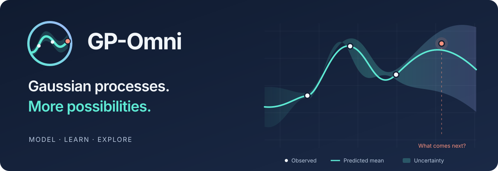
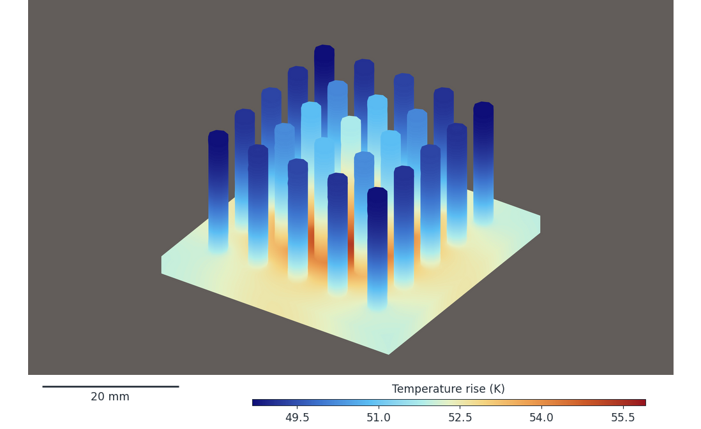
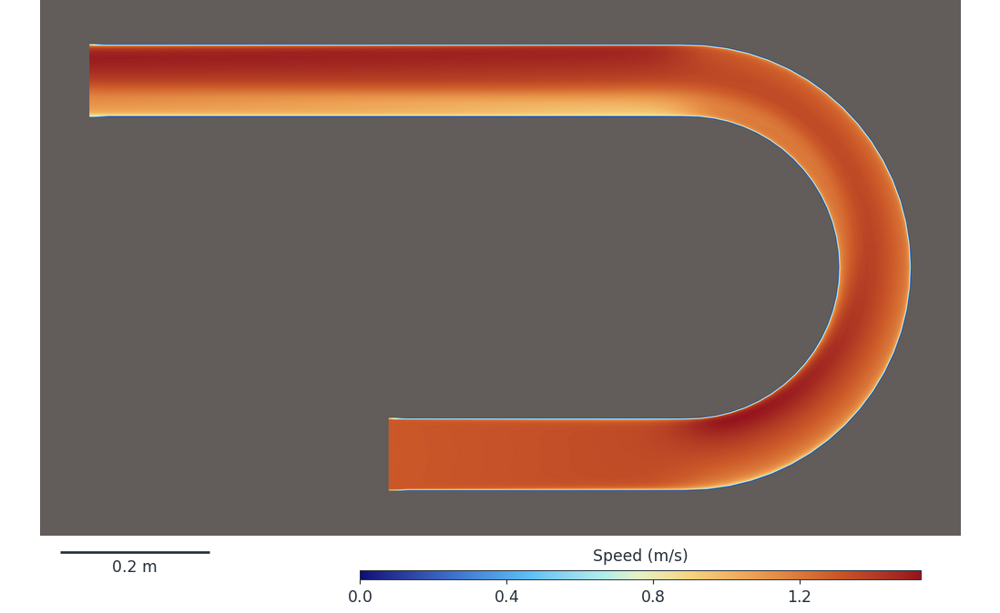
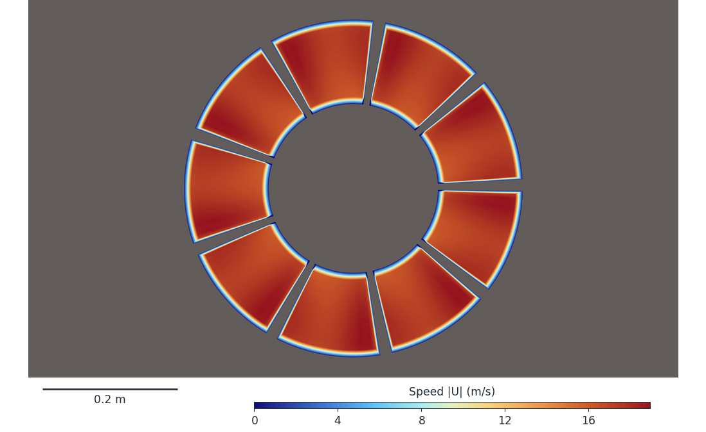
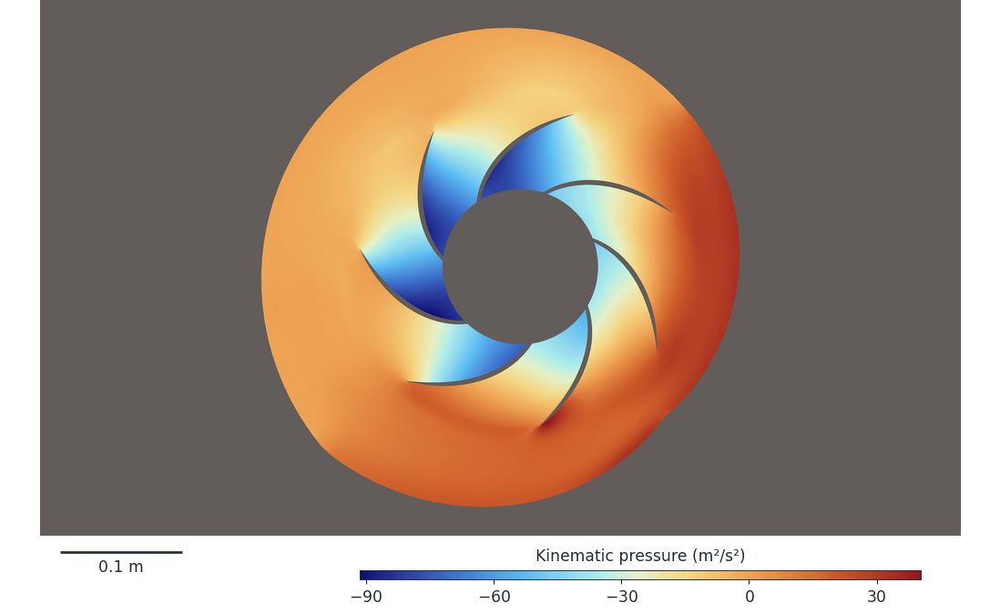
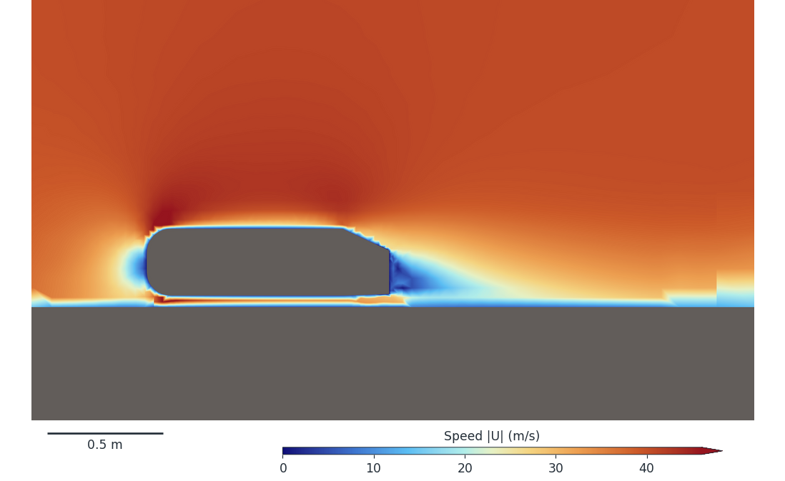
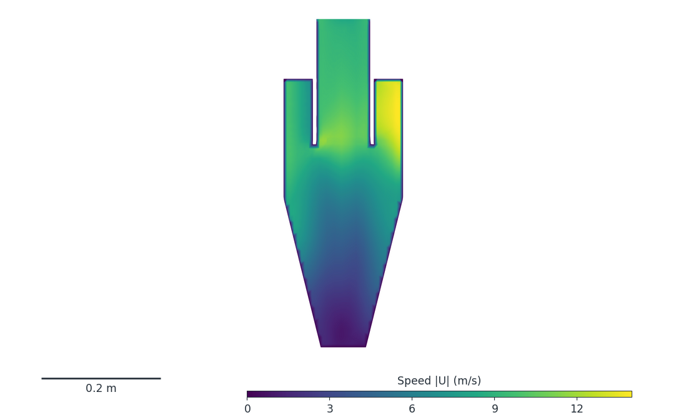

  

<h1 align="center">GP-Omni</h1>

<strong>Make every experiment count.</strong> 
Composable Gaussian processes for expensive questions and better next experiments.

  
  
  
  

  
  
  
  
  

  <a href="examples/README.md"><strong>Engineering design optimization examples</strong></a> 
  
  
  

  <a href="docs/getting_started.md"><strong>Get started →</strong></a> &nbsp; · &nbsp;
  <a href="docs/README.md">Explore the docs</a> &nbsp; · &nbsp;
  <a href="docs/test_function_accuracy.md">See the benchmarks</a>

## An expensive evaluation deserves a smarter next step

Simulations take time. Experiments cost money. GP-Omni learns from the observations you
already have, estimates what remains uncertain, and helps choose where to look next.

Build a surrogate for your own workflow, or connect an experiment to the built-in
Bayesian optimization loops. Powered by **PyTorch, GPyTorch, and BoTorch**.

## More ways to model your world

| **Learn across responses** | **Connect levels of fidelity** |
| :--- | :--- |
| Model correlated outputs together, sharing structure across the quantities you care about. | Combine cheap approximations with expensive observations in a multi-fidelity surrogate. |
| **Make room for more data** | **Find structure in many inputs** |
| Use inducing-point approximations when a dense GP becomes too costly. | Model additive effects and low-order interactions across input dimensions. |

**Four capabilities. Combine them your way.** Use correlated outputs, multiple fidelities,
sparse inference, and additive kernels together for regression and feasibility classification.
[Find your model →](docs/use-cases.md)

## From observations to the next experiment

  <strong>Observe</strong> &nbsp; → &nbsp; <strong>Learn</strong> &nbsp; → &nbsp; <strong>Choose</strong> &nbsp; → &nbsp; <strong>Evaluate</strong> &nbsp; ↻

Run one evaluation at a time, launch coordinated batches, or keep workers busy as results
arrive. Learn unknown feasibility constraints alongside the objective.
[Run your first optimization →](docs/getting_started.md#plug-in-your-objective)

The built-in loops maximize one scalar objective at one fidelity. Multi-output optimization,
Pareto search, and cost-aware fidelity selection need a custom acquisition and workflow.

## Example gallery

Connect the loop to a finite element or flow solver. Select an example to see its model and
how to reproduce it.

| [Pin-fin heat sink](examples/postprocessing/README.md#heat-sink-fem) | [Pipe bend](examples/cfd/cases/pipe/README.md) | [Ducted axial fan](examples/cfd/cases/axial_fan/README.md) |
| :---: | :---: | :---: |
|  |  |  |
| FEM · temperature rise | CFD · flow speed | CFD · flow speed |

| [Pump impeller and casing](examples/cfd/cases/centrifugal_pump_optimization/README.md) | [Ahmed reference car body](examples/cfd/cases/ahmed_body/README.md) | [Cyclone separator](examples/cfd/cases/cyclone_separator/README.md) |
| :---: | :---: | :---: |
|  |  |  |
| CFD · pressure | CFD · flow speed | CFD · flow speed |

**[All examples](examples/README.md)** ·
[10 3D finite element designs](examples/fem/README.md) ·
[49 OpenFOAM cases](examples/cfd/README.md)

The CFD images show coarse reference runs. The heat sink uses an assumed convection
coefficient. Each case guide describes its model and limits.

## Start exploring

- **[Get started](docs/getting_started.md)** — installation, runnable code, and configuration.
- **[Choose a model](docs/use-cases.md)** — match your data and evaluation workflow.
- **[Explore hierarchical fidelities](docs/dag-cokriging.md)** — co-kriging over a directed graph.
- **[Run engineering design examples](examples/README.md)** — structural, thermal and flow designs with FEM and CFD solvers.
- **[Check the evidence](docs/test_function_accuracy.md)** — analytical benchmarks and reproduction settings.
- **[Contribute](docs/getting_started.md#contribute)** — bring a use case, report a bug, or improve the toolkit.

---

   
  <strong>GP-Omni</strong> · Open source · <a href="LICENSE">Apache 2.0</a> 
  Install as <code>gp-omni</code>. Import as <code>gp_omni</code>.

