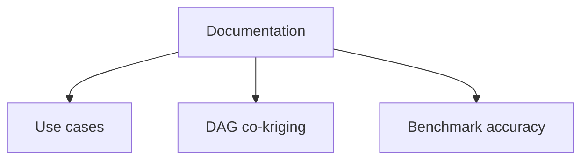

# Documentation

Start with the [project quickstart](../README.md) to install gp-omni and run a BO pipeline.
Use the guide below to choose models and configure your workflow.

- [Use cases](use-cases.md) — model switches, data format, constraints, and BO modes.
- [DAG co-kriging](dag-cokriging.md) — hierarchical fidelities with multiple parents.
- [Benchmark accuracy](test_function_accuracy.md) — definitions, regression results, and reproduction settings.

## Project overview

- [Project README](../README.md) — installation and runnable examples.
