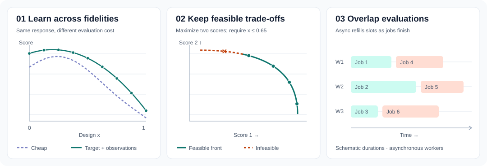
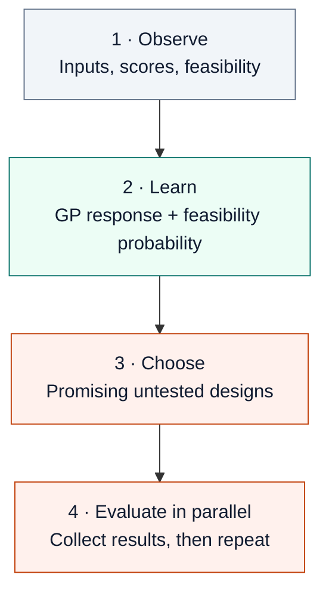

# Get started with GP-Omni

[Documentation](README.md) · [Choose a model](use-cases.md) · [Project home](../README.md)

Learn an expensive response from a few experiments, use cheaper simulations where
available, and choose what to evaluate next. This guide starts with a parallel constrained
optimization loop, then builds a custom workflow for competing objectives.



*Analytical toy responses and a schematic schedule, not benchmark results. Fidelity
controls which model you evaluate; objectives describe what you want to improve;
parallelism controls how many evaluations can run together.*

| Your experiment | Start here |
|---|---|
| One score, feasibility labels, several workers | [Parallel constrained BO](#plug-in-your-objective) |
| Many cheap simulations, a few expensive measurements | [Multi-fidelity regression](#learn-from-cheap-and-expensive-evaluations) |
| Competing scores subject to feasibility | [Constrained Pareto screening](#compare-objectives-under-constraints) |

## Install

Requires **Python 3.12+**. From a source checkout:

```bash
git clone https://github.com/anhvt2/gp-omni.git
cd gp-omni
uv sync --locked
```

Or install the local package into an existing environment:

```bash
python -m pip install -e .
```

The distribution is named `gp-omni`; import it as `gp_omni`. Importing the package sets
PyTorch's default dtype to `torch.float64` for GP linear algebra.

## Plug in your objective

Provide a Python callable returning `(objective_value, feasible)`, set bounds and a budget,
and run the pipeline:



*Each new result informs the next proposal. Repeat steps 2–4 until the evaluation
budget is exhausted.*

[Rendered workflow](assets/getting_started_workflow.png) ·
[Editable Mermaid source](assets/getting_started_workflow.mmd)

This complete example provides two concurrent evaluation slots and returns the best
feasible observation. The toy score peaks at `(0.3, 0.3)`; `x[0] >= 0.9` is infeasible.
Run it with `uv run python your_script.py` after installation.

```python
import tempfile

import numpy as np

from gp_omni.opt.parallel.asyncbo import async_bo, async_bo_config


def evaluate(x: np.ndarray) -> tuple[float, bool]:
    # Replace this with your simulator, experiment, or model evaluation.
    value = -float(np.sum((x - 0.3) ** 2))
    feasible = bool(x[0] < 0.9)
    return value, feasible


config = async_bo_config(
    model_name="my_experiment",
    x_lb=[0.0, 0.0],
    x_ub=[1.0, 1.0],
    num_init_point=4,
    max_iter=12,
    exploit_size=2,  # two evaluation slots; each proposal uses an acquisition
    explore_size=0,
    explore_classifier_size=0,
    check_time=0.001,  # polling interval in minutes
    gp_max_iter=60,
    cma_max_evals=60,
    seed=0,
)

with tempfile.TemporaryDirectory() as run_dir:
    best_x, best_y = async_bo(run_dir, config, evaluate=evaluate).run()

print("Best feasible observation:", best_x, best_y)
```

Python evaluators run in a thread pool: useful for simulator calls, I/O, and native code
that releases the GIL. This toy calculation is too fast to demonstrate a speedup. After
the initial design finishes, async BO refills free slots while other evaluations continue.

Both BO loops **maximize** the objective; negate a loss to minimize it. The example uses
a temporary directory; use a persistent run directory to retain job inputs and results.

Choose the execution pattern that matches your evaluations:

| Mode | Configuration | Behavior |
|---|---|---|
| Sequential | `async_bo` with `exploit_size=1`, both exploration sizes `0` | One evaluation at a time |
| Batch-sequential | `batch_bo` + `batch_bo_config` | Launch a batch, wait for all results, then propose the next batch |
| Asynchronous | `async_bo` + `async_bo_config` | Refill available slots while other evaluations continue |

`async_bo_config.max_iter` counts total evaluations, including initial points.
`batch_bo_config.max_iter` counts iterations: after `num_init_point` initial evaluations,
each remaining iteration launches a whole batch. Batch size is the sum of `exploit_size`,
`explore_size`, and `explore_classifier_size`.

The loops share one set of single-objective acquisitions
([`gp_omni.opt.acquisition`](../src/opt/acquisition/single_objective/)): `PI`, `EI`, `UCB`,
`PE` (pure exploration), `MES` (max-value entropy search), `KG` (knowledge gradient), and
`PES` (predictive entropy search; `cov="se_ard"` models only, other models raise
`NotImplementedError`). Acquisitions are always sequential. Parallel runs
([`gp_omni.opt.parallel`](../src/opt/parallel/)) only hallucinate pending points, using the
posterior mean as their output, and then search for the next point.

Async BO uses GP-Hedge to pick an acquisition for each proposal; choose its arms with
`async_bo_config(hedge_arms=("UCB", "EI", "PI"))` (any names above). Batch BO uses the single
`batch_bo_config(acquisition="EI")`. The loops also include CMA-ES acquisition optimization
and objective and constraint exploration slots. Known constraint callbacks and learned
feasibility probabilities weight exploitation proposals; initial and exploration points can
still be infeasible.

Load reusable settings with `async_bo_config.from_json(...)` or
`batch_bo_config.from_json(...)`; see [async settings](../config/async_bo.json) and
[batch settings](../config/batch_seq_bo.json). For external executables, supply a
`query_script` instead of `evaluate`; the job-folder protocol is described in
[`async_bo`](../src/opt/parallel/asyncbo/loop.py).

## Learn from cheap and expensive evaluations

A coarse simulation and a detailed simulation describe the same response at different
fidelities. The autoregressive model relates them through

$$
f_1(x) = \rho f_0(x) + \delta(x),
$$

where the learned discrepancy $\delta$ corrects the cheap response. Here, 31 cheap
observations support four expensive observations:

```python
import torch
from gp_omni import GPR


def high(x):
    return (6 * x[:, 0] - 2) ** 2 * torch.sin(12 * x[:, 0] - 4)


def low(x):
    return 0.5 * high(x) + 10 * (x[:, 0] - 0.5) - 5


x_low = torch.linspace(0, 1, 31).reshape(-1, 1)
x_high = x_low[::10]
x = torch.cat([x_low, x_high])
y = torch.cat([low(x_low), high(x_high)])
fidelity = torch.cat([torch.zeros(31), torch.ones(4)]).long()

model = GPR(num_fidelities=2).fit(x, y, fidelity=fidelity)
x_test = torch.linspace(0, 1, 200).reshape(-1, 1)
prediction = model.predict(x_test, fidelity=1)
mean, variance = prediction["fmu"], prediction["fs2"]
```

Fidelity `0` is cheapest; `L-1` is the target fidelity and the prediction default. Cheap
and expensive observations can use different inputs. A fidelity index is metadata,
separate from the physical input coordinates. The model learns their relationship;
choosing which fidelity to evaluate next is a separate optimization decision.

Run [the comparison example](../examples/gpr_multifidelity.py) to see held-out RMSE
against a model trained only on the expensive observations:

```bash
uv run python examples/gpr_multifidelity.py
```

## Compare objectives under constraints

Suppose a design must balance two competing scores while satisfying an experimentally
measured constraint. We seek

$$
\max_{x \in [0,1]^D} \bigl(f_1(x), f_2(x)\bigr)
\quad \text{subject to } c(x) \leq 0.
$$

There may be no single best design. A feasible design is **Pareto optimal** among the
observations if no other feasible observation improves one score without worsening
another. Negate any objective you want to minimize.

The [complete runnable example](../examples/constrained_multiobjective.py) combines
all three features in one custom screening round:

1. Fit `GPR(num_outputs=2, num_fidelities=2)` to **25 cheap and nine expensive designs**.
   Both scores are observed at each design; long-form rows carry output and fidelity indices.
2. Fit `GPC()` to the expensive evaluations' feasibility labels.
3. Predict both scores at the highest fidelity; retain unseen candidates with
   `P(feasible) >= 0.8`, then find their non-dominated predicted scores.
4. Select up to four designs spread across that predicted front and evaluate them in
   parallel with `ThreadPoolExecutor(max_workers=4)`.
5. Check observed feasibility and report the non-dominated **measured** scores from
   the initial expensive design and the new batch.

```bash
uv run python examples/constrained_multiobjective.py
```

The printed result includes the batch size, actual feasibility flags, Pareto inputs,
and their two scores. The toy objectives peak at different inputs (`0.2` and `0.8`),
while the measured constraint requires `x <= 0.65`; maximizing each score independently
would miss the feasible trade-offs.

This is a finite-candidate, posterior-mean screening example. Its feasibility threshold
is a model estimate, not a guarantee, and its Pareto set is relative to the observations.
It demonstrates data preparation, filtering, parallel evaluation, and result selection;
it does not optimize a hypervolume acquisition or automatically allocate fidelity costs.

**Choose the right integration:** the built-in `async_bo` and `batch_bo` loops accept
a scalar, single-fidelity objective. Use a custom workflow like this one for multiple
objectives or fidelity selection. For joint-posterior acquisitions in BoTorch, start
with the compatible builders [below](#work-with-gpytorch-and-botorch); `GPR` / `GPC`
provide marginal predictions through their own interface.

## Build, train, infer

The source follows the three phases of a GP workflow, plus an optimization layer on top:

| Package | Responsibility |
| --- | --- |
| [`gp_omni.build`](../src/build/) | Prepare models, covariance, means, likelihoods, and inducing inputs for the problem |
| [`gp_omni.train`](../src/train/) | Optimize evidence or ELBO objectives |
| [`gp_omni.infer`](../src/infer/) | Compute posterior distributions, predictive moments, and class probabilities |
| [`gp_omni.opt`](../src/opt/) | Sampling schemes for Bayesian optimization: acquisition functions, the inner search, and batch/async loops |

```python
from gp_omni.build import GPR
from gp_omni.train import fit
from gp_omni.infer import predict

model = GPR(cov="matern_ard", nu=20)
fit(model, x, y, max_iter=100)
prediction = predict(model, x_new)
```

The model methods `fit()` and `predict()` delegate to these phase implementations.
For GPyTorch models, use `train.gpytorch.fit_exact` or `fit_variational` and
`infer.predict`; supply the separately trained likelihood for variational predictions.
Co-kriging constructors prepare data and topology; call `fit()` explicitly to train
and assemble their posterior before predicting.

## Compose your surrogate

Use the same `fit` / `predict` interface as your modeling needs grow. This example combines
two correlated outputs, two fidelities, sparse inference, and additive interactions:

```python
import torch

from gp_omni import GPR, GPC

torch.manual_seed(0)
x = torch.rand(160, 3)
output = torch.arange(160) % 2
fidelity = (torch.arange(160) // 2) % 2
y = torch.sin(6 * x[:, 0]) + 0.3 * output + 0.2 * fidelity
feasible = x[:, 0] + x[:, 1] < 1.2

settings = dict(num_outputs=2, num_fidelities=2, nu=20, additive=2)
objective = GPR(**settings).fit(x, y, output=output, fidelity=fidelity)
constraint = GPC(**settings).fit(x, feasible, output=output, fidelity=fidelity)

x_next = torch.rand(5, 3)
prediction = objective.predict(x_next)
mean, variance = prediction["fmu"], prediction["fs2"]  # shape (5, 2)
probability_feasible = constraint.predict_proba(x_next)  # shape (5, 2)
```

**Multiple outputs describe responses; a Pareto rule makes them an optimization problem.**
The snippet above fits surrogates; the constrained example above demonstrates selection
and evaluation.

Keep observations in one table: inputs `x` have shape `(n, D)`, targets `y` have shape
`(n,)`, and optional integer `output` and `fidelity` indices identify each row. Outputs and
fidelities may be observed at different inputs. Fidelity `0` is the cheapest; `L-1` is the
highest. Predictions default to every output at the highest fidelity; pass `output=k` or
`fidelity=l` to select one.

Regression targets are standardized per output/fidelity pair and predictions are returned
in the original units. Scale inputs to comparable ranges, such as the unit cube.
`fmu` / `fs2` describe the latent function; `ymu` / `ys2` include observation noise.
`GPC` accepts boolean, `{0, 1}`, or `{-1, +1}` labels and returns marginal feasibility
probabilities for each constraint output.

See the [documentation](README.md) for model choices, inference options,
data layouts, and model limitations. Run combinations directly:

```bash
uv run python examples/gpr_combined.py mo additive
uv run python examples/gpr_combined.py mf sparse
uv run python examples/gpr_combined.py all
uv run python examples/gpr_gpc_constraints.py all
```

Model, training, inference, and BO defaults live in [`config/`](../config/README.md).
Explicit arguments override them; use `GPR.from_json(...)` or `GPC.from_json(...)` for
per-run constructor settings. Defaults are read at module import time.

Models use the `gp_omni.build`, `gp_omni.train`, and `gp_omni.infer` packages.
Likelihood names are `gaussian`, `probit`, and `logistic`. Covariance names include
`se_ard`, `se_iso`, `matern_ard`, and `matern_iso`.

## Work with GPyTorch and BoTorch

For direct GPyTorch / BoTorch workflows, [`gp_omni.build.gpytorch`](../src/build/gpytorch.py) provides
exact, additive, SGPR, KISS-GP, multitask ICM/LMC, and variational models. Use
[`gp_omni.train.gpytorch`](../src/train/gpytorch.py) for fitting helpers. The exact GP builders, `ar1_cokriging`, and `dag_cokriging`
expose BoTorch-compatible posteriors; `GPR` / `GPC` expose their own prediction
interface.

- [Exact GP](../examples/exact_gpr.py) · [Correlated outputs](../examples/multioutput.py)
- [SGPR, svgp, and KISS-GP](../examples/sparse.py) · [Variational classification](../examples/classification.py)
- [AR1 co-kriging](../examples/cokriging.py) · [BoTorch multi-fidelity](../examples/multifidelity_botorch.py)
- [Hierarchical DAG co-kriging](../examples/dag_cokriging.py) · [DAG model guide](dag-cokriging.md)
- [Sparse variational inference (VFE / FITC)](../examples/sparse_vfe.py)

## Contribute

Bug reports, new use cases, examples, and pull requests are welcome. To check a local change:

```bash
uv sync --locked
uv run ruff check .
uv run pytest -q
```

CI requires at least 80% of executed tests to pass, configured by
`TEST_MIN_PASS_RATE` in `.github/workflows/ci.yml`. Skipped tests (including expected
failures) are excluded from that rate. Collection, setup/teardown, and runner errors
still fail CI, as do empty runs. Lint must also pass. Individual failures remain
visible in the logs and the uploaded JUnit report; the job summary shows the pass rate.
The local `pytest` command above still requires every test to pass. To use the CI gate:

```bash
uv run python scripts/ci_tests.py --min-pass-rate 80 -q --durations=10
```

The test suite covers all 16 combinations of the four surrogate switches for regression
and classification, plus kernels, sparse inference, co-kriging, and the BO loops.

See the [benchmark accuracy report](test_function_accuracy.md) for analytical test
functions, modeling conventions, held-out errors, and reproduction settings.
