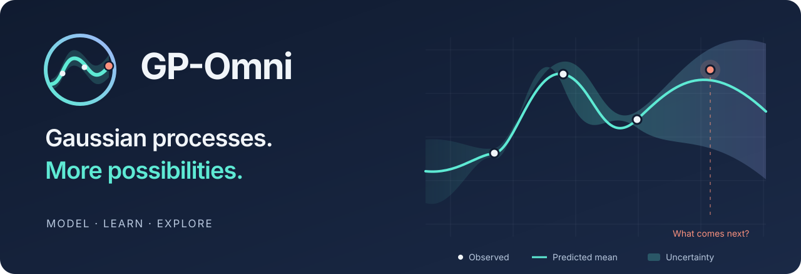

# GP-Omni visual identity

Use **GP-Omni** in titles and user-facing prose. Keep the distribution `gp-omni`, Python
import `gp_omni`, and existing code identifiers unchanged. New asset filenames use
lowercase words separated by underscores.

## Icon

The orbital ring suggests the breadth of models available in one toolkit. Inside it, a
GP curve runs through observed points with a translucent uncertainty band. The coral
point marks an experiment to explore next. The dark rounded tile keeps the mark visible
on both light and dark backgrounds.

The [icon SVG](assets/gp_omni_icon.svg) is the editable master, with a 256 × 256 view box.
The [512 × 512 PNG](assets/gp_omni_icon.png) is ready for avatar uploads and preserves
transparent corners. Use the icon for square placements. At very small sizes, the ring
and curve carry the identity; the details are intended for sizes of 48 pixels and above.

## Banner

The [banner SVG](assets/gp_omni_banner.svg) pairs the mark with a conceptual GP prediction,
not measured benchmark results. Both SVGs are self-contained, with no scripts, external
fonts, or linked image dependencies. Their title and description elements provide text
alternatives; Markdown embeds also supply alt text.

| Color | Hex | Role |
|---|---|---|
| Deep navy | `#101b30` | Background |
| Mint | `#5eead4` | GP mean and primary accent |
| Periwinkle | `#a5b4fc` | Orbital accent |
| Coral | `#fb927e` | Next experiment |
| Soft white | `#f1f5f9` | Text and observed points |

These assets are covered by the repository's [Apache 2.0 license](../LICENSE).
