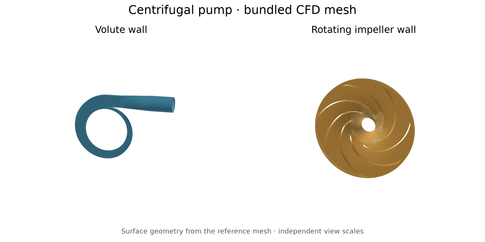
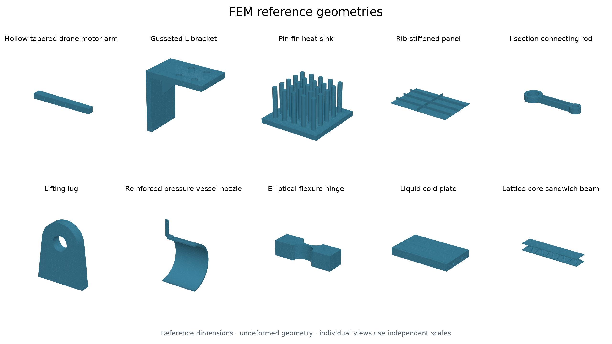

# Engineering design optimization

These examples run GP-Omni's constrained batch Bayesian optimization against physics solvers.
Run the commands from the repository root and give each run a new output directory.
The [numerical scripts](../tests/numerical/) and [analytical benchmarks](../tests/bo_functions/)
live under `tests/`.

## FEM · Tapered aluminum cantilever

Minimize the mass of a 600 mm cantilever with a rectangular cross section and a 1 kN tip load.
The 45 mm width stays fixed. The optimizer varies the root height and the ratio of tip height
to root height. Each evaluation uses scikit-fem with cubic Hermite beam elements to solve
the linear Euler–Bernoulli model and checks a 1.5 mm tip deflection limit.
[scikit-fem beam element example](https://scikit-fem.readthedocs.io/en/stable/listofexamples.html#example-34-euler-bernoulli)

```bash
uv run --locked --with 'scikit-fem==12.0.2' python examples/fem/cantilever.py cantilever-run
```

The script reports the best observed feasible dimensions, mass, and tip deflection. The output
directory contains the BO observations and feasibility flags. The model assumes an ideal clamp
and small elastic deflections and sizes the beam for stiffness.

## CFD · Centrifugal water pump



Minimize shaft power at a fixed flow of 0.04167 m³/s while delivering at least 90% of the
reference pump's static pressure rise. The design variables are a uniform scale applied
to the impeller and volute mesh and the impeller's angular speed. Each evaluation uses
OpenFOAM's steady `simpleFoam` solver with a multiple reference frame and the case's
`kOmegaSST` turbulence model. Shaft power is the resisting moment on the rotor walls
times the angular speed. All case inputs are bundled in [pump_case](cfd/pump_case/README.md),
including the GPL-3.0 license, provenance, checksums, and reference measurements.

Use the OpenCFD distribution of OpenFOAM v2406 in a shell that has sourced its
`etc/bashrc`. The case runs from the bundled files, and the driver verifies their
checksums before running. Each evaluation starts from a fresh copy of those inputs.

```bash
uv run --locked python examples/cfd/centrifugal_pump.py --verify-only
uv run --locked python examples/cfd/centrifugal_pump.py pump-baseline --baseline-only
uv run --locked python examples/cfd/centrifugal_pump.py pump-run
```

The default run solves the reference pump and ten candidate designs at 3,000 SIMPLE
iterations each. Use `--batches 1` to run a shorter campaign with six candidate designs.
The script keeps the reference as an eligible design and records solver logs, patch
measurements, and per-design JSON results in the output directory. It checks that both patch
flows are within 3% of the prescribed rate and that the pressure rise and shaft power vary
by at most 3% over the final ten samples. The campaign uses fixed mesh connectivity, one
operating point, and steady single-phase flow. Engineering use requires mesh refinement
and validation at the intended duty.

## CFD · 49 OpenFOAM design cases

Turbomachinery, internal flows and external aerodynamics, modelled on the application areas
of the CFD Support case studies, with generated geometry. They run in a container with
OpenCFD OpenFOAM v2406 and each plugs into the batch or asynchronous optimizer. Verification
is a coarse-mesh pipeline check, not an accuracy study.
[Setup, commands and limits](cfd/README.md).

```bash
examples/cfd/container/foam.sh build
examples/cfd/container/foam.sh python examples/cfd/run.py verify --output /runs/verify
```

## FEM · 3D reference designs



Ten constrained 3D design problems, one script each, covering static stress, vibration and
heat conduction. The views show their reference dimensions.
[Cases, results, limits and image gallery](fem/README.md).

```bash
uv run --locked --with 'scikit-fem==12.0.2' --with 'gmsh==4.15.2' python examples/fem/drone_arm.py optimize drone-arm-run
```
