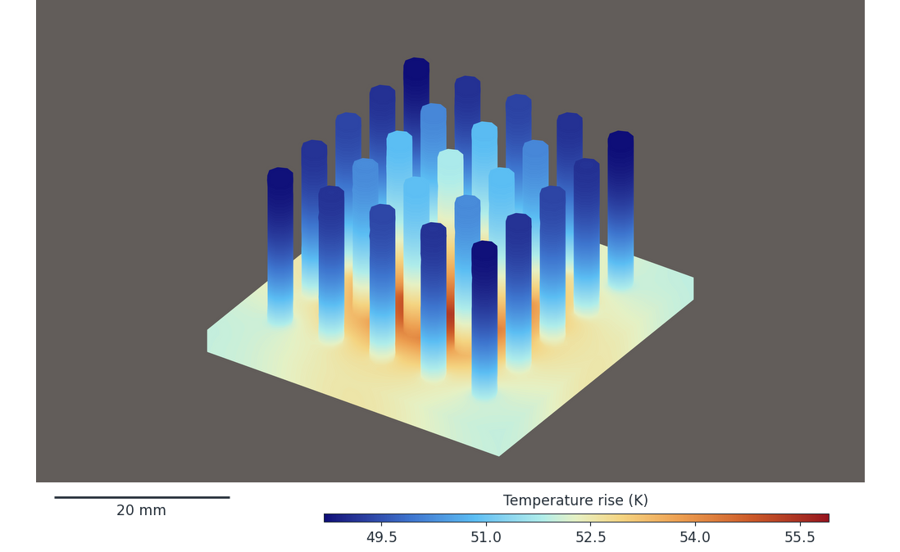
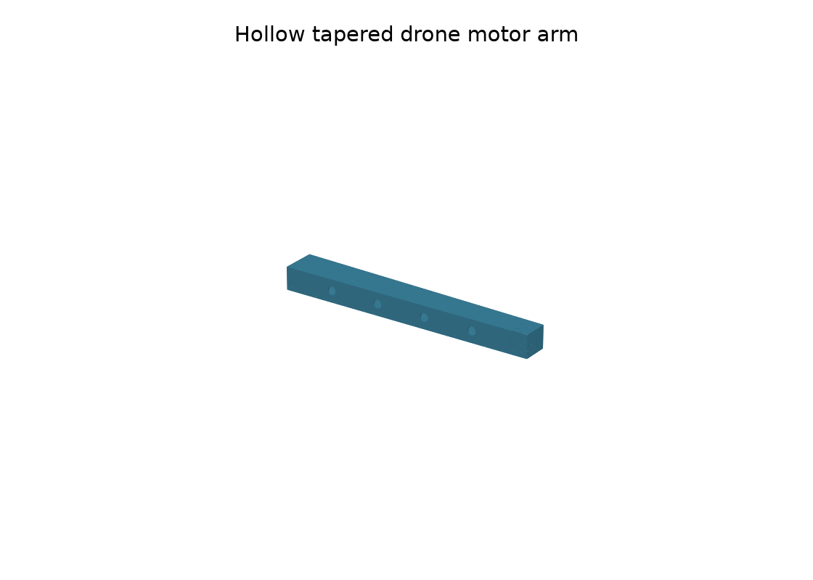
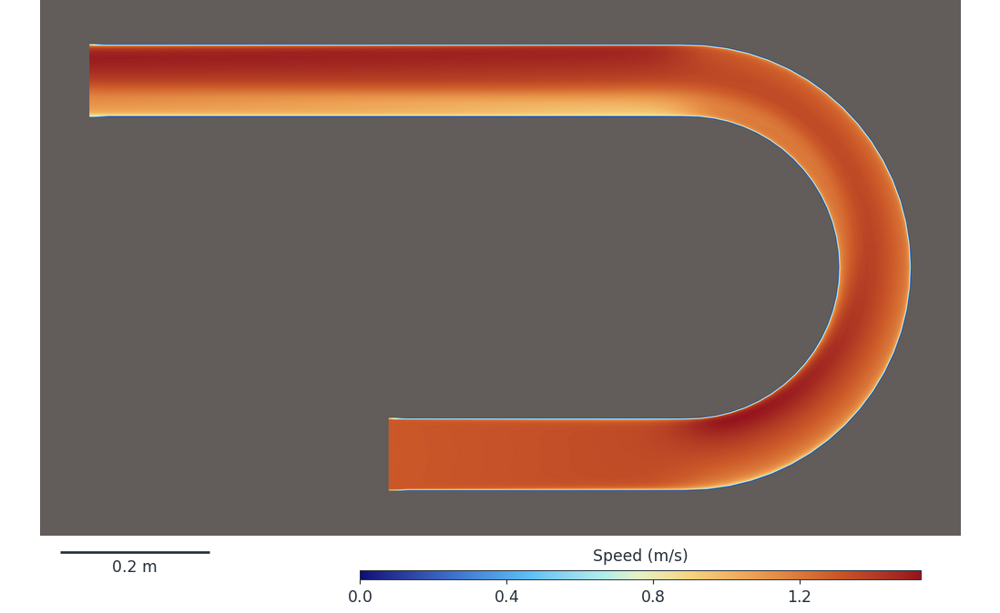
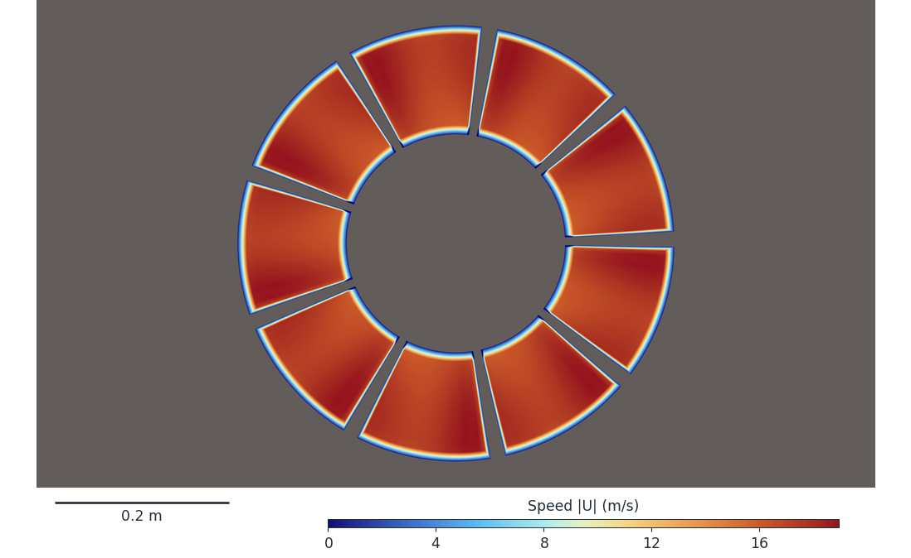
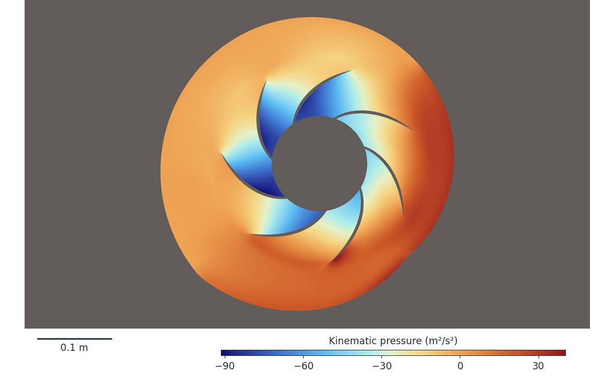
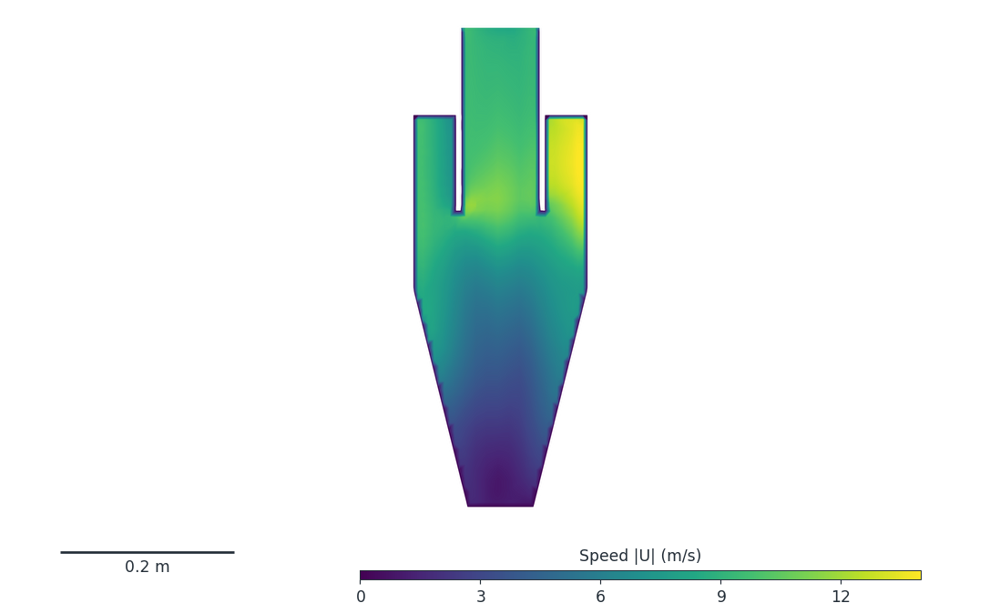

# Engineering design examples

GP-Omni couples Bayesian optimization with finite element and flow solvers. Choose an
example to see its reference design and how to reproduce the mesh, solve, or optimization.

## Finite element analysis

| [Pin-fin heat sink](postprocessing/README.md#heat-sink-fem) | [Drone motor arm](fem/drone_arm.py) | [Lattice beam](fem/lattice_beam.py) |
| --- | --- | --- |
|  |  |  |
| Minimize temperature rise under a mass limit | Minimize mass under deflection, stress, and frequency limits | Size a lightweight beam under deflection, stress, and frequency limits |

[Browse all ten 3D designs and run commands](fem/README.md) ·
[Tapered aluminum cantilever sizing](fem/README.md#tapered-aluminum-cantilever)

## Computational fluid dynamics

| [Pipe bend](cfd/cases/pipe/README.md) | [Ducted axial fan](cfd/cases/axial_fan/README.md) | [Pump impeller and casing](cfd/cases/centrifugal_pump_optimization/README.md) |
| --- | --- | --- |
|  |  |  |

| [Ahmed reference car body](cfd/cases/ahmed_body/README.md) | [Cyclone separator](cfd/cases/cyclone_separator/README.md) | [Ventilated room](cfd/cases/human_comfort/README.md) |
| --- | --- | --- |
|  |  |  |

[Browse all 49 OpenFOAM cases, meshes, and solved fields](cfd/README.md) ·
[Centrifugal water pump sizing](cfd/cases/centrifugal_pump/README.md)

The CFD previews show coarse reference runs. The heat-sink model uses an assumed
convection coefficient. Each case guide describes the model and its limits.

## Meshes and figures

[Prepare meshes and export solver fields](preprocessing/README.md) ·
[Render ParaView scenes, sample VTK profiles, and export figures](postprocessing/README.md)

Run commands from the repository root and use a fresh directory under `runs/` for each
mesh or simulation. [Numerical examples](../tests/numerical/) and
[analytical benchmarks](../tests/bo_functions/) live under `tests/`.
