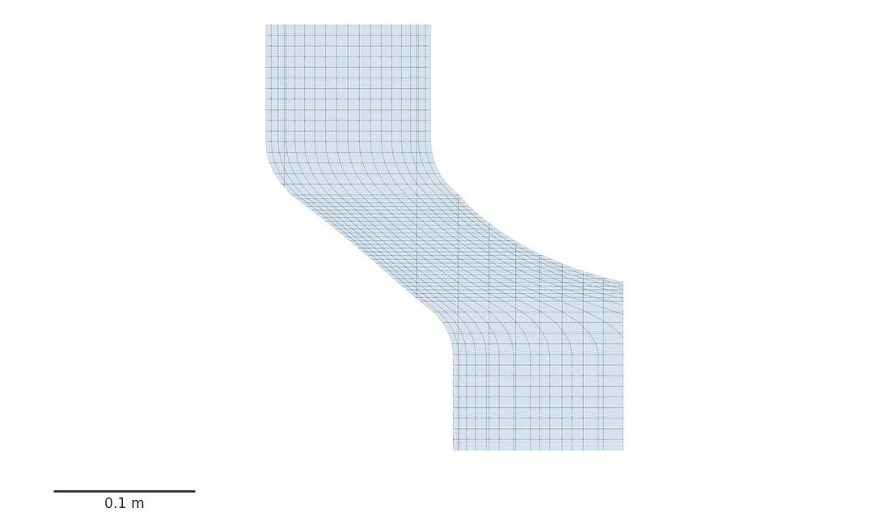
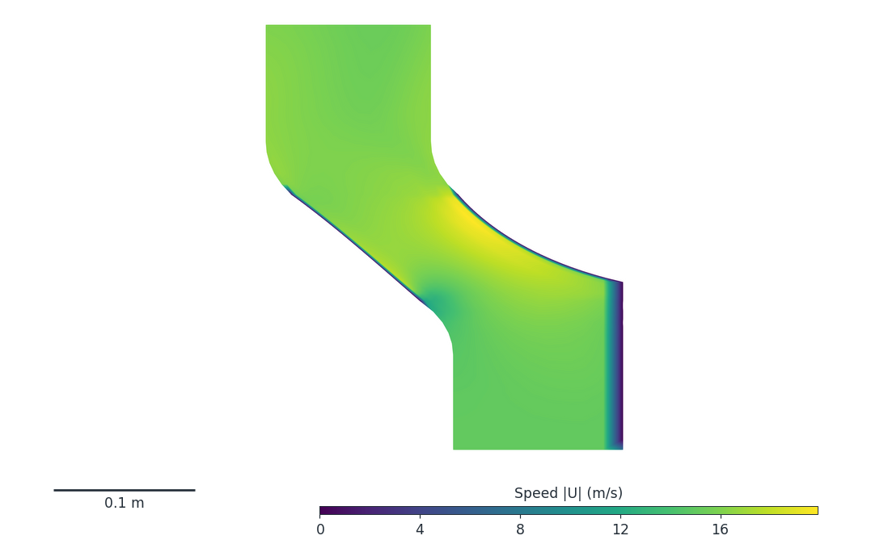

# Ducted axial fan, one blade passage

[CFD case index](../../README.md#axial-turbomachinery) · [Verification results](../../verification.md#axial-turbomachinery) · [Case source](__init__.py) · [View settings](view.json)

One periodic passage represents a shrouded axial fan. Inlet angle offset, blade camber, and
chord fraction change the rotor duty while a pressure-rise constraint preserves its operating
point.

**Solver** `simpleFoam` · **Mesh** structured `polyMesh` · **Level** `smoke`

## Mesh and results

| Initial mesh with cell edges | Solved field |
| --- | --- |
|  |  |

Initial mesh and solved field on the `x = 0.16 m` plane. The results show point data for `U` at
iteration 200. The longitudinal cut crosses the periodic passage. The color field is the stored
OpenFOAM speed magnitude. The optimization variant shares this reference and varies blade count
instead of chord.

`checkMesh` reported 12,528 cells and maximum non-orthogonality of 68.98°. It reported zero
failed quality checks. The measured flow imbalance was 0.00%.

## Boundary conditions

| Patches | Velocity condition | `p` condition |
| --- | --- | --- |
| `blade_rotor`, `hub`, `hub_rotor`, `shroud` | `noSlip` | `zeroGradient` |
| `inlet` | `flowRateInletVelocity` | `zeroGradient` |
| `outlet` | `pressureInletOutletVelocity` | `fixedValue` |
| `periodic_a`, `periodic_b` | `cyclic` | `cyclic` |

## Design and reference measurements

| Variable | Unit | Lower | Reference | Upper |
| --- | --- | ---: | ---: | ---: |
| `inlet_offset_deg` | ° | -3 | 2 | 6 |
| `camber_deg` | ° | 4 | 10 | 18 |
| `chord_fraction` | — | 0.18 | 0.25 | 0.32 |

| Role | Metric | Reference | Campaign bound |
| --- | --- | ---: | ---: |
| **Maximize** | `efficiency` | 0.925743 | — |
| Constraint | `pressure_rise_pa` | 235.652 Pa | ≥ 212.087 Pa (10% margin) |

This smoke run checks the workflow on a coarse mesh. The saved iteration is a coarse-run
reference. Model limits include shrouded blades without tip clearance.

## Reproduce the views

Set up [OpenFOAM and ParaView](../../README.md#set-up), then run from the repository root.

```bash
python3 examples/cfd/gallery.py axial_fan
```

The workflow writes to `runs/cfd_gallery/axial_fan/`. Open `figures/mesh/scene.pvsm`
or `figures/reference/scene.pvsm` in ParaView. Each `figure.json` records the saved time,
field association, color range, camera, and source run. See the
[shared workflow](../../README.md#run-one-case) for individual mesh, solve, and optimization commands.
