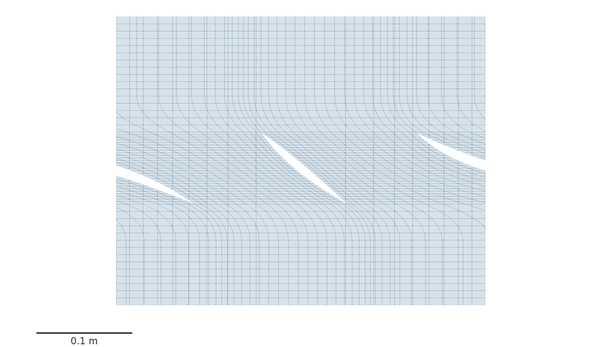
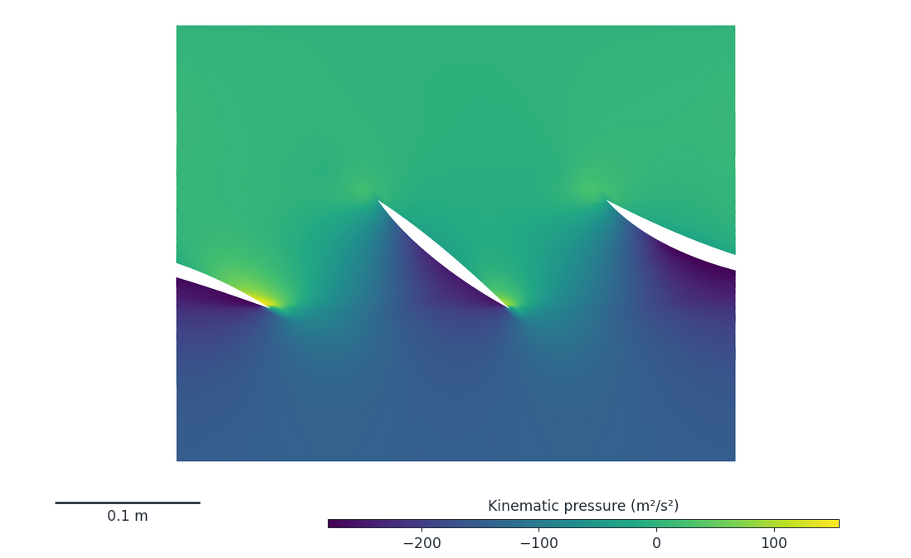
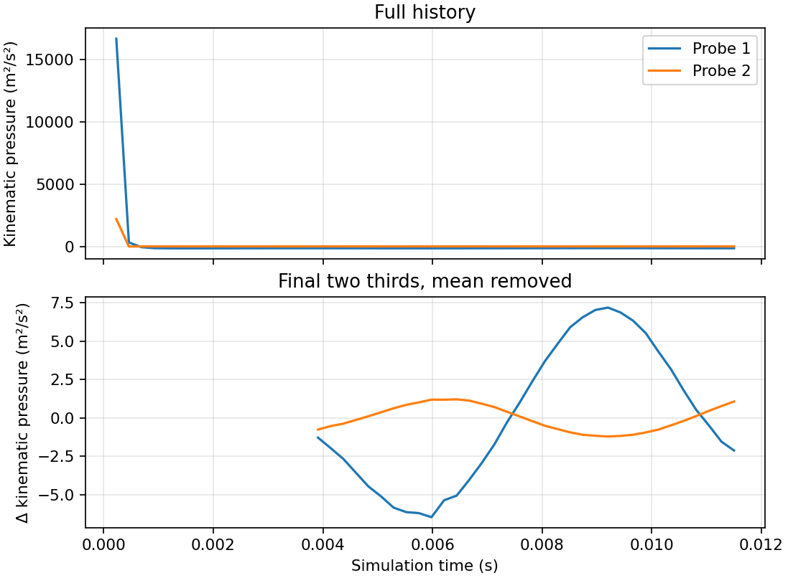

# Sliding-mesh axial fan with pressure probes

[CFD case index](../../README.md#axial-turbomachinery) · [Verification results](../../verification.md#axial-turbomachinery) · [Case source](__init__.py) · [View settings](view.json)

A shrouded fan runs with a moving rotor and sliding interfaces. Speed ratio and blade count
change the local pressure fluctuations under a pressure-rise constraint.

**Solver** `pimpleFoam` · **Mesh** structured `polyMesh` · **Level** `smoke`

## Mesh and results

| Initial mesh with cell edges | Solved field |
| --- | --- |
|  |  |

Initial mesh and solved field on the `x = 0.16 m` plane. The results show point data for `p` at
t = 0.0115 s. Use the pressure slice to locate the passage at the final saved time. The probe
plot shows local pressure histories for the short transient. The objective uses the largest
probe standard deviation over the final two thirds of the samples.

`checkMesh` reported 87,696 cells and maximum non-orthogonality of 69.82°. It reported zero
failed quality checks. The measured transient flow mismatch was 0.00%.



The upper panel shows the full history, including the startup transient. The lower panel shows
each probe's departure from its mean over the final two thirds of the samples, the window used
to measure fluctuation. Probe values use the native pressure units written by OpenFOAM.

## Boundary conditions

| Patches | Velocity condition | `p` condition |
| --- | --- | --- |
| `blade_rotor`, `hub_rotor`, `shroud_rotor` | `movingWallVelocity` | `zeroGradient` |
| `front_rotor`, `front_static`, `rear_rotor`, `rear_static` | `cyclicAMI` | `cyclicAMI` |
| `hub`, `shroud` | `noSlip` | `zeroGradient` |
| `inlet` | `flowRateInletVelocity` | `zeroGradient` |
| `outlet` | `pressureInletOutletVelocity` | `fixedValue` |

## Design and reference measurements

| Variable | Unit | Lower | Reference | Upper |
| --- | --- | ---: | ---: | ---: |
| `speed_ratio` | — | 0.8 | 1 | 1.15 |
| `blade_count` | count | 5 | 7 | 9 |

| Role | Metric | Reference | Campaign bound |
| --- | --- | ---: | ---: |
| **Minimize** | `pressure_fluctuation_pa` | 5.38068 Pa | — |
| Constraint | `pressure_rise_pa` | 194.762 Pa | ≥ 136.333 Pa (30% margin) |

This smoke run checks the workflow on a coarse mesh. The short transient represents startup or
early evolution. Model limits include probe pressures only, no far-field acoustics.

## Reproduce the views

Set up [OpenFOAM and ParaView](../../README.md#set-up), then run from the repository root.

```bash
python3 examples/cfd/gallery.py axial_fan_acoustic
```

The workflow writes to `runs/cfd_gallery/axial_fan_acoustic/`. Open `figures/mesh/scene.pvsm`
or `figures/reference/scene.pvsm` in ParaView. Each `figure.json` records the saved time,
field association, color range, camera, and source run. See the
[shared workflow](../../README.md#run-one-case) for individual mesh, solve, and optimization commands.
