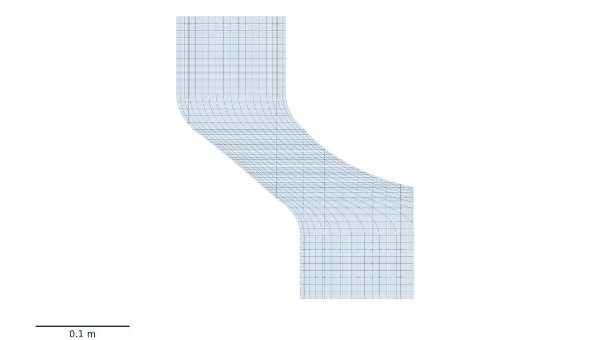
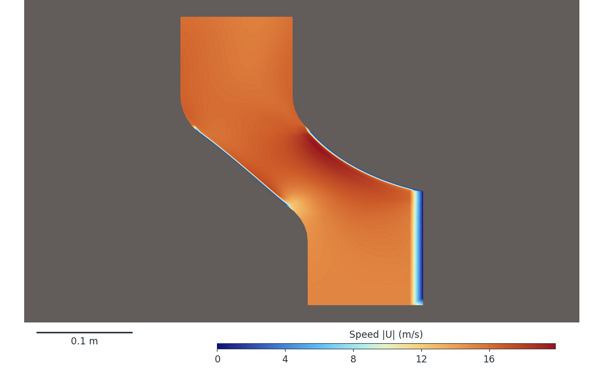
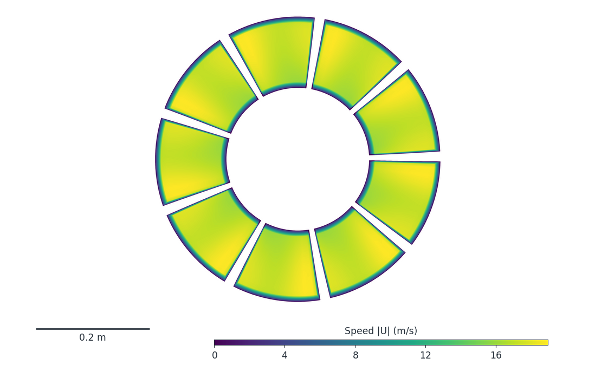

# Axial fan with a free blade count

[CFD case index](../../README.md#axial-turbomachinery) · [Verification results](../../verification.md#axial-turbomachinery) · [Case source](__init__.py) · [View settings](view.json)

This variant uses the same shrouded reference fan as the axial fan example. It treats blade
count as a design variable alongside inlet angle offset and camber.

**Solver** `simpleFoam` · **Mesh** structured `polyMesh` · **Level** `smoke`

## Mesh and results

| Initial mesh with cell edges | Solved field |
| --- | --- |
|  |  |

Initial mesh and solved field on the `x = 0.16 m` plane. The results show point data for `U` at
iteration 200. At the reference blade count and geometry, the resulting mesh and speed field
match the axial fan reference.

`checkMesh` reported 12,528 cells and maximum non-orthogonality of 68.98°. It reported zero
failed quality checks. The measured flow imbalance was 0.00%.

### Full-annulus field



The transverse section at `z = 0.14 m` shows 9 rotational copies of the solved
passage. The editable `figures/annulus/scene.pvsm` contains the full 3D reconstruction.
Move the slice or show the merged volume in ParaView to inspect another location.

## Boundary conditions

| Patches | Velocity condition | `p` condition |
| --- | --- | --- |
| `blade_rotor`, `hub`, `hub_rotor`, `shroud` | `noSlip` | `zeroGradient` |
| `inlet` | `flowRateInletVelocity` | `zeroGradient` |
| `outlet` | `pressureInletOutletVelocity` | `fixedValue` |
| `periodic_a`, `periodic_b` | `cyclic` | `cyclic` |

## Design and reference measurements

| Variable | Unit | Lower | Reference | Upper |
| --- | --- | ---: | ---: | ---: |
| `inlet_offset_deg` | ° | -3 | 2 | 6 |
| `camber_deg` | ° | 4 | 10 | 18 |
| `blade_count` | count | 6 | 9 | 12 |

| Role | Metric | Reference | Campaign bound |
| --- | --- | ---: | ---: |
| **Maximize** | `efficiency` | 0.925743 | — |
| Constraint | `pressure_rise_pa` | 235.652 Pa | ≥ 212.087 Pa (10% margin) |

This smoke run checks the workflow on a coarse mesh. The saved iteration is a coarse-run
reference. Model limits include shrouded blades without tip clearance.

## Reproduce the views

Set up [OpenFOAM and ParaView](../../README.md#set-up), then run from the repository root.

```bash
python3 examples/cfd/gallery.py axial_fan_optimization
```

The workflow writes to `runs/cfd_gallery/axial_fan_optimization/`. Open `figures/mesh/scene.pvsm`
or `figures/reference/scene.pvsm` in ParaView. Each `figure.json` records the saved time,
field association, color range, camera, and source run. See the
[shared workflow](../../README.md#run-one-case) for individual mesh, solve, and optimization commands.
