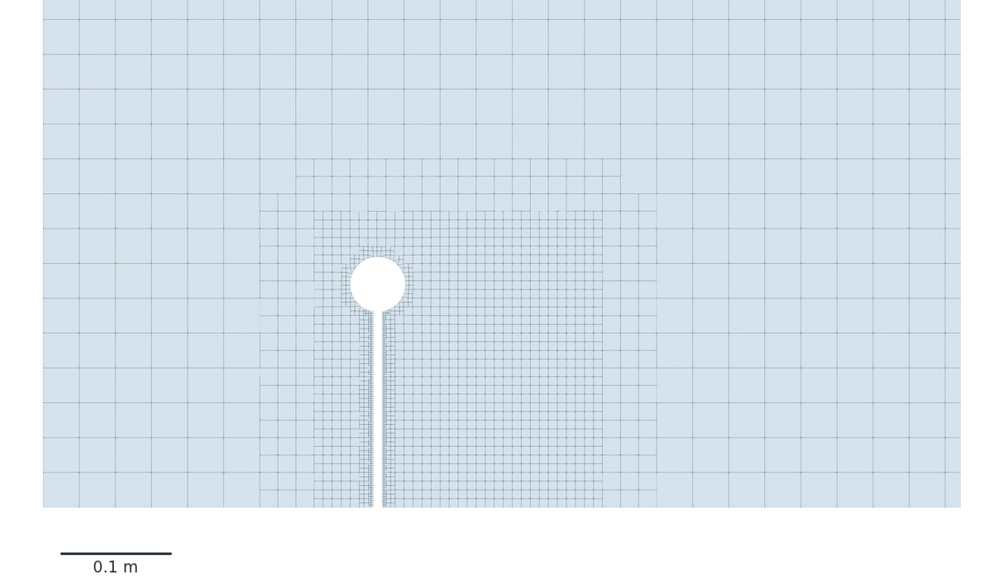
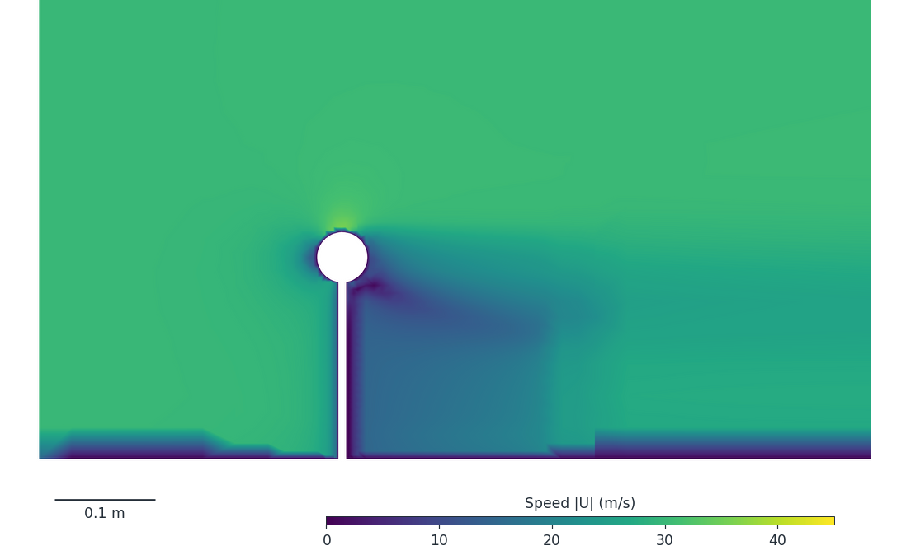

# Ball on a cantilever rod

[CFD case index](../../README.md#external-aerodynamics) · [Verification results](../../verification.md#external-aerodynamics) · [Case source](__init__.py) · [View settings](view.json)

A stationary ball and cantilever rod sit in a wind tunnel. Ball radius and rod length change
drag and estimated deflection.

**Solver** `simpleFoam` · **Mesh** `snappyHexMesh` · **Level** `smoke`

## Mesh and results

| Initial mesh with cell edges | Solved field |
| --- | --- |
|  |  |

Initial mesh and solved field on the `y = 0.001 m` plane. The results show point data for `U` at
iteration 200. The longitudinal speed cut shows the wake behind the supported ball. Deflection
comes from a one-way beam calculation using fluid loads.

`checkMesh` reported 35,066 cells and maximum non-orthogonality of 43.77°. It reported zero
failed quality checks. The measured flow imbalance was 0.00%.

## Boundary conditions

| Patches | Velocity condition | `p` condition |
| --- | --- | --- |
| `inlet` | `fixedValue` | `zeroGradient` |
| `outlet` | `pressureInletOutletVelocity` | `fixedValue` |
| `left`, `right`, `top` | `slip` | `zeroGradient` |
| `ground`, `ball`, `rod` | `noSlip` | `zeroGradient` |

## Design and reference measurements

| Variable | Unit | Lower | Reference | Upper |
| --- | --- | ---: | ---: | ---: |
| `ball_radius_m` | m | 0.015 | 0.025 | 0.035 |
| `beam_length_m` | m | 0.12 | 0.2 | 0.3 |

| Role | Metric | Reference | Campaign bound |
| --- | --- | ---: | ---: |
| **Minimize** | `drag_n` | 1.80363 N | — |
| Constraint | `deflection_m` | 0.000222031 m | ≤ 0.000266437 m (20% margin) |

This smoke run checks the workflow on a coarse mesh. The saved iteration is a coarse-run
reference. Model limits include one-way estimate from beam theory, no fluid-structure coupling.

## Reproduce the views

Set up [OpenFOAM and ParaView](../../README.md#set-up), then run from the repository root.

```bash
python3 examples/cfd/gallery.py beam_ball
```

The workflow writes to `runs/cfd_gallery/beam_ball/`. Open `figures/mesh/scene.pvsm`
or `figures/reference/scene.pvsm` in ParaView. Each `figure.json` records the saved time,
field association, color range, camera, and source run. See the
[shared workflow](../../README.md#run-one-case) for individual mesh, solve, and optimization commands.
