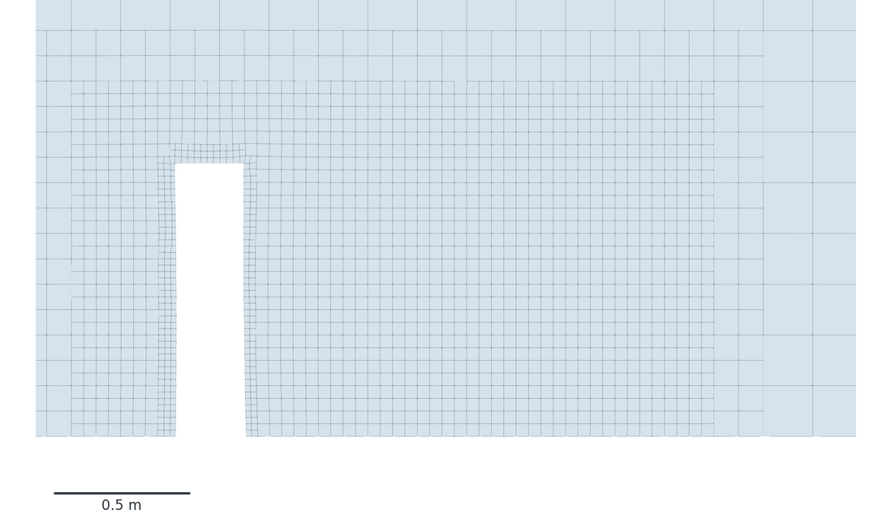
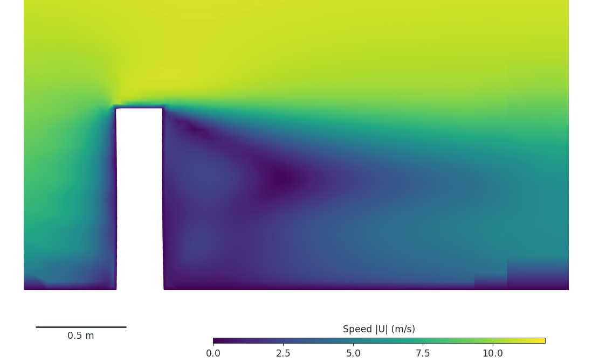

# Tall building in an atmospheric wind profile

[CFD case index](../../README.md#external-aerodynamics) · [Verification results](../../verification.md#external-aerodynamics) · [Case source](__init__.py) · [View settings](view.json)

A tapered, twisted tower with chamfered corners sits in an atmospheric inlet velocity profile.
The design varies its taper, twist and chamfer under a volume constraint.

**Solver** `simpleFoam` · **Mesh** `snappyHexMesh` · **Level** `smoke`

## Mesh and results

| Initial mesh with cell edges | Solved field |
| --- | --- |
|  |  |

Initial mesh and solved field on the `y = 0.01 m` plane. The results show point data for `U` at
iteration 200. The longitudinal cut shows the wind profile and tower wake. The base-moment
coefficient comes from integrated tower loads.

`checkMesh` reported 62,300 cells and maximum non-orthogonality of 47.02°. It reported zero
failed quality checks. The measured flow imbalance was 0.00%.

## Boundary conditions

| Patches | Velocity condition | `p` condition |
| --- | --- | --- |
| `inlet` | `atmBoundaryLayerInletVelocity` | `zeroGradient` |
| `outlet` | `pressureInletOutletVelocity` | `fixedValue` |
| `left`, `right`, `top` | `slip` | `zeroGradient` |
| `ground`, `tower` | `noSlip` | `zeroGradient` |

## Design and reference measurements

| Variable | Unit | Lower | Reference | Upper |
| --- | --- | ---: | ---: | ---: |
| `taper_ratio` | — | 0.6 | 0.85 | 1 |
| `twist_deg` | ° | 0 | 30 | 90 |
| `chamfer_fraction` | — | 0.02 | 0.08 | 0.2 |

| Role | Metric | Reference | Campaign bound |
| --- | --- | ---: | ---: |
| **Minimize** | `base_moment_coefficient` | 0.427046 | — |
| Constraint | `volume_m3` | 0.0569177 m³ | ≥ 0.0540718 m³ (5% margin) |

This smoke run checks the workflow on a coarse mesh. The saved iteration is a coarse-run
reference. Model limits include generic tower, steady wind.

## Reproduce the views

Set up [OpenFOAM and ParaView](../../README.md#set-up), then run from the repository root.

```bash
python3 examples/cfd/gallery.py building_wind_load
```

The workflow writes to `runs/cfd_gallery/building_wind_load/`. Open `figures/mesh/scene.pvsm`
or `figures/reference/scene.pvsm` in ParaView. Each `figure.json` records the saved time,
field association, color range, camera, and source run. See the
[shared workflow](../../README.md#run-one-case) for individual mesh, solve, and optimization commands.
