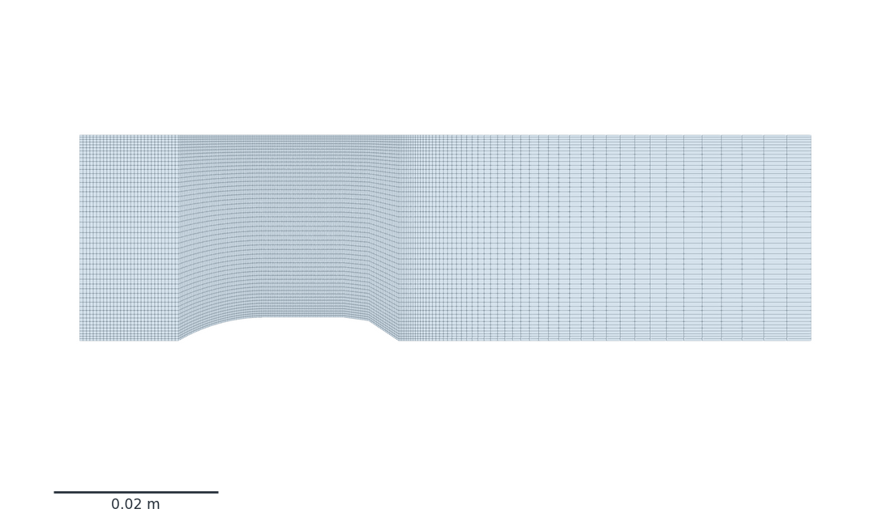
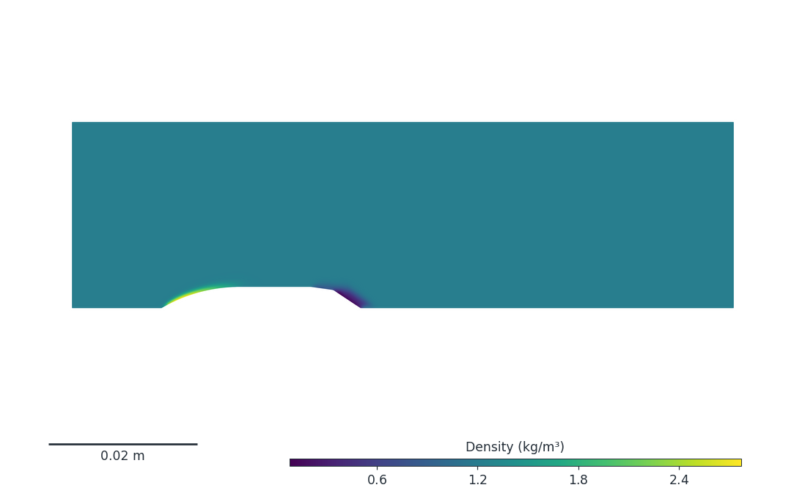

# Supersonic bullet

[CFD case index](../../README.md#external-aerodynamics) · [Verification results](../../verification.md#external-aerodynamics) · [Case source](__init__.py) · [View settings](view.json)

This archived example uses a structured axisymmetric mesh for a short compressible smoke run.

**Solver** `rhoCentralFoam` · **Mesh** structured `polyMesh` · **Level** `smoke`

## Mesh and results

| Initial mesh with cell edges | Solved field |
| --- | --- |
|  |  |

Initial mesh and solved field on the `z = 0 m` plane. The results show point data for `rho` at t
= 2e-06 s. The density image shows the state saved after about two microseconds of simulation.
The short snapshot provides a pipeline check.

`checkMesh` reported 11,400 cells and maximum non-orthogonality of 33.50°. It reported zero
failed quality checks. The measured transient flow mismatch was 0.00%.

## Model and limits

This smoke run checks the workflow on a coarse mesh. The short transient represents startup or
early evolution. Model limits include axisymmetric short transient, no structural analysis.

The existing smoke configuration and output are described in the linked verification report.

## Reproduce the views

Set up [OpenFOAM and ParaView](../../README.md#set-up), then run from the repository root.

```bash
python3 examples/cfd/gallery.py bullet_223
```

The workflow writes to `runs/cfd_gallery/bullet_223/`. Open `figures/mesh/scene.pvsm`
or `figures/reference/scene.pvsm` in ParaView. Each `figure.json` records the saved time,
field association, color range, camera, and source run. See the
[shared workflow](../../README.md#run-one-case) for individual mesh, solve, and optimization commands.
