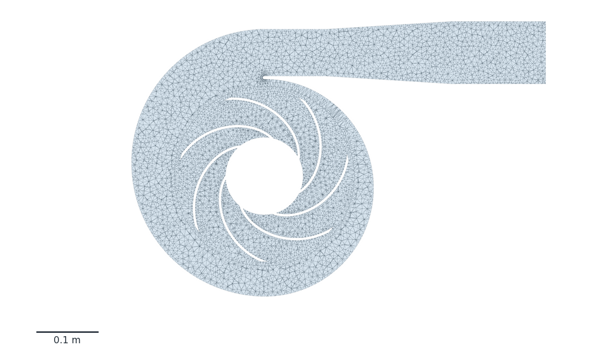
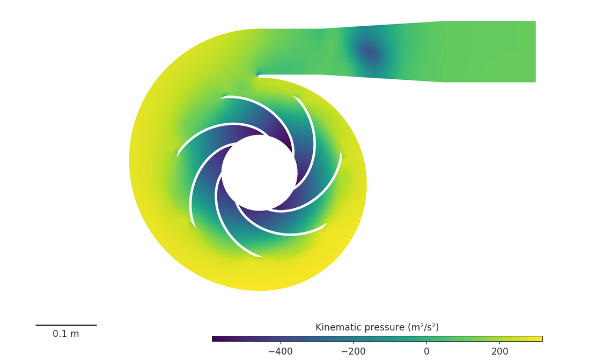

# Volute water pump on the bundled reference mesh

[CFD case index](../../README.md#radial-and-mixed-flow-turbomachinery) · [Verification results](../../verification.md#radial-and-mixed-flow-turbomachinery) · [Case source](__init__.py) · [View settings](view.json)

A bundled, full-wheel liquid-pump mesh contains the impeller, volute and ducts. The model uses a
steady multiple reference frame at a fixed 0.04167 m³/s duty and varies mesh scale and impeller
speed.

**Solver** `simpleFoam` · **Mesh** bundled `polyMesh` · **Level** `smoke`

## Mesh and results

| Initial mesh with cell edges | Solved field |
| --- | --- |
|  |  |

Initial mesh and solved field on the `x = 0.01 m` plane. The results show point data for `p` at
iteration 200. A section perpendicular to the shaft reveals the impeller and volute pressure
field. Smoke pressure rise is about 694 kPa, compared with about 1041 kPa after 800 iterations
in the standalone validation run.

`checkMesh` reported 229,999 cells and maximum non-orthogonality of 77.04°. It reported zero
failed quality checks. The measured flow imbalance was 2.24%.

## Boundary conditions

| Patches | Velocity condition | `p` condition |
| --- | --- | --- |
| `Inlet` | `flowRateInletVelocity` | `zeroGradient` |
| `Outlet` | `inletOutlet` | `fixedValue` |
| `Wall_1`, `Wall_2`, `Wall_3` | `noSlip` | `zeroGradient` |
| `AMI1_2`, `AMI2_2`, `AMI2_1`, `AMI1_1` | `cyclicAMI` | `cyclicAMI` |

## Design and reference measurements

| Variable | Unit | Lower | Reference | Upper |
| --- | --- | ---: | ---: | ---: |
| `scale` | — | 0.9 | 1 | 1.1 |
| `speed_ratio` | — | 0.85 | 1 | 1.15 |

| Role | Metric | Reference | Campaign bound |
| --- | --- | ---: | ---: |
| **Minimize** | `shaft_power_w` | 52367.2 W | — |
| Constraint | `pressure_rise_pa` | 693821 Pa | ≥ 624439 Pa (10% margin) |

This smoke run checks the workflow on a coarse mesh. The saved iteration is a coarse-run
reference.

## Reproduce the views

Set up [OpenFOAM and ParaView](../../README.md#set-up), then run from the repository root.

```bash
python3 examples/cfd/gallery.py centrifugal_pump
```

The workflow writes to `runs/cfd_gallery/centrifugal_pump/`. Open `figures/mesh/scene.pvsm`
or `figures/reference/scene.pvsm` in ParaView. Each `figure.json` records the saved time,
field association, color range, camera, and source run. See the
[shared workflow](../../README.md#run-one-case) for individual mesh, solve, and optimization commands.

## Standalone pump sizing

The [standalone driver](../../centrifugal_pump.py) runs the reference and sizing
campaign with longer solves and stricter stability checks. The
[bundled case](../../pump_case/README.md) documents its GPL-3.0 inputs,
checksums and 800-iteration reference measurements.

```bash
foam=examples/cfd/container/foam.sh
"$foam" python examples/cfd/centrifugal_pump.py --verify-only
"$foam" python examples/cfd/centrifugal_pump.py /runs/pump_baseline --baseline-only
"$foam" python examples/cfd/centrifugal_pump.py /runs/pump_run
```

The default campaign solves the reference and ten candidates at 3,000 iterations
each. Set `--batches 1` for six candidates. It checks that inlet and outlet flows
are within 3% of the prescribed rate and that pressure rise and shaft power vary
by at most 3% over the final ten samples. To view the standalone reference, export
`/runs/pump_baseline/baseline` with `foamToVTK` and open its VTK data in ParaView.
