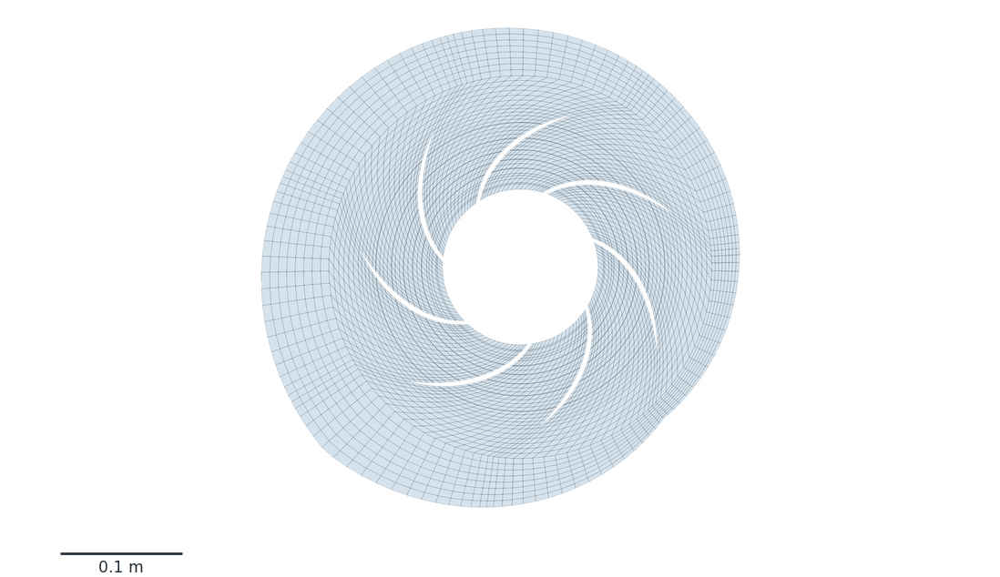
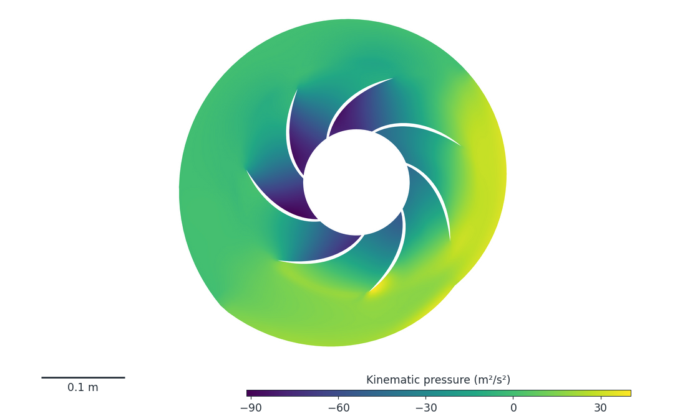

# Pump impeller and casing shape

[CFD case index](../../README.md#radial-and-mixed-flow-turbomachinery) · [Verification results](../../verification.md#radial-and-mixed-flow-turbomachinery) · [Case source](__init__.py) · [View settings](view.json)

A generated backswept impeller turns water into a rectangular spiral casing. Blade angles and
exit width affect hydraulic efficiency under a head constraint.

**Solver** `simpleFoam` · **Mesh** structured `polyMesh` · **Level** `smoke`

## Mesh and results

| Initial mesh with cell edges | Solved field |
| --- | --- |
|  |  |

Initial mesh and solved field on the `z = 0.036 m` plane. The results show point data for `p` at
iteration 200. The transverse pressure cut passes through the outer portion of the impeller and
spiral casing.

`checkMesh` reported 87,696 cells and maximum non-orthogonality of 69.54°. It reported zero
failed quality checks. The measured flow imbalance was 0.16%.

## Boundary conditions

| Patches | Velocity condition | `p` condition |
| --- | --- | --- |
| `blade_rotor`, `casing`, `hub`, `hub_rotor`, `shroud` | `noSlip` | `zeroGradient` |
| `inlet` | `flowRateInletVelocity` | `zeroGradient` |
| `outlet` | `pressureInletOutletVelocity` | `fixedValue` |

## Design and reference measurements

| Variable | Unit | Lower | Reference | Upper |
| --- | --- | ---: | ---: | ---: |
| `outlet_angle_deg` | ° | 40 | 55 | 65 |
| `outlet_width_m` | m | 0.016 | 0.022 | 0.028 |
| `inlet_offset_deg` | ° | -4 | 2 | 6 |

| Role | Metric | Reference | Campaign bound |
| --- | --- | ---: | ---: |
| **Maximize** | `efficiency` | 0.742331 | — |
| Constraint | `head_m` | 7.82996 m | ≥ 7.04696 m (10% margin) |

This smoke run checks the workflow on a coarse mesh. The saved iteration is a coarse-run
reference. Model limits include two-dimensional blades, rectangular spiral casing with a radial
slot over half a turn.

## Reproduce the views

Set up [OpenFOAM and ParaView](../../README.md#set-up), then run from the repository root.

```bash
python3 examples/cfd/gallery.py centrifugal_pump_optimization
```

The workflow writes to `runs/cfd_gallery/centrifugal_pump_optimization/`. Open `figures/mesh/scene.pvsm`
or `figures/reference/scene.pvsm` in ParaView. Each `figure.json` records the saved time,
field association, color range, camera, and source run. See the
[shared workflow](../../README.md#run-one-case) for individual mesh, solve, and optimization commands.
