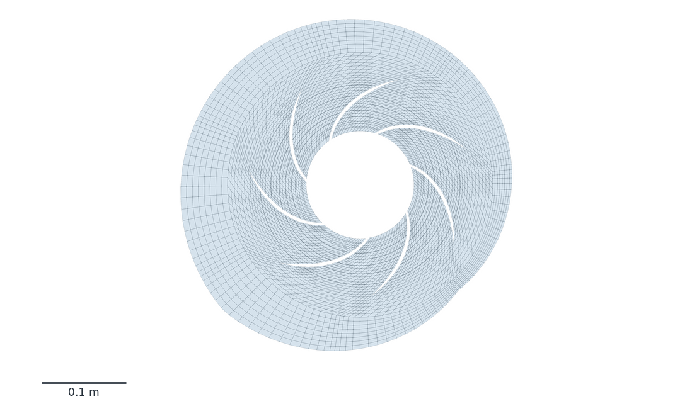
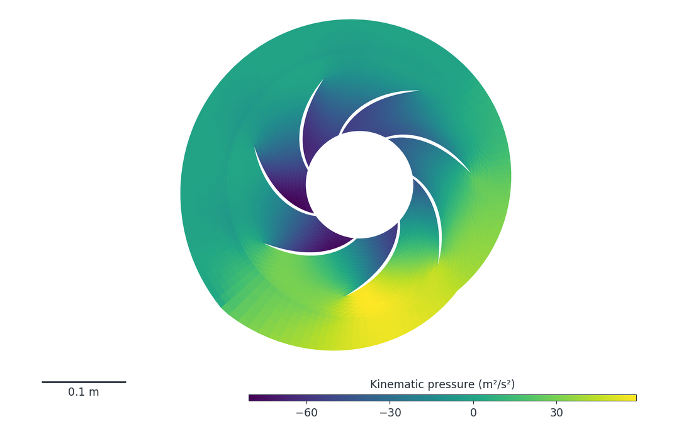

# Sliding pump with an offset casing

[CFD case index](../../README.md#radial-and-mixed-flow-turbomachinery) · [Verification results](../../verification.md#radial-and-mixed-flow-turbomachinery) · [Case source](__init__.py) · [View settings](view.json)

A full-wheel impeller and spiral casing run with a transient partial-overlap interface. Casing
outlet offset and speed affect the power needed to maintain pressure rise.

**Solver** `pimpleFoam` · **Mesh** structured `polyMesh` · **Level** `smoke`

## Mesh and results

| Initial mesh with cell edges | Solved field |
| --- | --- |
|  |  |

Initial mesh and solved field on the `z = 0.036 m` plane. The results show cell data for `p` at
t = 0.015 s. Compare the reference snapshot with the initial mesh. The transient ends early in
the time evolution.

`checkMesh` reported 87,696 cells and maximum non-orthogonality of 70.95°. It reported zero
failed quality checks. The measured transient flow mismatch was 5.48%.

## Boundary conditions

| Patches | Velocity condition | `p` condition |
| --- | --- | --- |
| `blade_rotor`, `hub`, `hub_rotor`, `shroud`, `rotor_block` | `movingWallVelocity` | `zeroGradient` |
| `casing`, `volute_block` | `noSlip` | `zeroGradient` |
| `inlet` | `flowRateInletVelocity` | `zeroGradient` |
| `outlet` | `pressureInletOutletVelocity` | `fixedValue` |
| `rotor_couple`, `volute_couple` | `cyclicACMI` | `cyclicACMI` |

## Design and reference measurements

| Variable | Unit | Lower | Reference | Upper |
| --- | --- | ---: | ---: | ---: |
| `outlet_offset` | — | 0.1 | 0.25 | 0.4 |
| `speed_ratio` | — | 0.85 | 1 | 1.15 |

| Role | Metric | Reference | Campaign bound |
| --- | --- | ---: | ---: |
| **Minimize** | `shaft_power_w` | 3842.38 W | — |
| Constraint | `pressure_rise_pa` | 65086.3 Pa | ≥ 45560.4 Pa (30% margin) |

This smoke run checks the workflow on a coarse mesh. The short transient represents startup or
early evolution. Model limits include two-dimensional blades, rectangular spiral casing with a
radial slot over half a turn, short transient.

## Reproduce the views

Set up [OpenFOAM and ParaView](../../README.md#set-up), then run from the repository root.

```bash
python3 examples/cfd/gallery.py centrifugal_pump_partial_overlap
```

The workflow writes to `runs/cfd_gallery/centrifugal_pump_partial_overlap/`. Open `figures/mesh/scene.pvsm`
or `figures/reference/scene.pvsm` in ParaView. Each `figure.json` records the saved time,
field association, color range, camera, and source run. See the
[shared workflow](../../README.md#run-one-case) for individual mesh, solve, and optimization commands.
