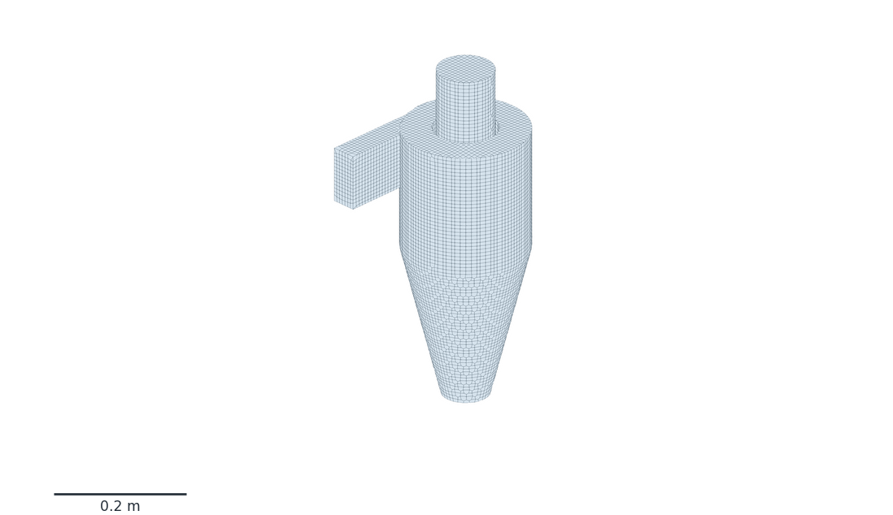
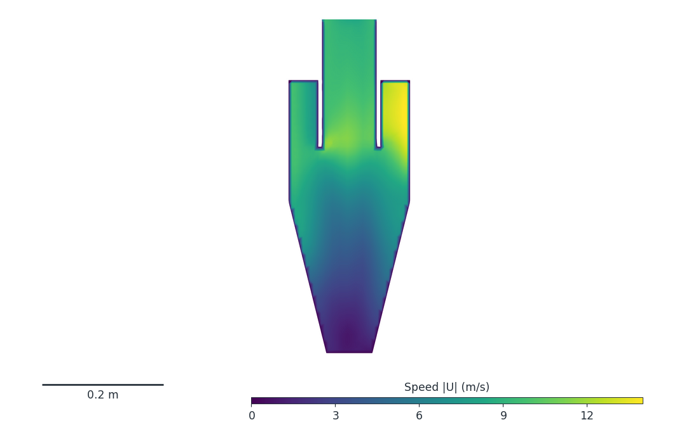

# Reverse-flow cyclone

[CFD case index](../../README.md#internal-and-process-flows) · [Verification results](../../verification.md#internal-and-process-flows) · [Case source](__init__.py) · [View settings](view.json)

A tangential inlet feeds a barrel and cone with a vortex finder. The gas solution drives one-way
tracking for a single particle size.

**Solver** `simpleFoam` · **Mesh** `snappyHexMesh` · **Level** `smoke`

## Mesh and results

| Initial mesh with cell edges | Solved field |
| --- | --- |
|  |  |

Oblique view of the initial mesh alongside a solved section in the `y = 0 m` plane. The results
show point data for `U` at iteration 201. The slice shows the carrier-flow speed. Particle
capture is reported separately and depends strongly on the smoke flow state.

`checkMesh` reported 27,813 cells and maximum non-orthogonality of 47.48°. It reported zero
failed quality checks. The measured flow imbalance was 0.00%.

## Boundary conditions

| Patches | Velocity condition | `p` condition |
| --- | --- | --- |
| `inlet` | `flowRateInletVelocity` | `zeroGradient` |
| `outlet` | `pressureInletOutletVelocity` | `fixedValue` |
| `walls`, `dust` | `noSlip` | `zeroGradient` |

## Design and reference measurements

| Variable | Unit | Lower | Reference | Upper |
| --- | --- | ---: | ---: | ---: |
| `cone_tip_radius_m` | m | 0.03 | 0.038 | 0.05 |
| `finder_radius_m` | m | 0.035 | 0.045 | 0.055 |
| `inlet_width_m` | m | 0.03 | 0.04 | 0.05 |

| Role | Metric | Reference | Campaign bound |
| --- | --- | ---: | ---: |
| **Maximize** | `capture_fraction` | 0.13 | — |
| Constraint | `pressure_drop_pa` | 270.131 Pa | ≤ 324.157 Pa (20% margin) |

This smoke run checks the workflow on a coarse mesh. The saved iteration is a coarse-run
reference. Model limits include one-way coupled particles of one size.

## Reproduce the views

Set up [OpenFOAM and ParaView](../../README.md#set-up), then run from the repository root.

```bash
python3 examples/cfd/gallery.py cyclone_separator
```

The workflow writes to `runs/cfd_gallery/cyclone_separator/`. Open `figures/mesh/scene.pvsm`
or `figures/reference/scene.pvsm` in ParaView. Each `figure.json` records the saved time,
field association, color range, camera, and source run. See the
[shared workflow](../../README.md#run-one-case) for individual mesh, solve, and optimization commands.
