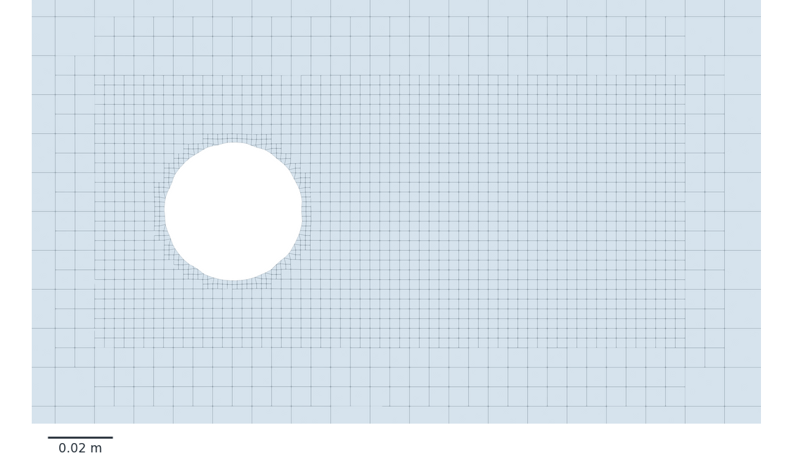
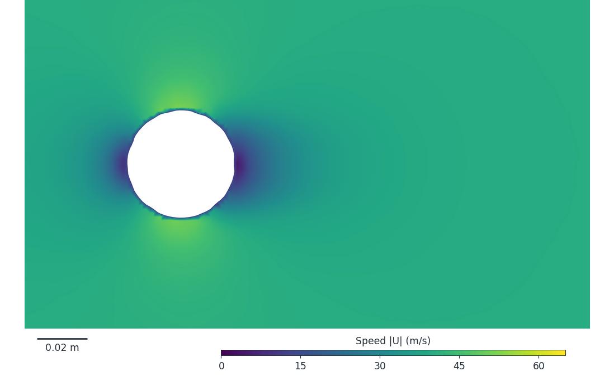

# Spinning dimpled ball

[CFD case index](../../README.md#external-aerodynamics) · [Verification results](../../verification.md#external-aerodynamics) · [Case source](__init__.py) · [View settings](view.json)

A generated dimpled sphere uses a prescribed rotating-wall velocity in a short compressible run.
Dimple depth and spin rate affect the measured drag and lift.

**Solver** `rhoPimpleFoam` · **Mesh** `snappyHexMesh` · **Level** `smoke`

## Mesh and results

| Initial mesh with cell edges | Solved field |
| --- | --- |
|  |  |

Initial mesh and solved field on the `y = 0.0007 m` plane. The results show point data for `U`
at t = 0.001 s. The near-body speed section shows the wake at the saved time. The wall model
imposes spin on fixed geometry.

`checkMesh` reported 67,095 cells and maximum non-orthogonality of 38.83°. It reported zero
failed quality checks. The measured transient flow mismatch was 0.03%.

## Boundary conditions

| Patches | Velocity condition | `p` condition |
| --- | --- | --- |
| `inlet` | `fixedValue` | `zeroGradient` |
| `outlet` | `pressureInletOutletVelocity` | `fixedValue` |
| `left`, `right`, `ground`, `top` | `slip` | `zeroGradient` |
| `ball` | `rotatingWallVelocity` | `zeroGradient` |

## Design and reference measurements

| Variable | Unit | Lower | Reference | Upper |
| --- | --- | ---: | ---: | ---: |
| `dimple_depth_m` | m | 0.0002 | 0.0005 | 0.001 |
| `spin_rad_s` | rad/s | 200 | 628 | 700 |

| Role | Metric | Reference | Campaign bound |
| --- | --- | ---: | ---: |
| **Minimize** | `drag_coefficient` | 0.42064 | — |
| Constraint | `lift_coefficient` | 0.0141893 | ≥ 0.010642 (25% margin) |

This smoke run checks the workflow on a coarse mesh. The short transient represents startup or
early evolution. Model limits include short transient, spinning surface without moving dimples,
no acoustics.

## Reproduce the views

Set up [OpenFOAM and ParaView](../../README.md#set-up), then run from the repository root.

```bash
python3 examples/cfd/gallery.py dimpled_ball
```

The workflow writes to `runs/cfd_gallery/dimpled_ball/`. Open `figures/mesh/scene.pvsm`
or `figures/reference/scene.pvsm` in ParaView. Each `figure.json` records the saved time,
field association, color range, camera, and source run. See the
[shared workflow](../../README.md#run-one-case) for individual mesh, solve, and optimization commands.
