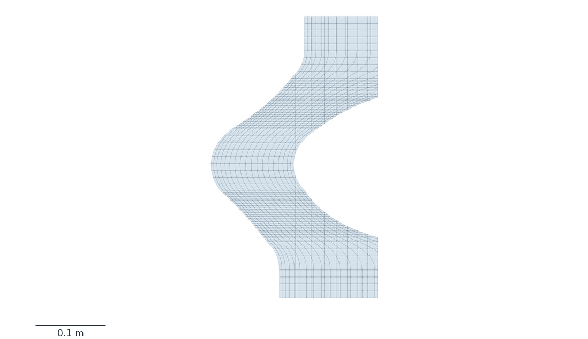
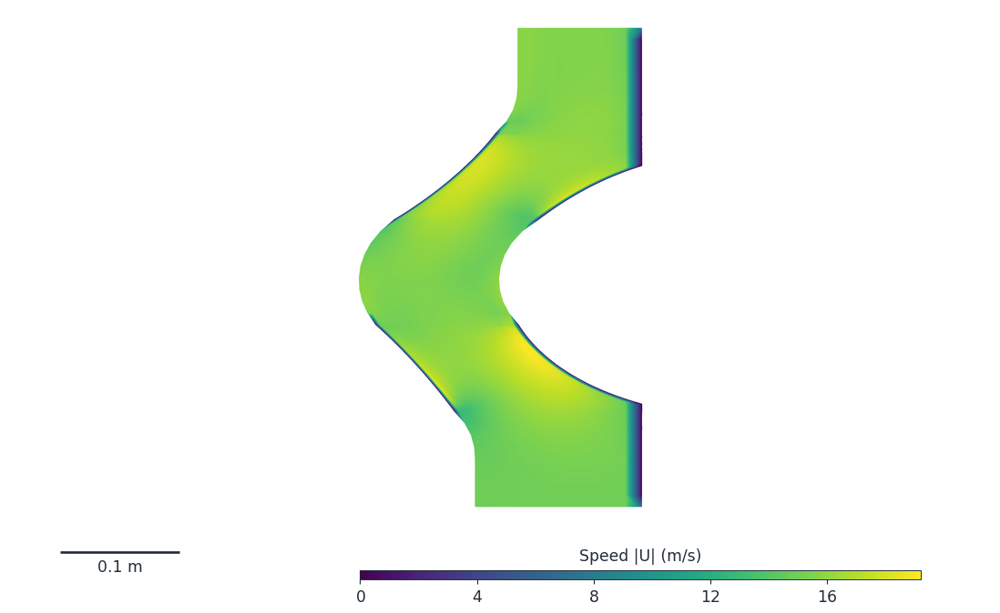

# Counter-rotating fan

[CFD case index](../../README.md#axial-turbomachinery) · [Verification results](../../verification.md#axial-turbomachinery) · [Case source](__init__.py) · [View settings](view.json)

Two counter-rotating blade rows exchange work with the flow. Separate cambers and a rear/front
speed ratio control the pressure rise and efficiency.

**Solver** `simpleFoam` · **Mesh** structured `polyMesh` · **Level** `smoke`

## Mesh and results

| Initial mesh with cell edges | Solved field |
| --- | --- |
|  |  |

Initial mesh and solved field on the `x = 0.16 m` plane. The results show point data for `U` at
iteration 200. The longitudinal cut passes through both rows of the frozen-rotor model. Read the
image together with the reference pressure rise and efficiency.

`checkMesh` reported 17,712 cells and maximum non-orthogonality of 68.40°. It reported zero
failed quality checks. The measured flow imbalance was 0.00%.

## Boundary conditions

| Patches | Velocity condition | `p` condition |
| --- | --- | --- |
| `blade_front`, `blade_rear`, `hub`, `hub_front`, `hub_rear`, `shroud` | `noSlip` | `zeroGradient` |
| `inlet` | `flowRateInletVelocity` | `zeroGradient` |
| `outlet` | `pressureInletOutletVelocity` | `fixedValue` |
| `periodic_a`, `periodic_b` | `cyclic` | `cyclic` |

## Design and reference measurements

| Variable | Unit | Lower | Reference | Upper |
| --- | --- | ---: | ---: | ---: |
| `front_camber_deg` | ° | 4 | 9 | 16 |
| `rear_camber_deg` | ° | 4 | 9 | 16 |
| `speed_ratio` | — | 0.7 | 1 | 1.2 |

| Role | Metric | Reference | Campaign bound |
| --- | --- | ---: | ---: |
| **Maximize** | `efficiency` | 0.947027 | — |
| Constraint | `pressure_rise_pa` | 228.633 Pa | ≥ 205.77 Pa (10% margin) |

This smoke run checks the workflow on a coarse mesh. The saved iteration is a coarse-run
reference. Model limits include equal blade counts, frozen rotor, no tip clearance.

## Reproduce the views

Set up [OpenFOAM and ParaView](../../README.md#set-up), then run from the repository root.

```bash
python3 examples/cfd/gallery.py double_rotor_fan
```

The workflow writes to `runs/cfd_gallery/double_rotor_fan/`. Open `figures/mesh/scene.pvsm`
or `figures/reference/scene.pvsm` in ParaView. Each `figure.json` records the saved time,
field association, color range, camera, and source run. See the
[shared workflow](../../README.md#run-one-case) for individual mesh, solve, and optimization commands.
