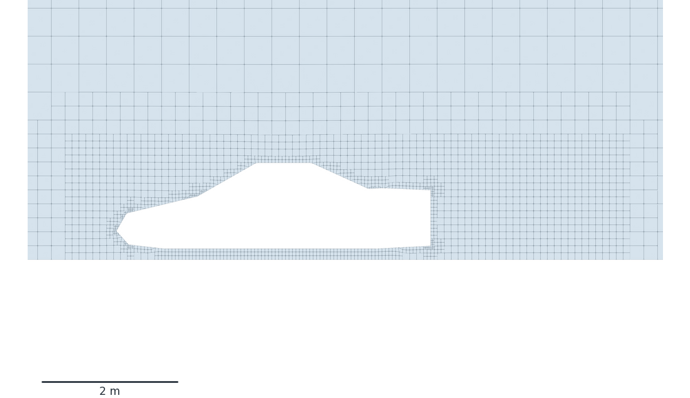
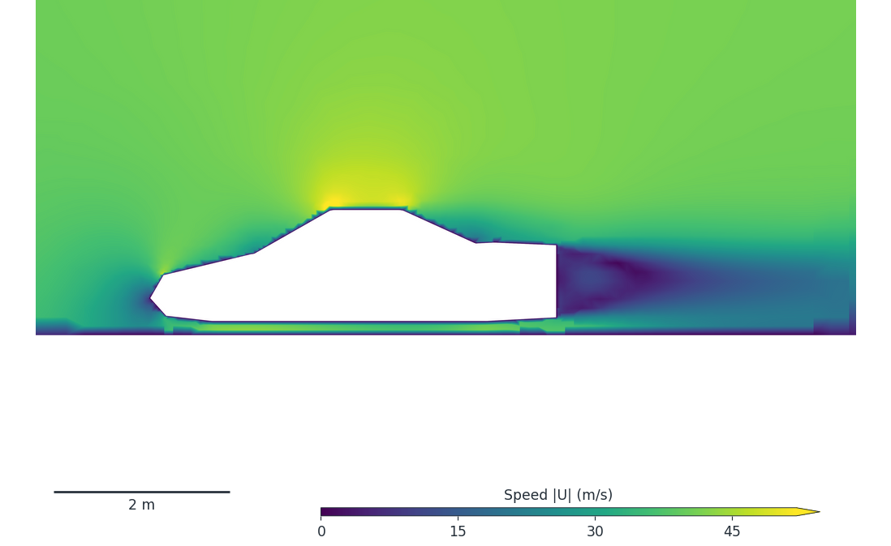

# Simplified notchback sedan

[CFD case index](../../README.md#external-aerodynamics) · [Verification results](../../verification.md#external-aerodynamics) · [Case source](__init__.py) · [View settings](view.json)

A generated notchback half-model includes simplified wheels and a stationary ground plane. Rear
slant, diffuser angle and trunk height vary under a body-volume constraint.

**Solver** `simpleFoam` · **Mesh** `snappyHexMesh` · **Level** `smoke`

## Mesh and results

| Initial mesh with cell edges | Solved field |
| --- | --- |
|  |  |

Initial mesh and solved field on the `y = 0.14 m` plane. The results show point data for `U` at
iteration 200. The longitudinal section shows the rear geometry and the near wake from this
representative shape.

`checkMesh` reported 59,290 cells and maximum non-orthogonality of 62.34°. It reported zero
failed quality checks. The measured flow imbalance was 0.00%.

## Boundary conditions

| Patches | Velocity condition | `p` condition |
| --- | --- | --- |
| `inlet` | `fixedValue` | `zeroGradient` |
| `outlet` | `pressureInletOutletVelocity` | `fixedValue` |
| `left` | `symmetry` | `symmetry` |
| `right`, `top` | `slip` | `zeroGradient` |
| `ground`, `body`, `cabin`, `wheels`, `axles` | `noSlip` | `zeroGradient` |

## Design and reference measurements

| Variable | Unit | Lower | Reference | Upper |
| --- | --- | ---: | ---: | ---: |
| `rear_slant_deg` | ° | 18 | 26 | 35 |
| `diffuser_angle_deg` | ° | 0 | 3 | 8 |
| `trunk_height_m` | m | 0.9 | 1.02 | 1.15 |

| Role | Metric | Reference | Campaign bound |
| --- | --- | ---: | ---: |
| **Minimize** | `drag_coefficient` | 0.602852 | — |
| Constraint | `volume_m3` | 7.27288 m³ | ≥ 7.05469 m³ (3% margin) |

This smoke run checks the workflow on a coarse mesh. The saved iteration is a coarse-run
reference. Model limits include own geometry, not the published DrivAer model. static wheels and
ground.

## Reproduce the views

Set up [OpenFOAM and ParaView](../../README.md#set-up), then run from the repository root.

```bash
python3 examples/cfd/gallery.py drivaer
```

The workflow writes to `runs/cfd_gallery/drivaer/`. Open `figures/mesh/scene.pvsm`
or `figures/reference/scene.pvsm` in ParaView. Each `figure.json` records the saved time,
field association, color range, camera, and source run. See the
[shared workflow](../../README.md#run-one-case) for individual mesh, solve, and optimization commands.
