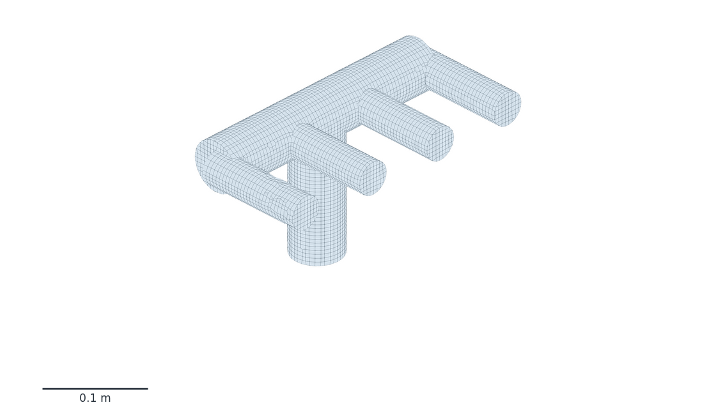
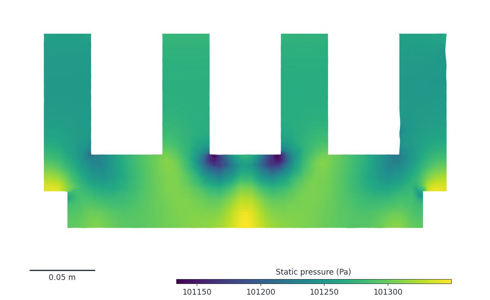

# Four-into-one exhaust manifold

[CFD case index](../../README.md#internal-and-process-flows) · [Verification results](../../verification.md#internal-and-process-flows) · [Case source](__init__.py) · [View settings](view.json)

Hot gas enters four runner ports and exits through a common collector. Runner and collector
radii and collector position affect pressure loss and volume.

**Solver** `rhoPimpleFoam` · **Mesh** `snappyHexMesh` · **Level** `smoke`

## Mesh and results

| Initial mesh with cell edges | Solved field |
| --- | --- |
|  |  |

Oblique view of the initial mesh alongside a solved section in the `z = 0 m` plane. The results
show point data for `p` at t = 0.005 s. The section crosses the runner-merging plane. The
pressure field is a snapshot from the short compressible transient.

`checkMesh` reported 14,591 cells and maximum non-orthogonality of 51.88°. It reported zero
failed quality checks. The measured transient flow mismatch was 12.47%.

## Boundary conditions

| Patches | Velocity condition | `p` condition |
| --- | --- | --- |
| `port_1`, `port_2`, `port_3`, `port_4` | `flowRateInletVelocity` | `zeroGradient` |
| `outlet` | `pressureInletOutletVelocity` | `fixedValue` |
| `walls` | `noSlip` | `zeroGradient` |

## Design and reference measurements

| Variable | Unit | Lower | Reference | Upper |
| --- | --- | ---: | ---: | ---: |
| `runner_radius_m` | m | 0.014 | 0.018 | 0.022 |
| `collector_radius_m` | m | 0.022 | 0.028 | 0.034 |
| `collector_position_m` | m | 0.06 | 0.135 | 0.21 |

| Role | Metric | Reference | Campaign bound |
| --- | --- | ---: | ---: |
| **Minimize** | `pressure_loss_pa` | 524.467 Pa | — |
| Constraint | `volume_m3` | 0.00138367 m³ | ≤ 0.00152203 m³ (10% margin) |

This smoke run checks the workflow on a coarse mesh. The short transient represents startup or
early evolution. Model limits include steady port flows, short transient.

## Reproduce the views

Set up [OpenFOAM and ParaView](../../README.md#set-up), then run from the repository root.

```bash
python3 examples/cfd/gallery.py exhaust_manifold
```

The workflow writes to `runs/cfd_gallery/exhaust_manifold/`. Open `figures/mesh/scene.pvsm`
or `figures/reference/scene.pvsm` in ParaView. Each `figure.json` records the saved time,
field association, color range, camera, and source run. See the
[shared workflow](../../README.md#run-one-case) for individual mesh, solve, and optimization commands.
