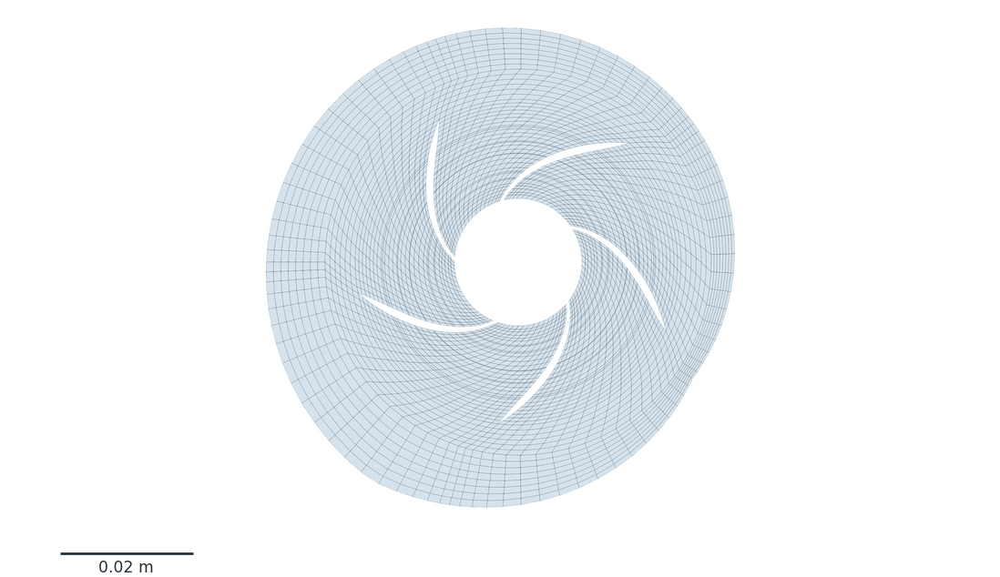
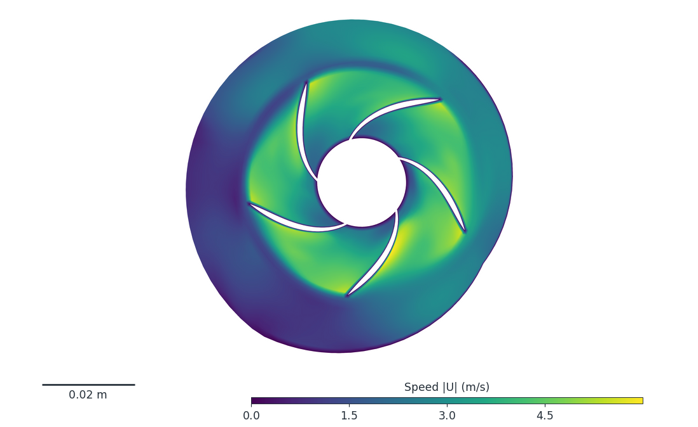

# Small centrifugal blood pump

[CFD case index](../../README.md#radial-and-mixed-flow-turbomachinery) · [Verification results](../../verification.md#radial-and-mixed-flow-turbomachinery) · [Case source](__init__.py) · [View settings](view.json)

A small generated radial pump moves a single-phase fluid analogue. Speed, outlet angle and
casing gap change rotor wall shear and pressure rise.

**Solver** `simpleFoam` · **Mesh** structured `polyMesh` · **Level** `smoke`

## Mesh and results

| Initial mesh with cell edges | Solved field |
| --- | --- |
|  |  |

Initial mesh and solved field on the `z = 0.006 m` plane. The results show point data for `U` at
iteration 200. The speed slice captures the impeller and casing region. The rotor wall-shear
metric is reported separately. The geometry is representative.

`checkMesh` reported 62,640 cells and maximum non-orthogonality of 74.77°. It reported zero
failed quality checks. The measured flow imbalance was 1.22%.

## Boundary conditions

| Patches | Velocity condition | `p` condition |
| --- | --- | --- |
| `blade_rotor`, `casing`, `hub`, `hub_rotor`, `shroud` | `noSlip` | `zeroGradient` |
| `inlet` | `flowRateInletVelocity` | `zeroGradient` |
| `outlet` | `pressureInletOutletVelocity` | `fixedValue` |

## Design and reference measurements

| Variable | Unit | Lower | Reference | Upper |
| --- | --- | ---: | ---: | ---: |
| `speed_ratio` | — | 0.8 | 1 | 1.2 |
| `outlet_angle_deg` | ° | 20 | 40 | 55 |
| `casing_gap_m` | m | 0.0015 | 0.0025 | 0.004 |

| Role | Metric | Reference | Campaign bound |
| --- | --- | ---: | ---: |
| **Minimize** | `wall_shear_pa` | 31.708 Pa | — |
| Constraint | `pressure_rise_pa` | 23850.8 Pa | ≥ 20273.2 Pa (15% margin) |

This smoke run checks the workflow on a coarse mesh. The saved iteration is a coarse-run
reference. Model limits include two-dimensional blades, rectangular spiral casing with a radial
slot over half a turn, own geometry.

## Reproduce the views

Set up [OpenFOAM and ParaView](../../README.md#set-up), then run from the repository root.

```bash
python3 examples/cfd/gallery.py fda_pump
```

The workflow writes to `runs/cfd_gallery/fda_pump/`. Open `figures/mesh/scene.pvsm`
or `figures/reference/scene.pvsm` in ParaView. Each `figure.json` records the saved time,
field association, color range, camera, and source run. See the
[shared workflow](../../README.md#run-one-case) for individual mesh, solve, and optimization commands.
