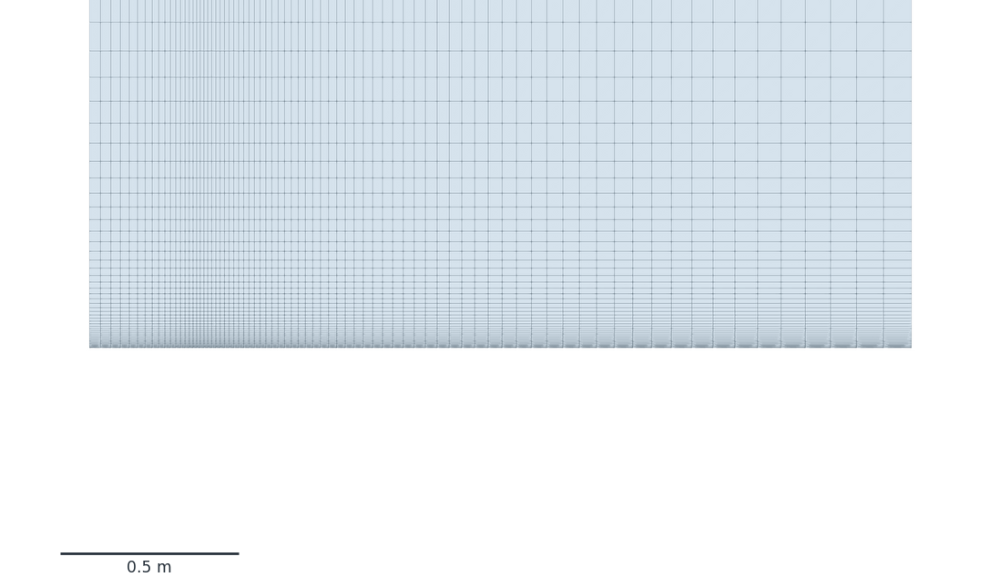
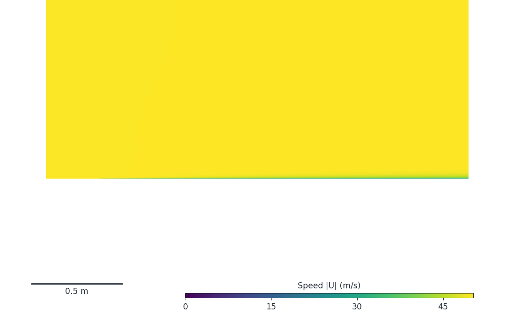
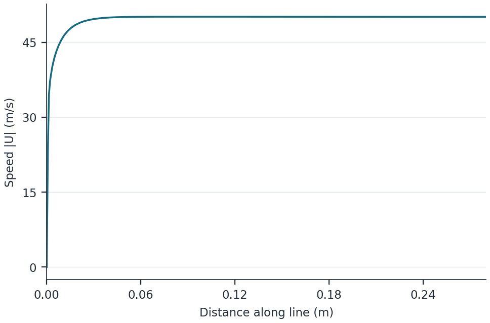

# Turbulent flat plate against a drag correlation

[CFD case index](../../README.md#external-aerodynamics) · [Verification results](../../verification.md#external-aerodynamics) · [Case source](__init__.py) · [View settings](view.json)

A structured two-dimensional wind-tunnel mesh grades wall-normal cells over a flat plate. The
objective compares the computed drag coefficient with a correlation.

**Solver** `simpleFoam` · **Mesh** structured `polyMesh` · **Level** `smoke`

## Mesh and results

| Initial mesh with cell edges | Solved field |
| --- | --- |
|  |  |

Initial mesh and solved field on the `z = 0.05 m` plane. The results show point data for `U` at
iteration 200. The speed profile is normal to the plate at the documented streamwise station.
Closely spaced near-wall lines show the initial cell grading.

`checkMesh` reported 3,800 cells and maximum non-orthogonality of 0.00°. It reported zero failed
quality checks.



The profile runs from `(1.2, 0, 0.05)` to `(1.2, 0.28, 0.05)` m.

## Boundary conditions

| Patches | Velocity condition | `p` condition |
| --- | --- | --- |
| `back`, `front` | `empty` | `empty` |
| `inlet` | `fixedValue` | `zeroGradient` |
| `outlet` | `pressureInletOutletVelocity` | `fixedValue` |
| `plate` | `noSlip` | `zeroGradient` |
| `top` | `slip` | `zeroGradient` |
| `upstream` | `symmetry` | `symmetry` |

## Design and reference measurements

| Variable | Unit | Lower | Reference | Upper |
| --- | --- | ---: | ---: | ---: |
| `speed_m_s` | m/s | 30 | 50 | 70 |
| `first_cell_m` | m | 0.0002 | 0.001 | 0.003 |

| Role | Metric | Reference | Campaign bound |
| --- | --- | ---: | ---: |
| **Minimize** | `drag_error` | 0.0246376 | — |
| Constraint | `cell_count` | 3800 count | ≤ 4180 count (10% margin) |

This smoke run checks the workflow on a coarse mesh. The saved iteration is a coarse-run
reference. Model limits include operating variables only, a pipeline check.

## Reproduce the views

Set up [OpenFOAM and ParaView](../../README.md#set-up), then run from the repository root.

```bash
python3 examples/cfd/gallery.py flat_plate
```

The workflow writes to `runs/cfd_gallery/flat_plate/`. Open `figures/mesh/scene.pvsm`
or `figures/reference/scene.pvsm` in ParaView. Each `figure.json` records the saved time,
field association, color range, camera, and source run. See the
[shared workflow](../../README.md#run-one-case) for individual mesh, solve, and optimization commands.
