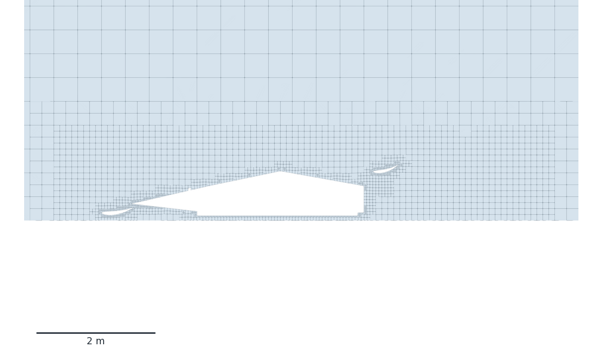
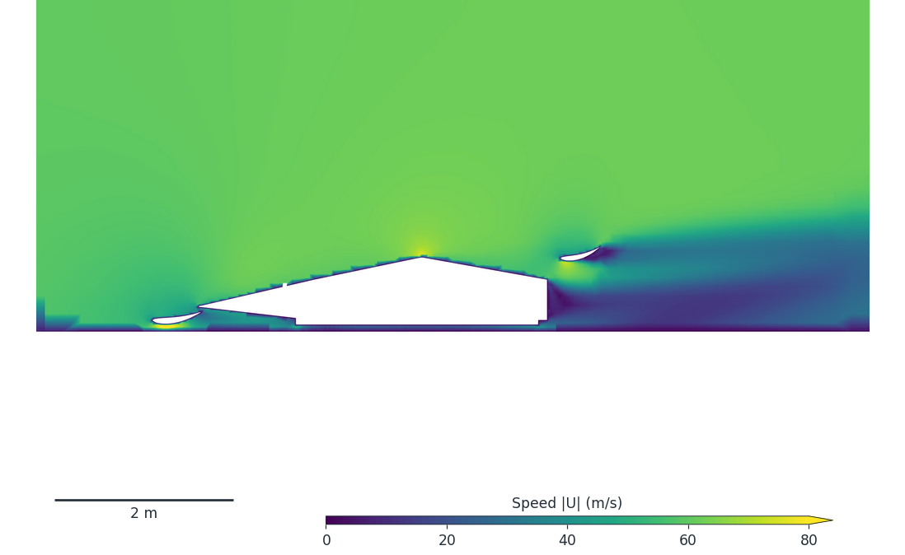

# Simplified open-wheel racing car

[CFD case index](../../README.md#external-aerodynamics) · [Verification results](../../verification.md#external-aerodynamics) · [Case source](__init__.py) · [View settings](view.json)

A generated half-model contains front and rear wings, a floor, and fixed wheels on a stationary
ground plane. The objective seeks downforce under a drag constraint.

**Solver** `simpleFoam` · **Mesh** `snappyHexMesh` · **Level** `smoke`

## Mesh and results

| Initial mesh with cell edges | Solved field |
| --- | --- |
|  |  |

Initial mesh and solved field on the `y = 0.17 m` plane. The results show point data for `U` at
iteration 200. The longitudinal slice shows the underbody and wing region. The smoke mesh has a
recorded quality warning.

`checkMesh` reported 69,861 cells and maximum non-orthogonality of 63.72°. It also reported one
failed quality check. See the retained `log.checkMesh`. The measured flow imbalance was 0.00%.

## Boundary conditions

| Patches | Velocity condition | `p` condition |
| --- | --- | --- |
| `inlet` | `fixedValue` | `zeroGradient` |
| `outlet` | `pressureInletOutletVelocity` | `fixedValue` |
| `left` | `symmetry` | `symmetry` |
| `right`, `top` | `slip` | `zeroGradient` |
| `ground`, `body`, `floor`, `front_wing`, `rear_wing`, `pylon`, `wheels`, `axles` | `noSlip` | `zeroGradient` |

## Design and reference measurements

| Variable | Unit | Lower | Reference | Upper |
| --- | --- | ---: | ---: | ---: |
| `front_wing_deg` | ° | 2 | 10 | 20 |
| `rear_wing_deg` | ° | 5 | 16 | 30 |
| `ride_height_m` | m | 0.05 | 0.08 | 0.12 |

| Role | Metric | Reference | Campaign bound |
| --- | --- | ---: | ---: |
| **Maximize** | `downforce_coefficient` | 0.280763 | — |
| Constraint | `drag_coefficient` | 0.87358 | ≤ 1.00462 (15% margin) |

This smoke run checks the workflow on a coarse mesh. The saved iteration is a coarse-run
reference. Model limits include simplified body, static wheels and ground.

## Reproduce the views

Set up [OpenFOAM and ParaView](../../README.md#set-up), then run from the repository root.

```bash
python3 examples/cfd/gallery.py formula_one
```

The workflow writes to `runs/cfd_gallery/formula_one/`. Open `figures/mesh/scene.pvsm`
or `figures/reference/scene.pvsm` in ParaView. Each `figure.json` records the saved time,
field association, color range, camera, and source run. See the
[shared workflow](../../README.md#run-one-case) for individual mesh, solve, and optimization commands.
