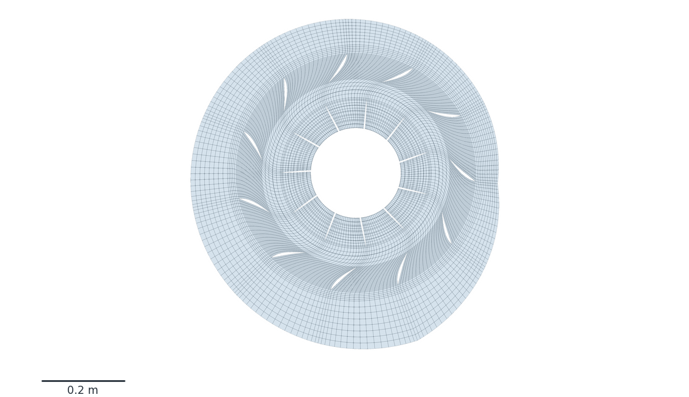
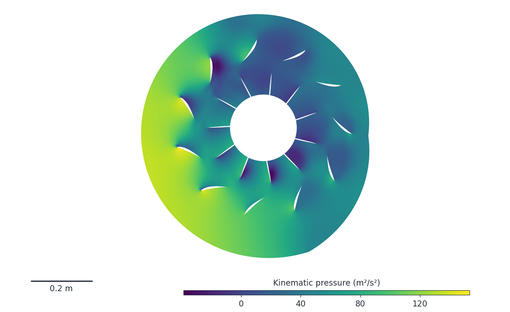

# Francis turbine with casing and guide vanes

[CFD case index](../../README.md#radial-and-mixed-flow-turbomachinery) · [Verification results](../../verification.md#radial-and-mixed-flow-turbomachinery) · [Case source](__init__.py) · [View settings](view.json)

Water enters via a spiral casing and vanes, travels inward through a runner, and leaves axially.
Vane angle, exit offset and speed affect efficiency and power.

**Solver** `simpleFoam` · **Mesh** structured `polyMesh` · **Level** `smoke`

## Mesh and results

| Initial mesh with cell edges | Solved field |
| --- | --- |
|  |  |

Initial mesh and solved field on the `z = 0.093 m` plane. The results show point data for `p` at
iteration 200. The pressure slice shows the inlet casing and parts of the vane and runner
passage at the selected height.

`checkMesh` reported 199,584 cells and maximum non-orthogonality of 67.63°. It reported zero
failed quality checks. The measured flow imbalance was 0.00%.

## Boundary conditions

| Patches | Velocity condition | `p` condition |
| --- | --- | --- |
| `blade_rotor`, `blade_vane`, `casing`, `hub`, `hub_rotor`, `shroud` | `noSlip` | `zeroGradient` |
| `inlet` | `flowRateInletVelocity` | `zeroGradient` |
| `outlet` | `pressureInletOutletVelocity` | `fixedValue` |

## Design and reference measurements

| Variable | Unit | Lower | Reference | Upper |
| --- | --- | ---: | ---: | ---: |
| `vane_angle_deg` | ° | 48 | 58 | 66 |
| `exit_offset_deg` | ° | -8 | 2 | 14 |
| `speed_ratio` | — | 0.8 | 1 | 1.2 |

| Role | Metric | Reference | Campaign bound |
| --- | --- | ---: | ---: |
| **Maximize** | `efficiency` | 0.537134 | — |
| Constraint | `output_power_w` | 18424.5 W | ≥ 16582.1 W (10% margin) |

This smoke run checks the workflow on a coarse mesh. The saved iteration is a coarse-run
reference. Model limits include two-dimensional blades, rectangular spiral casing with a radial
slot over half a turn used as the inlet, no draft tube.

## Reproduce the views

Set up [OpenFOAM and ParaView](../../README.md#set-up), then run from the repository root.

```bash
python3 examples/cfd/gallery.py francis_turbine
```

The workflow writes to `runs/cfd_gallery/francis_turbine/`. Open `figures/mesh/scene.pvsm`
or `figures/reference/scene.pvsm` in ParaView. Each `figure.json` records the saved time,
field association, color range, camera, and source run. See the
[shared workflow](../../README.md#run-one-case) for individual mesh, solve, and optimization commands.
