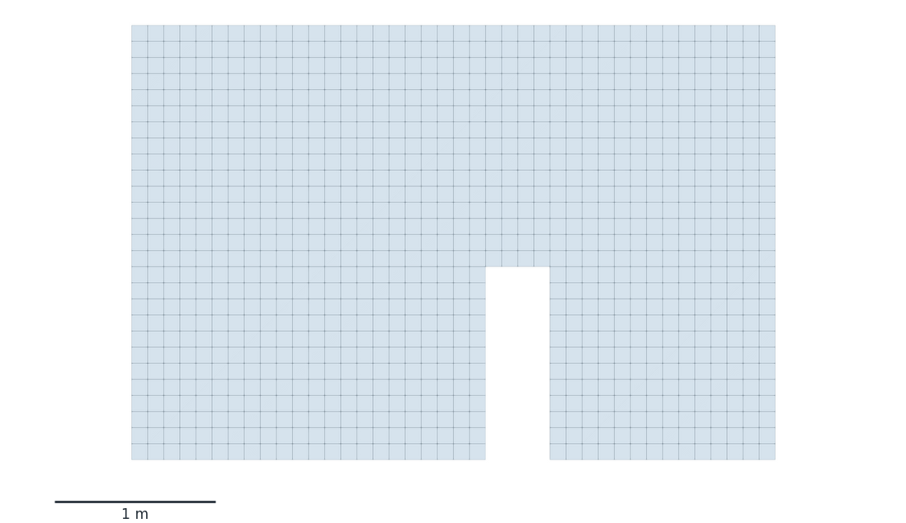
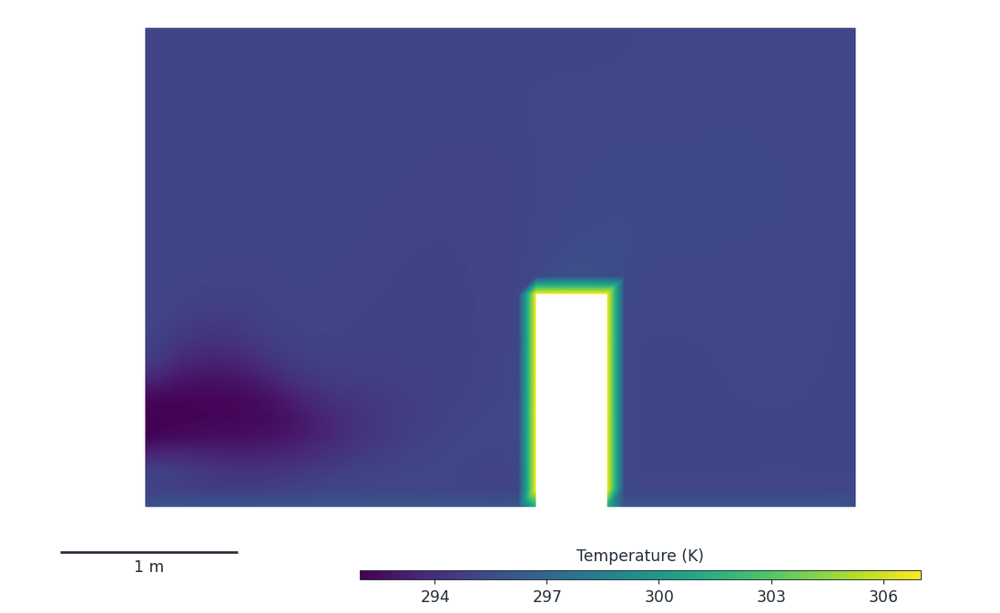

# Ventilated room with a seated occupant

[CFD case index](../../README.md#internal-and-process-flows) · [Verification results](../../verification.md#internal-and-process-flows) · [Case source](__init__.py) · [View settings](view.json)

The room contains a heated box manikin, a floor held at fixed temperature, a supply inlet and an
upper exhaust. The design varies supply speed, temperature and vent height.

**Solver** `buoyantSimpleFoam` · **Mesh** structured `polyMesh` · **Level** `smoke`

## Mesh and results

| Initial mesh with cell edges | Solved field |
| --- | --- |
|  |  |

Initial mesh and solved field on the `y = 1.5 m` plane. The results show point data for `T` at
iteration 200. The room center plane shows temperature around the manikin and between the vents.
Comfort and draught use averages over the occupied volume.

`checkMesh` reported 32,208 cells and maximum non-orthogonality of 0.00°. It reported zero
failed quality checks. The measured flow imbalance was 0.01%.

## Boundary conditions

| Patches | Velocity condition | `p` condition |
| --- | --- | --- |
| `floor`, `person`, `walls` | `noSlip` | `calculated` |
| `inlet` | `fixedValue` | `calculated` |
| `outlet` | `pressureInletOutletVelocity` | `calculated` |

## Design and reference measurements

| Variable | Unit | Lower | Reference | Upper |
| --- | --- | ---: | ---: | ---: |
| `inlet_speed_m_s` | m/s | 0.15 | 0.3 | 0.6 |
| `supply_temperature_k` | K | 288 | 292 | 296 |
| `vent_height_m` | m | 0.3 | 0.5 | 1.8 |

| Role | Metric | Reference | Campaign bound |
| --- | --- | ---: | ---: |
| **Minimize** | `comfort_deviation_k` | 0.585571 K | — |
| Constraint | `draught_speed_m_s` | 0.462219 m/s | ≤ 0.600884 m/s (30% margin) |

This smoke run checks the workflow on a coarse mesh. The saved iteration is a coarse-run
reference. Model limits include box manikin, no radiation or humidity.

## Reproduce the views

Set up [OpenFOAM and ParaView](../../README.md#set-up), then run from the repository root.

```bash
python3 examples/cfd/gallery.py human_comfort
```

The workflow writes to `runs/cfd_gallery/human_comfort/`. Open `figures/mesh/scene.pvsm`
or `figures/reference/scene.pvsm` in ParaView. Each `figure.json` records the saved time,
field association, color range, camera, and source run. See the
[shared workflow](../../README.md#run-one-case) for individual mesh, solve, and optimization commands.
