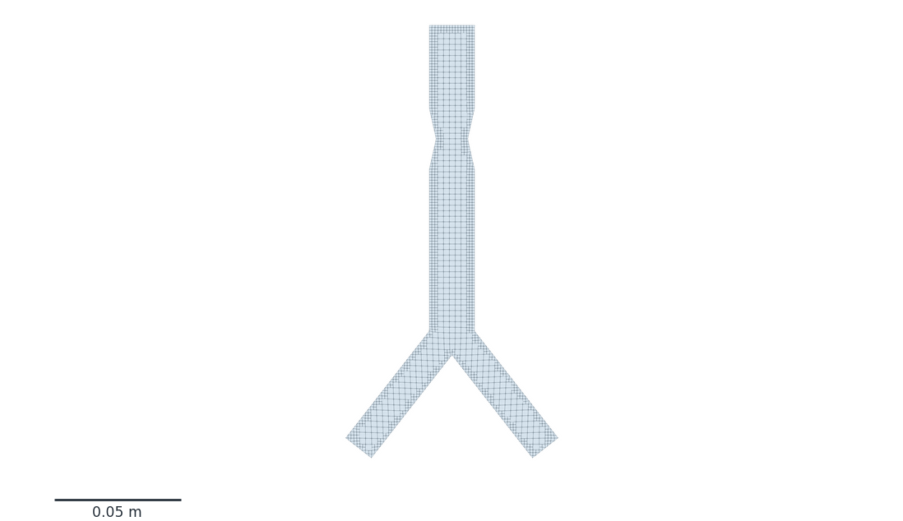
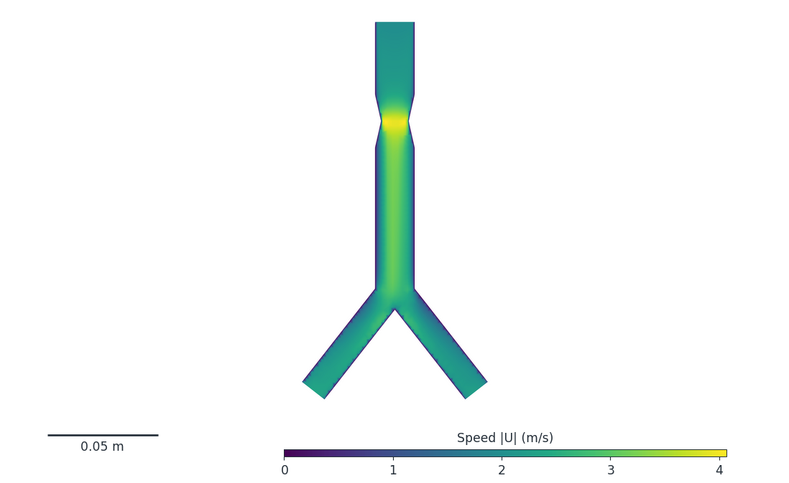

# Idealized upper airway

[CFD case index](../../README.md#internal-and-process-flows) · [Verification results](../../verification.md#internal-and-process-flows) · [Case source](__init__.py) · [View settings](view.json)

Idealized tubes represent a tracheal constriction and a bifurcation into two bronchi. The model
uses steady prescribed inhalation with pressure outlets.

**Solver** `simpleFoam` · **Mesh** `snappyHexMesh` · **Level** `smoke`

## Mesh and results

| Initial mesh with cell edges | Solved field |
| --- | --- |
|  |  |

Initial mesh and solved field on the `y = 0 m` plane. The results show point data for `U` at
iteration 200. The longitudinal speed cut shows the throat and both branches. The left outlet
flow fraction is measured at the branch cap.

`checkMesh` reported 21,280 cells and maximum non-orthogonality of 55.46°. It reported zero
failed quality checks. The measured flow imbalance was 0.00%.

## Boundary conditions

| Patches | Velocity condition | `p` condition |
| --- | --- | --- |
| `mouth` | `flowRateInletVelocity` | `zeroGradient` |
| `left`, `right` | `pressureInletOutletVelocity` | `fixedValue` |
| `walls` | `noSlip` | `zeroGradient` |

## Design and reference measurements

| Variable | Unit | Lower | Reference | Upper |
| --- | --- | ---: | ---: | ---: |
| `constriction_ratio` | — | 0.55 | 0.7 | 0.9 |
| `constriction_position` | — | 0.25 | 0.45 | 0.7 |
| `branch_angle_deg` | ° | 25 | 38 | 55 |

| Role | Metric | Reference | Campaign bound |
| --- | --- | ---: | ---: |
| **Minimize** | `pressure_drop_pa` | 5.86313 Pa | — |
| Constraint | `left_flow_fraction` | 0.512709 | ≥ 0.435802 (15% margin) |

This smoke run checks the workflow on a coarse mesh. The saved iteration is a coarse-run
reference. Model limits include idealized tubes, steady inhalation.

## Reproduce the views

Set up [OpenFOAM and ParaView](../../README.md#set-up), then run from the repository root.

```bash
python3 examples/cfd/gallery.py human_upper_airways
```

The workflow writes to `runs/cfd_gallery/human_upper_airways/`. Open `figures/mesh/scene.pvsm`
or `figures/reference/scene.pvsm` in ParaView. Each `figure.json` records the saved time,
field association, color range, camera, and source run. See the
[shared workflow](../../README.md#run-one-case) for individual mesh, solve, and optimization commands.
