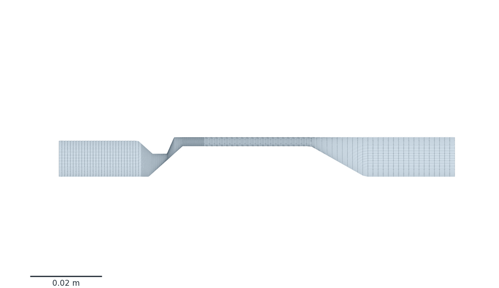
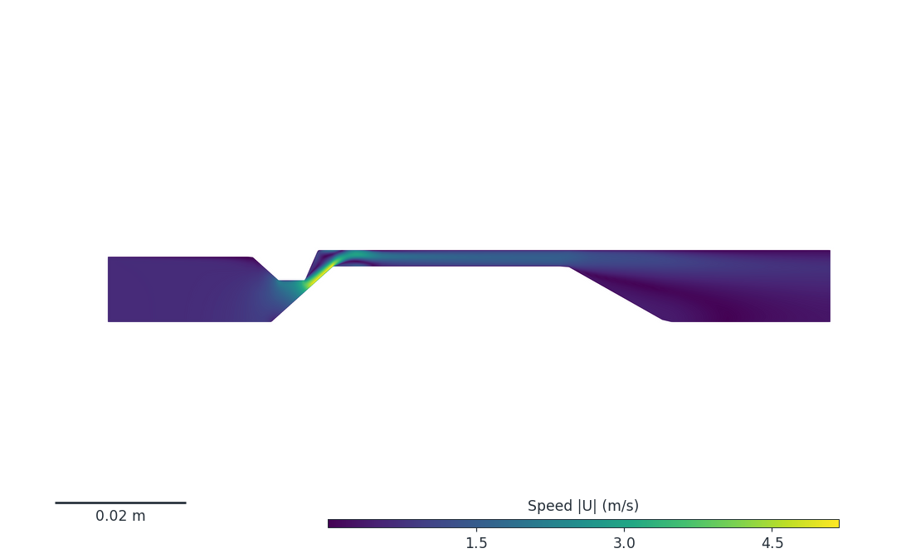

# Axisymmetric poppet valve

[CFD case index](../../README.md#internal-and-process-flows) · [Verification results](../../verification.md#internal-and-process-flows) · [Case source](__init__.py) · [View settings](view.json)

An axisymmetric wedge contains an idealized poppet, seat and outlet passage. Cone angle, lift
and seat radius change the flow restriction and force on the poppet.

**Solver** `simpleFoam` · **Mesh** structured `polyMesh` · **Level** `smoke`

## Mesh and results

| Initial mesh with cell edges | Solved field |
| --- | --- |
|  |  |

Initial mesh and solved field on the `z = 0 m` plane. The results show point data for `U` at
iteration 200. The axial speed section resolves the gap at the seat. The constraint uses the
integrated force scaled from the wedge to a full turn.

`checkMesh` reported 5,010 cells and maximum non-orthogonality of 66.37°. It reported zero
failed quality checks. The measured flow imbalance was 0.00%.

## Boundary conditions

| Patches | Velocity condition | `p` condition |
| --- | --- | --- |
| `axis` | `slip` | `zeroGradient` |
| `inlet` | `flowRateInletVelocity` | `zeroGradient` |
| `outlet` | `pressureInletOutletVelocity` | `fixedValue` |
| `plug`, `walls` | `noSlip` | `zeroGradient` |
| `wedge_back`, `wedge_front` | `wedge` | `wedge` |

## Design and reference measurements

| Variable | Unit | Lower | Reference | Upper |
| --- | --- | ---: | ---: | ---: |
| `cone_half_angle_deg` | ° | 30 | 42 | 55 |
| `lift_m` | m | 0.0012 | 0.002 | 0.003 |
| `seat_radius_m` | m | 0.0055 | 0.0064 | 0.0072 |

| Role | Metric | Reference | Campaign bound |
| --- | --- | ---: | ---: |
| **Minimize** | `pressure_loss_pa` | 9888.37 Pa | — |
| Constraint | `flow_force_n` | 0.350234 N | ≤ 0.402769 N (15% margin) |

This smoke run checks the workflow on a coarse mesh. The saved iteration is a coarse-run
reference. Model limits include axisymmetric, no structural analysis.

## Reproduce the views

Set up [OpenFOAM and ParaView](../../README.md#set-up), then run from the repository root.

```bash
python3 examples/cfd/gallery.py hydraulic_valve
```

The workflow writes to `runs/cfd_gallery/hydraulic_valve/`. Open `figures/mesh/scene.pvsm`
or `figures/reference/scene.pvsm` in ParaView. Each `figure.json` records the saved time,
field association, color range, camera, and source run. See the
[shared workflow](../../README.md#run-one-case) for individual mesh, solve, and optimization commands.
