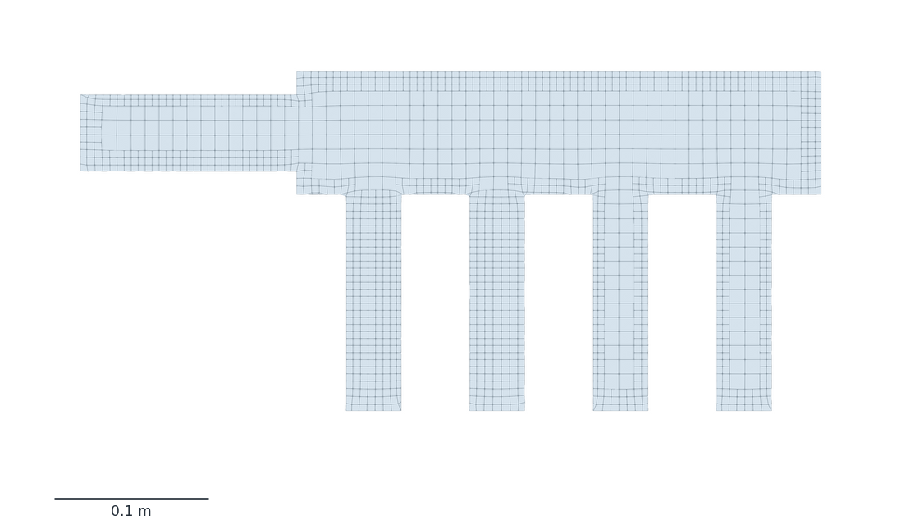
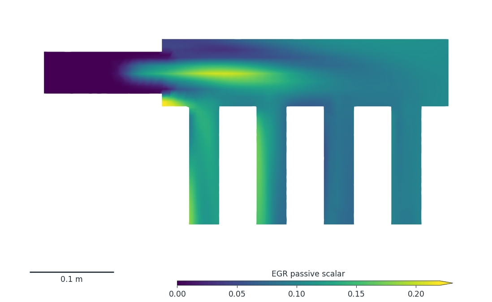

# Intake manifold with exhaust gas recirculation

[CFD case index](../../README.md#internal-and-process-flows) · [Verification results](../../verification.md#internal-and-process-flows) · [Case source](__init__.py) · [View settings](view.json)

A plenum distributes inlet flow and a passive exhaust-gas-recirculation tracer through four
runners. Plenum and runner sizes and tracer inlet position change the outlet mixture.

**Solver** `simpleFoam` · **Mesh** `snappyHexMesh` · **Level** `smoke`

## Mesh and results

| Initial mesh with cell edges | Solved field |
| --- | --- |
|  |  |

Initial mesh and solved field on the `y = 0 m` plane. The results show point data for `egr` at
iteration 200. The scalar section crosses the plenum and runners. The reported imbalance
compares the tracer carried by the outlets.

`checkMesh` reported 17,868 cells and maximum non-orthogonality of 50.34°. It reported zero
failed quality checks. The measured flow imbalance was 0.00%.

## Boundary conditions

| Patches | Velocity condition | `p` condition |
| --- | --- | --- |
| `inlet`, `egr` | `flowRateInletVelocity` | `zeroGradient` |
| `runner_1`, `runner_2`, `runner_3`, `runner_4` | `pressureInletOutletVelocity` | `fixedValue` |
| `walls` | `noSlip` | `zeroGradient` |

## Design and reference measurements

| Variable | Unit | Lower | Reference | Upper |
| --- | --- | ---: | ---: | ---: |
| `plenum_radius_m` | m | 0.032 | 0.04 | 0.05 |
| `runner_radius_m` | m | 0.015 | 0.018 | 0.022 |
| `egr_position_m` | m | -0.08 | -0.05 | -0.025 |

| Role | Metric | Reference | Campaign bound |
| --- | --- | ---: | ---: |
| **Minimize** | `mixture_imbalance` | 0.394108 | — |
| Constraint | `pressure_loss_pa` | 312.349 Pa | ≤ 374.818 Pa (20% margin) |

This smoke run checks the workflow on a coarse mesh. The saved iteration is a coarse-run
reference. Model limits include steady flow, passive scalar mixing.

## Reproduce the views

Set up [OpenFOAM and ParaView](../../README.md#set-up), then run from the repository root.

```bash
python3 examples/cfd/gallery.py intake_manifold_egr
```

The workflow writes to `runs/cfd_gallery/intake_manifold_egr/`. Open `figures/mesh/scene.pvsm`
or `figures/reference/scene.pvsm` in ParaView. Each `figure.json` records the saved time,
field association, color range, camera, and source run. See the
[shared workflow](../../README.md#run-one-case) for individual mesh, solve, and optimization commands.
