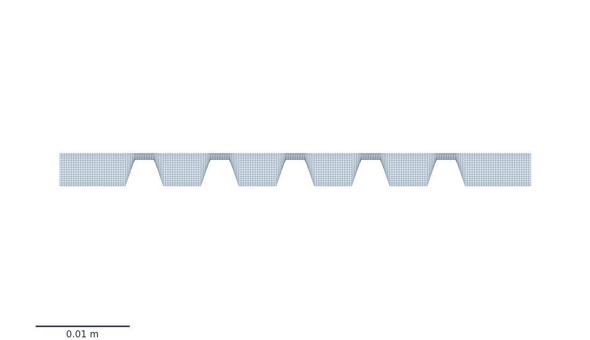
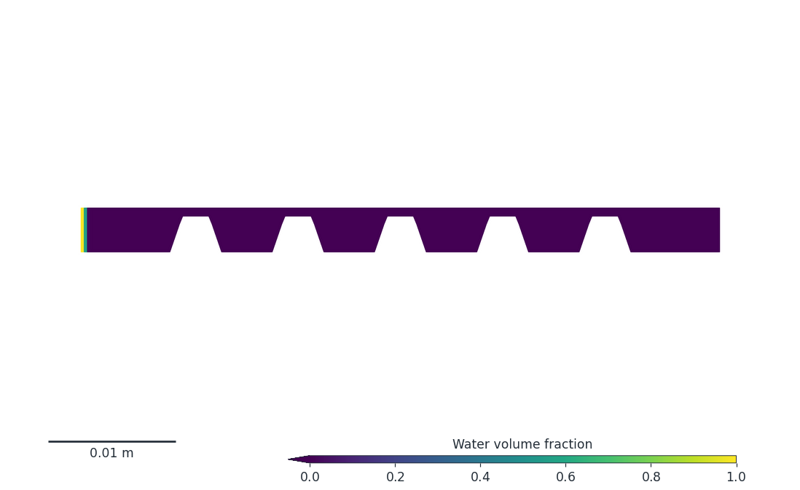

# Labyrinth seal filling with water

[CFD case index](../../README.md#internal-and-process-flows) · [Verification results](../../verification.md#internal-and-process-flows) · [Case source](__init__.py) · [View settings](view.json)

Water enters an initially air-filled annular labyrinth with square teeth. Tooth count, clearance
and length are design variables in a leakage problem.

**Solver** `interFoam` · **Mesh** structured `polyMesh` · **Level** `smoke`

## Mesh and results

| Initial mesh with cell edges | Solved field |
| --- | --- |
|  |  |

Initial mesh and solved field on the `z = 0 m` plane. The results show cell data for
`alpha.water` at t = 0.0001 s. The final water volume fraction shows the start of filling in the
short smoke run. Leakage during this run describes startup.

`checkMesh` reported 3,600 cells and maximum non-orthogonality of 70.78°. It reported zero
failed quality checks. The measured transient flow mismatch was 0.00%.

## Boundary conditions

| Patches | Velocity condition | `p_rgh` condition |
| --- | --- | --- |
| `inlet` | `pressureInletOutletVelocity` | `totalPressure` |
| `outlet` | `pressureInletOutletVelocity` | `fixedValue` |
| `shaft`, `walls` | `noSlip` | `fixedFluxPressure` |
| `wedge_back`, `wedge_front` | `wedge` | `wedge` |

## Design and reference measurements

| Variable | Unit | Lower | Reference | Upper |
| --- | --- | ---: | ---: | ---: |
| `tooth_count` | count | 3 | 5 | 7 |
| `clearance_m` | m | 0.0004 | 0.0007 | 0.0012 |
| `length_m` | m | 0.04 | 0.05 | 0.07 |

| Role | Metric | Reference | Campaign bound |
| --- | --- | ---: | ---: |
| **Minimize** | `leakage_m3_s` | 0.00255331 m³/s | — |
| Constraint | `length_m` | 0.05 m | ≤ 0.055 m (10% margin) |

This smoke run checks the workflow on a coarse mesh. The short transient represents startup or
early evolution. Model limits include axisymmetric, short transient from an air-filled gap.

## Reproduce the views

Set up [OpenFOAM and ParaView](../../README.md#set-up), then run from the repository root.

```bash
python3 examples/cfd/gallery.py labyrinth_maze
```

The workflow writes to `runs/cfd_gallery/labyrinth_maze/`. Open `figures/mesh/scene.pvsm`
or `figures/reference/scene.pvsm` in ParaView. Each `figure.json` records the saved time,
field association, color range, camera, and source run. See the
[shared workflow](../../README.md#run-one-case) for individual mesh, solve, and optimization commands.
