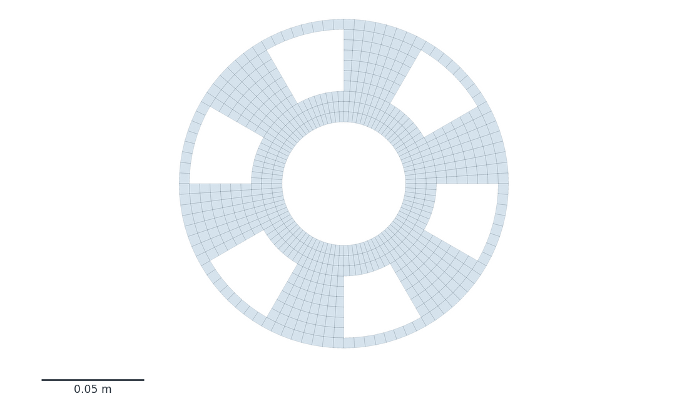
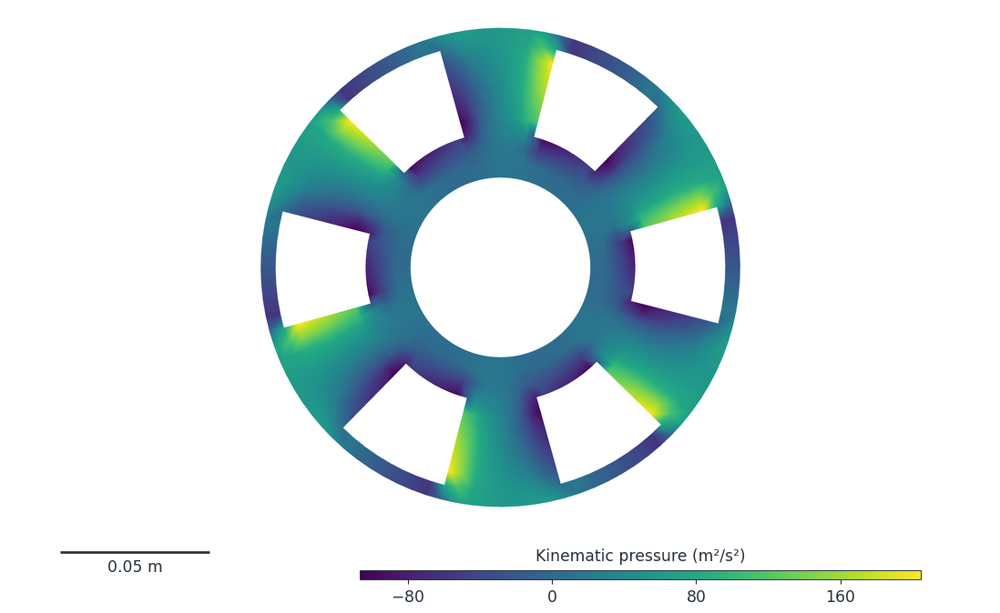
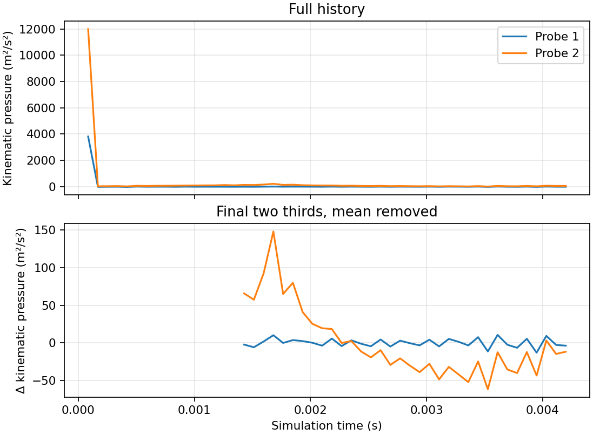

# Sliding-mesh siren

[CFD case index](../../README.md#internal-and-process-flows) · [Verification results](../../verification.md#internal-and-process-flows) · [Case source](__init__.py) · [View settings](view.json)

Slotted rotor and stator discs periodically interrupt throughflow across sliding interfaces.
Port count, gap and speed vary pressure amplitude under a pressure-drop constraint.

**Solver** `pimpleFoam` · **Mesh** structured `polyMesh` · **Level** `smoke`

## Mesh and results

| Initial mesh with cell edges | Solved field |
| --- | --- |
|  |  |

Initial mesh and solved field on the `z = 0.104 m` plane. The results show point data for `p` at
t = 0.0042 s. The transverse cut crosses the rotor ports. The local probe histories show
pressure fluctuations over the recorded short run.

`checkMesh` reported 43,776 cells and maximum non-orthogonality of 0.00°. It reported zero
failed quality checks. The measured transient flow mismatch was 0.27%.



The upper panel shows the full history, including the startup transient. The lower panel shows
each probe's departure from its mean over the final two thirds of the samples, the window used
to measure fluctuation. Probe values use the native pressure units written by OpenFOAM.

## Boundary conditions

| Patches | Velocity condition | `p` condition |
| --- | --- | --- |
| `front_rotor`, `front_static`, `rear_rotor`, `rear_static` | `cyclicAMI` | `cyclicAMI` |
| `inlet` | `flowRateInletVelocity` | `zeroGradient` |
| `outlet` | `pressureInletOutletVelocity` | `fixedValue` |
| `rotor_walls` | `movingWallVelocity` | `zeroGradient` |
| `walls` | `noSlip` | `zeroGradient` |

## Design and reference measurements

| Variable | Unit | Lower | Reference | Upper |
| --- | --- | ---: | ---: | ---: |
| `port_count` | count | 4 | 6 | 10 |
| `gap_m` | m | 0.002 | 0.004 | 0.008 |
| `speed_rad_s` | rad/s | 200 | 314 | 500 |

| Role | Metric | Reference | Campaign bound |
| --- | --- | ---: | ---: |
| **Maximize** | `pressure_amplitude_pa` | 56.1725 Pa | — |
| Constraint | `pressure_drop_pa` | 74.3219 Pa | ≤ 111.483 Pa (50% margin) |

This smoke run checks the workflow on a coarse mesh. The short transient represents startup or
early evolution. Model limits include probe pressures only, short transient.

## Reproduce the views

Set up [OpenFOAM and ParaView](../../README.md#set-up), then run from the repository root.

```bash
python3 examples/cfd/gallery.py mechanical_siren
```

The workflow writes to `runs/cfd_gallery/mechanical_siren/`. Open `figures/mesh/scene.pvsm`
or `figures/reference/scene.pvsm` in ParaView. Each `figure.json` records the saved time,
field association, color range, camera, and source run. See the
[shared workflow](../../README.md#run-one-case) for individual mesh, solve, and optimization commands.
