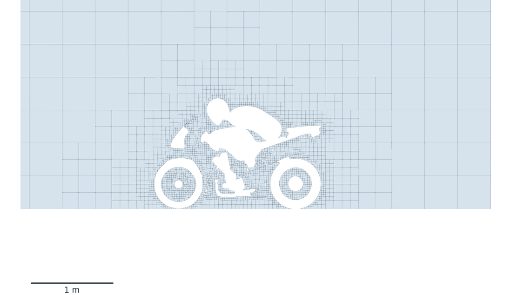
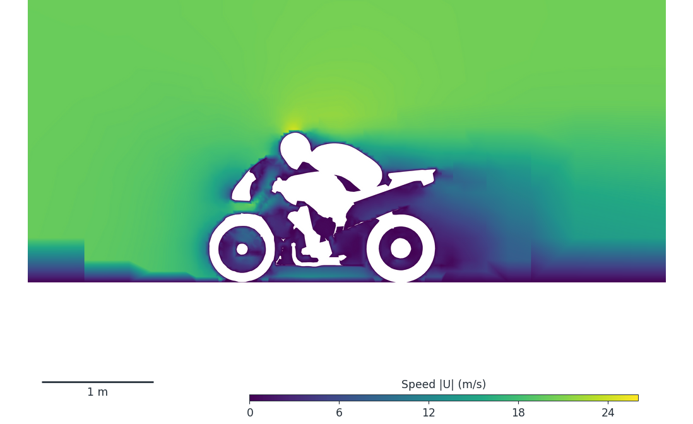

# Solver run time on the motorbike geometry

[CFD case index](../../README.md#external-aerodynamics) · [Verification results](../../verification.md#external-aerodynamics) · [Case source](__init__.py) · [View settings](view.json)

The OpenFOAM tutorial motorbike geometry runs in a generated wind tunnel. Background size and
surface level change computational cost while drag is constrained.

**Solver** `simpleFoam` · **Mesh** `snappyHexMesh` · **Level** `smoke`

## Mesh and results

| Initial mesh with cell edges | Solved field |
| --- | --- |
|  |  |

Initial mesh and solved field on the `y = 0.03 m` plane. The results show point data for `U` at
iteration 200. The slice shows the refinement and modeled wake. The runtime metric is the solver
execution time from this machine and run configuration.

`checkMesh` reported 54,488 cells and maximum non-orthogonality of 69.41°. It also reported one
failed quality check. See the retained `log.checkMesh`. The measured flow imbalance was 0.00%.

## Boundary conditions

| Patches | Velocity condition | `p` condition |
| --- | --- | --- |
| `inlet` | `fixedValue` | `zeroGradient` |
| `outlet` | `pressureInletOutletVelocity` | `fixedValue` |
| `left`, `right`, `top` | `slip` | `zeroGradient` |
| `ground`, `motorbike` | `noSlip` | `zeroGradient` |

## Design and reference measurements

| Variable | Unit | Lower | Reference | Upper |
| --- | --- | ---: | ---: | ---: |
| `surface_level` | count | 3 | 4 | 5 |
| `background_cell_m` | m | 0.3 | 0.4 | 0.6 |

| Role | Metric | Reference | Campaign bound |
| --- | --- | ---: | ---: |
| **Minimize** | `execution_time_s` | 31.98 s | — |
| Constraint | `drag_coefficient` | 0.657642 | ≤ 0.822053 (25% margin) |

This smoke run checks the workflow on a coarse mesh. The saved iteration is a coarse-run
reference. Model limits include speed benchmark. processes are set with --cores.

## Reproduce the views

Set up [OpenFOAM and ParaView](../../README.md#set-up), then run from the repository root.

```bash
python3 examples/cfd/gallery.py motorbike_benchmark
```

The workflow writes to `runs/cfd_gallery/motorbike_benchmark/`. Open `figures/mesh/scene.pvsm`
or `figures/reference/scene.pvsm` in ParaView. Each `figure.json` records the saved time,
field association, color range, camera, and source run. See the
[shared workflow](../../README.md#run-one-case) for individual mesh, solve, and optimization commands.
