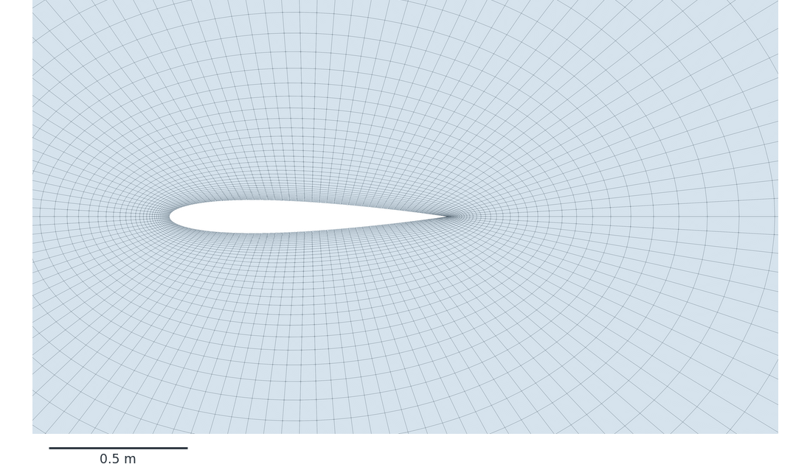
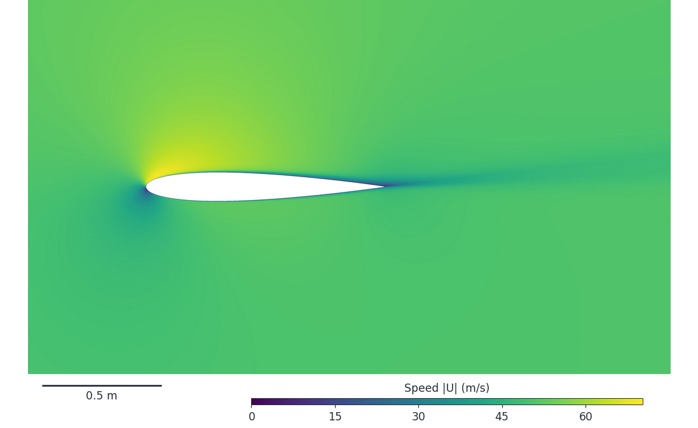

# NACA 0012 airfoil in two dimensions

[CFD case index](../../README.md#external-aerodynamics) · [Verification results](../../verification.md#external-aerodynamics) · [Case source](__init__.py) · [View settings](view.json)

A two-dimensional NACA 0012 section uses a structured O-grid and far-field boundary conditions.
Angle of attack changes lift-to-drag ratio under a minimum lift constraint.

**Solver** `simpleFoam` · **Mesh** structured `polyMesh` · **Level** `smoke`

## Mesh and results

| Initial mesh with cell edges | Solved field |
| --- | --- |
|  |  |

Initial mesh and solved field on the `z = 0.05 m` plane. The results show point data for `U` at
iteration 200. The near-field crop displays the airfoil cells and downstream velocity. Lift and
drag are integrated forces normalized by the reference dynamic pressure and area.

`checkMesh` reported 7,080 cells and maximum non-orthogonality of 76.99°. It reported zero
failed quality checks.

## Boundary conditions

| Patches | Velocity condition | `p` condition |
| --- | --- | --- |
| `airfoil` | `noSlip` | `zeroGradient` |
| `back`, `front` | `empty` | `empty` |
| `farfield` | `freestreamVelocity` | `freestreamPressure` |

## Design and reference measurements

| Variable | Unit | Lower | Reference | Upper |
| --- | --- | ---: | ---: | ---: |
| `angle_deg` | ° | 1 | 5 | 12 |

| Role | Metric | Reference | Campaign bound |
| --- | --- | ---: | ---: |
| **Maximize** | `lift_to_drag` | 15.8758 | — |
| Constraint | `lift_coefficient` | 0.470017 | ≥ 0.376014 (20% margin) |

This smoke run checks the workflow on a coarse mesh. The saved iteration is a coarse-run
reference.

## Reproduce the views

Set up [OpenFOAM and ParaView](../../README.md#set-up), then run from the repository root.

```bash
python3 examples/cfd/gallery.py naca_0012
```

The workflow writes to `runs/cfd_gallery/naca_0012/`. Open `figures/mesh/scene.pvsm`
or `figures/reference/scene.pvsm` in ParaView. Each `figure.json` records the saved time,
field association, color range, camera, and source run. See the
[shared workflow](../../README.md#run-one-case) for individual mesh, solve, and optimization commands.
