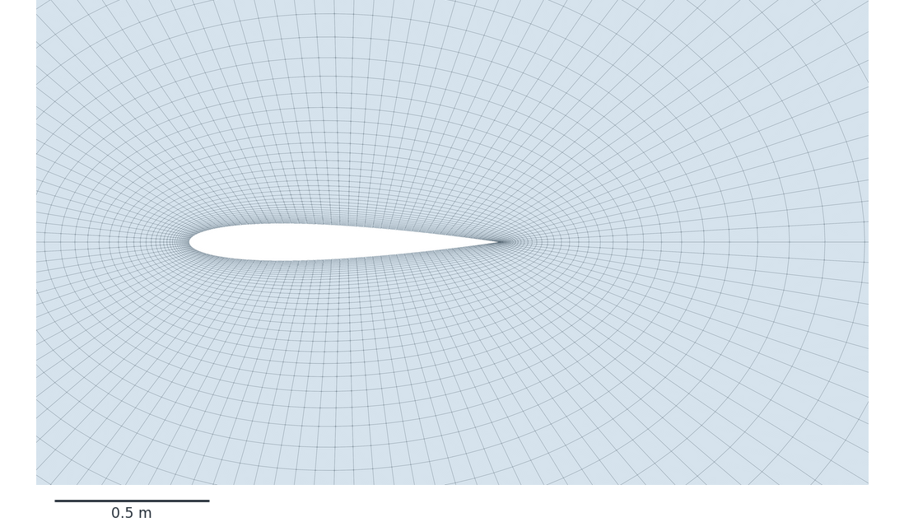
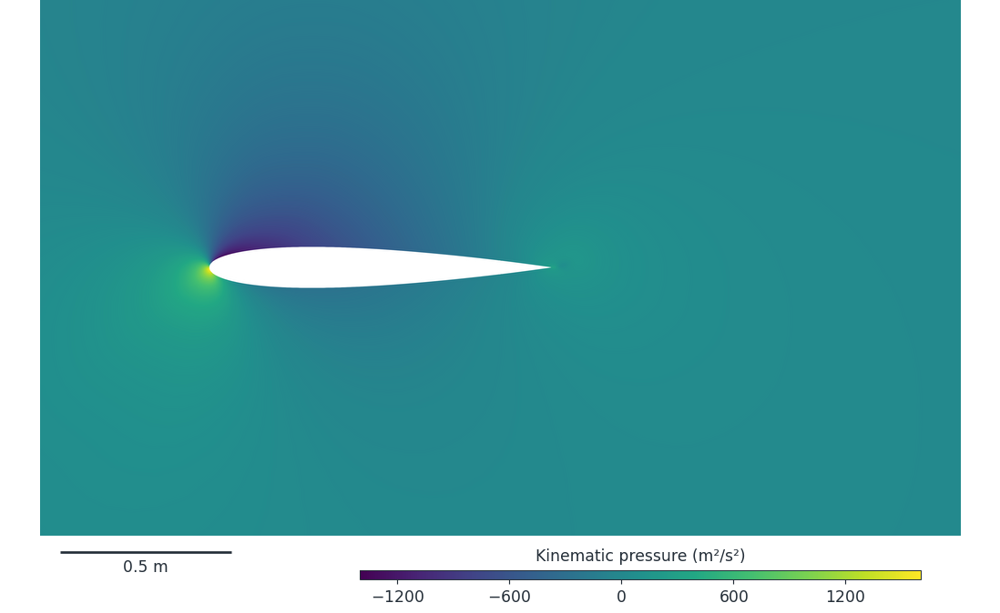
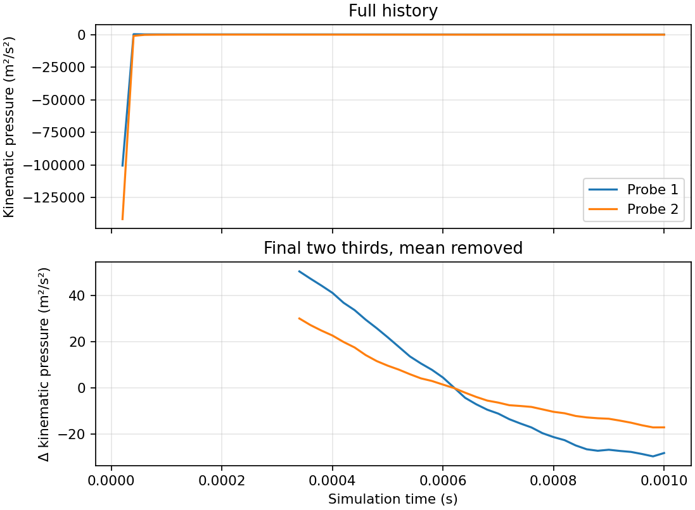

# Unsteady pressure near the NACA 0012 trailing edge

[CFD case index](../../README.md#external-aerodynamics) · [Verification results](../../verification.md#external-aerodynamics) · [Case source](__init__.py) · [View settings](view.json)

A time-dependent version of the two-dimensional airfoil case records local pressure at two
probes. Angle and speed influence the fluctuation objective and lift constraint.

**Solver** `pimpleFoam` · **Mesh** structured `polyMesh` · **Level** `smoke`

## Mesh and results

| Initial mesh with cell edges | Solved field |
| --- | --- |
|  |  |

Initial mesh and solved field on the `z = 0.05 m` plane. The results show point data for `p` at
t = 0.001 s. The image shows pressure near the airfoil at the saved time. Probe histories
describe local fluctuations within the simulated interval.

`checkMesh` reported 7,080 cells and maximum non-orthogonality of 76.99°. It reported zero
failed quality checks.



The upper panel shows the full history, including the startup transient. The lower panel shows
each probe's departure from its mean over the final two thirds of the samples, the window used
to measure fluctuation. Probe values use the native pressure units written by OpenFOAM. In this
smoke run both probes still drift steadily through that window, so the fluctuation value
reflects startup settling rather than periodic unsteadiness.

## Boundary conditions

| Patches | Velocity condition | `p` condition |
| --- | --- | --- |
| `airfoil` | `noSlip` | `zeroGradient` |
| `back`, `front` | `empty` | `empty` |
| `farfield` | `freestreamVelocity` | `freestreamPressure` |

## Design and reference measurements

| Variable | Unit | Lower | Reference | Upper |
| --- | --- | ---: | ---: | ---: |
| `angle_deg` | ° | 0 | 5 | 10 |
| `speed_m_s` | m/s | 40 | 55 | 70 |

| Role | Metric | Reference | Campaign bound |
| --- | --- | ---: | ---: |
| **Minimize** | `pressure_fluctuation_pa` | 31.0585 Pa | — |
| Constraint | `lift_coefficient` | 0.28268 | ≥ 0.169608 (40% margin) |

This smoke run checks the workflow on a coarse mesh. The short transient represents startup or
early evolution. Model limits include two-dimensional short transient, probes only.

## Reproduce the views

Set up [OpenFOAM and ParaView](../../README.md#set-up), then run from the repository root.

```bash
python3 examples/cfd/gallery.py naca_0012_acoustic
```

The workflow writes to `runs/cfd_gallery/naca_0012_acoustic/`. Open `figures/mesh/scene.pvsm`
or `figures/reference/scene.pvsm` in ParaView. Each `figure.json` records the saved time,
field association, color range, camera, and source run. See the
[shared workflow](../../README.md#run-one-case) for individual mesh, solve, and optimization commands.
