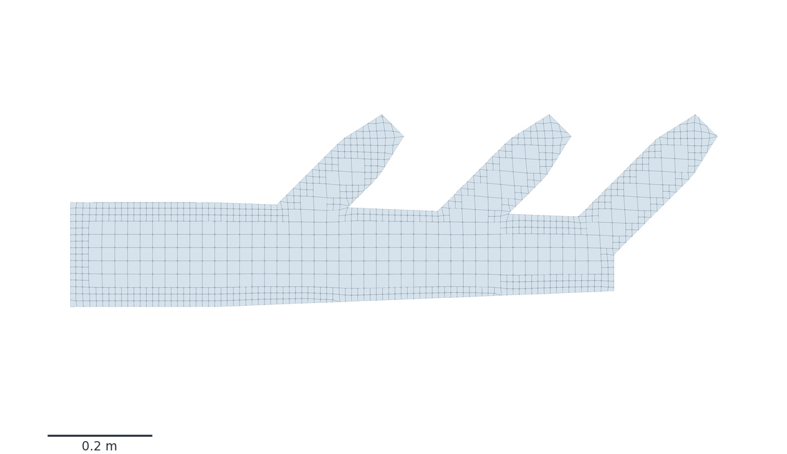
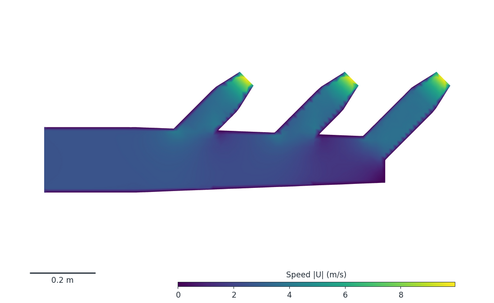

# Pelton turbine distributor

[CFD case index](../../README.md#internal-and-process-flows) · [Verification results](../../verification.md#internal-and-process-flows) · [Case source](__init__.py) · [View settings](view.json)

A tapered supply pipe feeds three nozzles. Branch angle and radii control the flow split under a
pressure-loss constraint.

**Solver** `simpleFoam` · **Mesh** `snappyHexMesh` · **Level** `smoke`

## Mesh and results

| Initial mesh with cell edges | Solved field |
| --- | --- |
|  |  |

Initial mesh and solved field on the `z = 0 m` plane. The results show point data for `U` at
iteration 200. The distributor plane shows the branch junctions and nozzle contractions. The
metric compares the three outlet flows.

`checkMesh` reported 11,868 cells and maximum non-orthogonality of 56.80°. It reported zero
failed quality checks. The measured flow imbalance was 0.00%.

## Boundary conditions

| Patches | Velocity condition | `p` condition |
| --- | --- | --- |
| `inlet` | `flowRateInletVelocity` | `zeroGradient` |
| `nozzle_1`, `nozzle_2`, `nozzle_3` | `pressureInletOutletVelocity` | `fixedValue` |
| `walls` | `noSlip` | `zeroGradient` |

## Design and reference measurements

| Variable | Unit | Lower | Reference | Upper |
| --- | --- | ---: | ---: | ---: |
| `branch_angle_deg` | ° | 30 | 45 | 65 |
| `branch_radius_m` | m | 0.04 | 0.05 | 0.06 |
| `end_radius_m` | m | 0.055 | 0.07 | 0.09 |

| Role | Metric | Reference | Campaign bound |
| --- | --- | ---: | ---: |
| **Minimize** | `nozzle_imbalance` | 0.0122185 | — |
| Constraint | `pressure_loss_pa` | 7084.51 Pa | ≤ 8501.41 Pa (20% margin) |

This smoke run checks the workflow on a coarse mesh. The saved iteration is a coarse-run
reference. Model limits include three nozzles, single phase.

## Reproduce the views

Set up [OpenFOAM and ParaView](../../README.md#set-up), then run from the repository root.

```bash
python3 examples/cfd/gallery.py pelton_distributor
```

The workflow writes to `runs/cfd_gallery/pelton_distributor/`. Open `figures/mesh/scene.pvsm`
or `figures/reference/scene.pvsm` in ParaView. Each `figure.json` records the saved time,
field association, color range, camera, and source run. See the
[shared workflow](../../README.md#run-one-case) for individual mesh, solve, and optimization commands.
