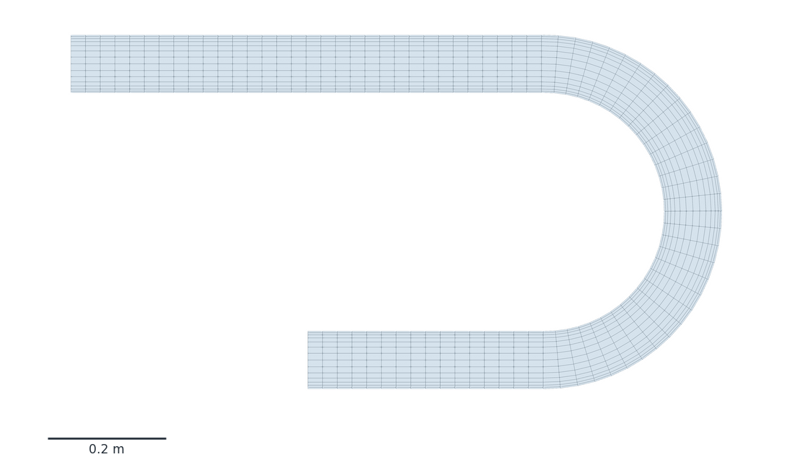
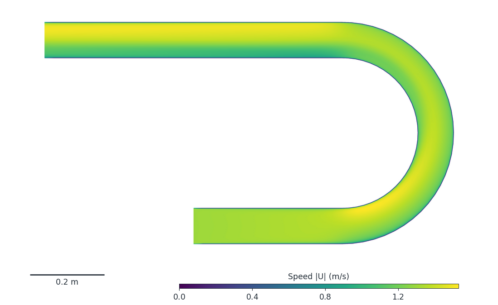
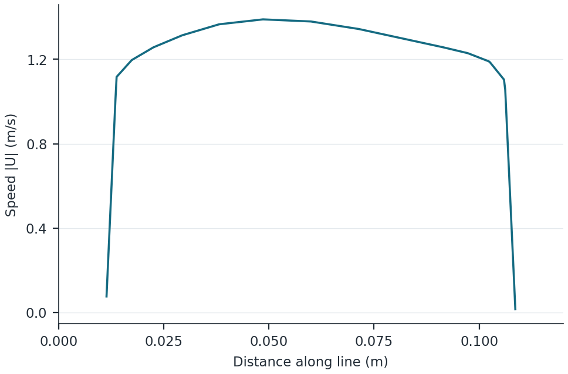

# Water pipe with a 180 degree bend

[CFD case index](../../README.md#internal-and-process-flows) · [Verification results](../../verification.md#internal-and-process-flows) · [Case source](__init__.py) · [View settings](view.json)

Water flows through a constant-diameter 180° bend at a prescribed volume flow of 0.01 m³/s. The
design varies the diameter and bend radius to reduce total pressure loss under a fluid-volume
limit.

**Solver** `simpleFoam` · **Mesh** structured `polyMesh` · **Level** `smoke`

## Mesh and results

| Initial mesh with cell edges | Solved field |
| --- | --- |
|  |  |

Initial mesh and solved field on the `y = 0 m` plane. The results show point data for `U` at
iteration 200. The bend-plane slice shows the curved passage. The radial profile samples speed
at the middle of the bend.

`checkMesh` reported 15,680 cells and maximum non-orthogonality of 26.06°. It reported zero
failed quality checks. The measured flow imbalance was 0.00%.



The profile runs from `(0.19, 0, 0.25)` to `(0.31, 0, 0.25)` m.

## Boundary conditions

| Patches | Velocity condition | `p` condition |
| --- | --- | --- |
| `inlet` | `flowRateInletVelocity` | `zeroGradient` |
| `outlet` | `pressureInletOutletVelocity` | `fixedValue` |
| `walls` | `noSlip` | `zeroGradient` |

## Design and reference measurements

| Variable | Unit | Lower | Reference | Upper |
| --- | --- | ---: | ---: | ---: |
| `diameter_m` | m | 0.08 | 0.1 | 0.12 |
| `bend_radius_m` | m | 0.15 | 0.25 | 0.4 |

| Role | Metric | Reference | Campaign bound |
| --- | --- | ---: | ---: |
| **Minimize** | `pressure_loss_pa` | 627.181 Pa | — |
| Constraint | `volume_m3` | 0.0155933 m³ | ≤ 0.0171526 m³ (10% margin) |

This smoke run checks the workflow on a coarse mesh. The saved iteration is a coarse-run
reference. Model limits include flow only, no structural analysis.

## Reproduce the views

Set up [OpenFOAM and ParaView](../../README.md#set-up), then run from the repository root.

```bash
python3 examples/cfd/gallery.py pipe
```

The workflow writes to `runs/cfd_gallery/pipe/`. Open `figures/mesh/scene.pvsm`
or `figures/reference/scene.pvsm` in ParaView. Each `figure.json` records the saved time,
field association, color range, camera, and source run. See the
[shared workflow](../../README.md#run-one-case) for individual mesh, solve, and optimization commands.
