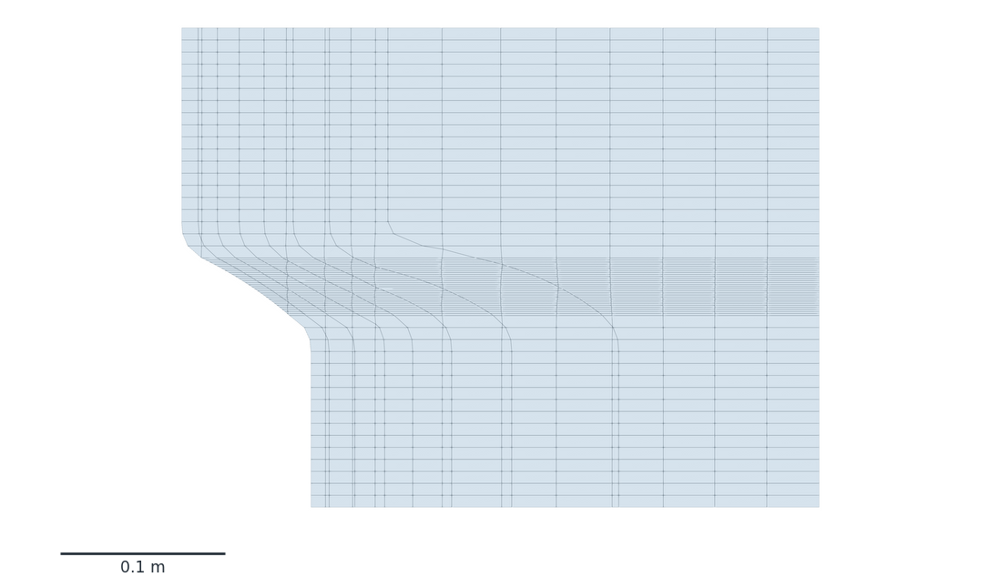
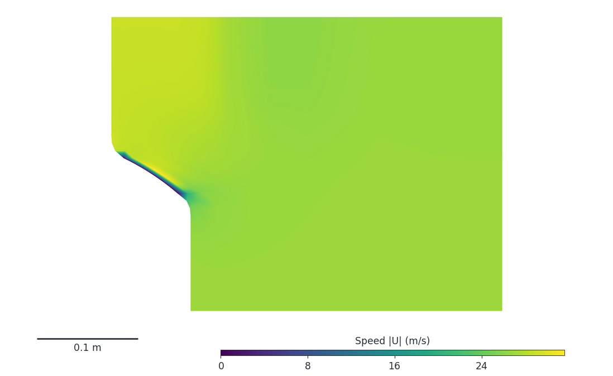

# Two-blade drone propeller

[CFD case index](../../README.md#axial-turbomachinery) · [Verification results](../../verification.md#axial-turbomachinery) · [Case source](__init__.py) · [View settings](view.json)

A generated small propeller uses independent root and tip pitch and a speed ratio. Shaft power
is minimized within a thrust constraint at the prescribed axial inflow.

**Solver** `simpleFoam` · **Mesh** structured `polyMesh` · **Level** `smoke`

## Mesh and results

| Initial mesh with cell edges | Solved field |
| --- | --- |
|  |  |

Initial mesh and solved field on the `x = 0.09 m` plane. The results show point data for `U` at
iteration 200. The cut samples the rotor and its modeled wake. The metric table provides the
reference thrust and power.

`checkMesh` reported 22,680 cells and maximum non-orthogonality of 67.02°. It reported zero
failed quality checks. The measured flow imbalance was 0.00%.

## Boundary conditions

| Patches | Velocity condition | `p` condition |
| --- | --- | --- |
| `blade_rotor`, `hub`, `hub_rotor` | `noSlip` | `zeroGradient` |
| `farfield` | `slip` | `zeroGradient` |
| `inlet` | `fixedValue` | `zeroGradient` |
| `outlet` | `pressureInletOutletVelocity` | `fixedValue` |
| `periodic_a`, `periodic_b` | `cyclic` | `cyclic` |

## Design and reference measurements

| Variable | Unit | Lower | Reference | Upper |
| --- | --- | ---: | ---: | ---: |
| `root_pitch_deg` | ° | 3 | 7 | 12 |
| `tip_pitch_deg` | ° | 1 | 4 | 8 |
| `speed_ratio` | — | 0.85 | 1 | 1.1 |

| Role | Metric | Reference | Campaign bound |
| --- | --- | ---: | ---: |
| **Minimize** | `shaft_power_w` | 176.244 W | — |
| Constraint | `thrust_n` | 4.88073 N | ≥ 4.39266 N (10% margin) |

This smoke run checks the workflow on a coarse mesh. The saved iteration is a coarse-run
reference. Model limits include axial inflow, slip far field, low tip speed ratio set by the
mesher's angle limit, own blade shape, no acoustics.

## Reproduce the views

Set up [OpenFOAM and ParaView](../../README.md#set-up), then run from the repository root.

```bash
python3 examples/cfd/gallery.py propeller_dji_9450
```

The workflow writes to `runs/cfd_gallery/propeller_dji_9450/`. Open `figures/mesh/scene.pvsm`
or `figures/reference/scene.pvsm` in ParaView. Each `figure.json` records the saved time,
field association, color range, camera, and source run. See the
[shared workflow](../../README.md#run-one-case) for individual mesh, solve, and optimization commands.
