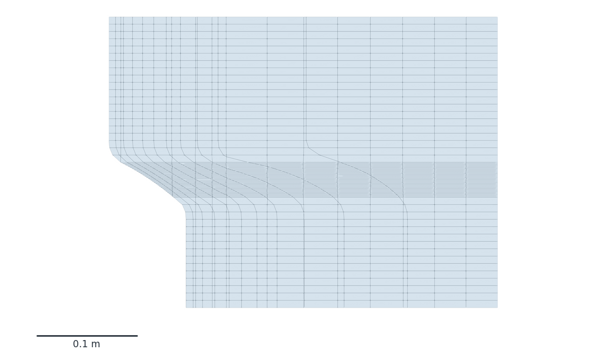
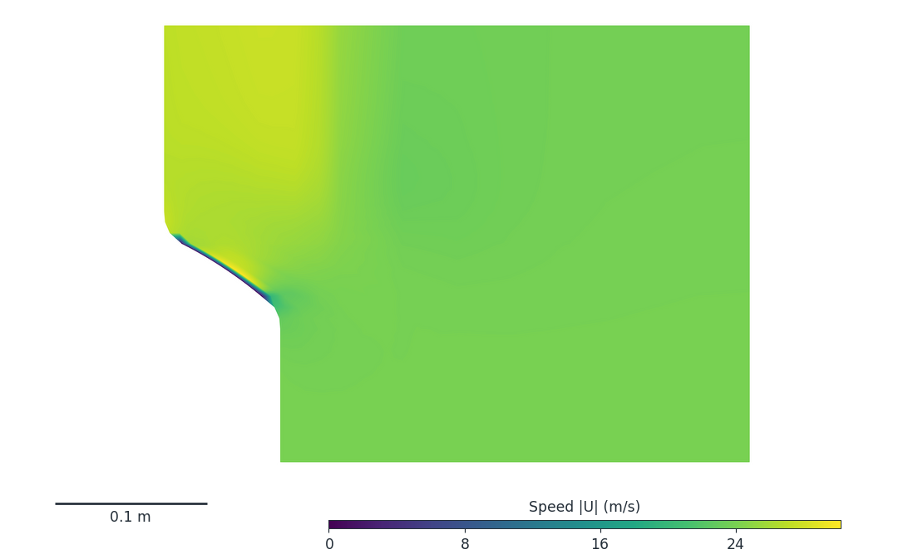
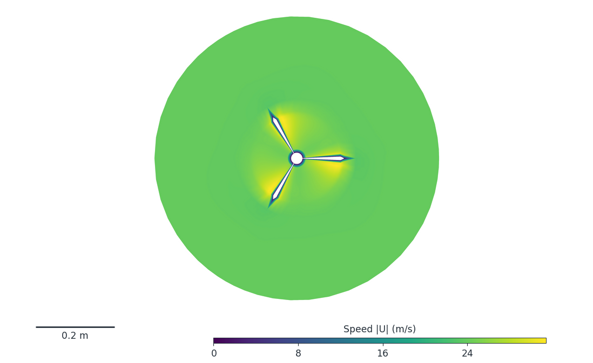

# Three-blade propeller sizing

[CFD case index](../../README.md#axial-turbomachinery) · [Verification results](../../verification.md#axial-turbomachinery) · [Case source](__init__.py) · [View settings](view.json)

A periodic small-propeller passage varies pitch, chord fraction and diameter at fixed axial
inflow. The objective is shaft power with a thrust constraint.

**Solver** `simpleFoam` · **Mesh** structured `polyMesh` · **Level** `smoke`

## Mesh and results

| Initial mesh with cell edges | Solved field |
| --- | --- |
|  |  |

Initial mesh and solved field on the `x = 0.09 m` plane. The results show point data for `U` at
iteration 200. The speed cut represents the wake under the imposed inflow. The verification
report describes the operating assumption in place of static hover.

`checkMesh` reported 22,680 cells and maximum non-orthogonality of 66.07°. It reported zero
failed quality checks. The measured flow imbalance was 0.00%.

### Full-annulus field



The transverse section at `z = 0.12672 m` shows 3 rotational copies of the solved
passage. The editable `figures/annulus/scene.pvsm` contains the full 3D reconstruction.
Move the slice or show the merged volume in ParaView to inspect another location.

## Boundary conditions

| Patches | Velocity condition | `p` condition |
| --- | --- | --- |
| `blade_rotor`, `hub`, `hub_rotor` | `noSlip` | `zeroGradient` |
| `farfield` | `slip` | `zeroGradient` |
| `inlet` | `fixedValue` | `zeroGradient` |
| `outlet` | `pressureInletOutletVelocity` | `fixedValue` |
| `periodic_a`, `periodic_b` | `cyclic` | `cyclic` |

## Design and reference measurements

| Variable | Unit | Lower | Reference | Upper |
| --- | --- | ---: | ---: | ---: |
| `pitch_deg` | ° | 2 | 5 | 10 |
| `chord_fraction` | — | 0.08 | 0.12 | 0.16 |
| `diameter_m` | m | 0.2 | 0.24 | 0.28 |

| Role | Metric | Reference | Campaign bound |
| --- | --- | ---: | ---: |
| **Minimize** | `shaft_power_w` | 162.219 W | — |
| Constraint | `thrust_n` | 4.93906 N | ≥ 4.44516 N (10% margin) |

This smoke run checks the workflow on a coarse mesh. The saved iteration is a coarse-run
reference. Model limits include axial inflow, slip far field, low tip speed ratio set by the
mesher's angle limit, fixed axial inflow in place of static hover.

## Reproduce the views

Set up [OpenFOAM and ParaView](../../README.md#set-up), then run from the repository root.

```bash
python3 examples/cfd/gallery.py propeller_optimization
```

The workflow writes to `runs/cfd_gallery/propeller_optimization/`. Open `figures/mesh/scene.pvsm`
or `figures/reference/scene.pvsm` in ParaView. Each `figure.json` records the saved time,
field association, color range, camera, and source run. See the
[shared workflow](../../README.md#run-one-case) for individual mesh, solve, and optimization commands.
