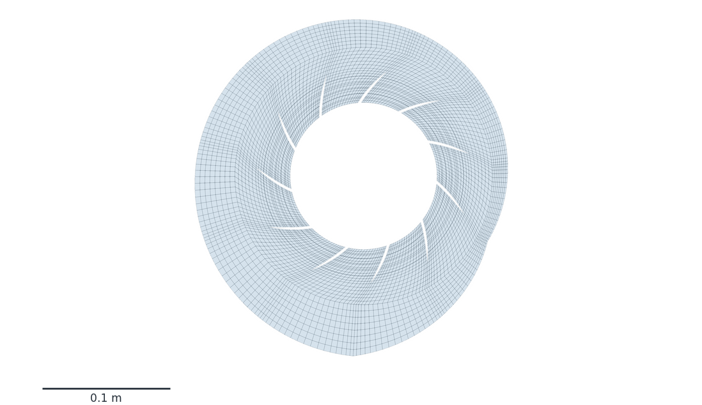
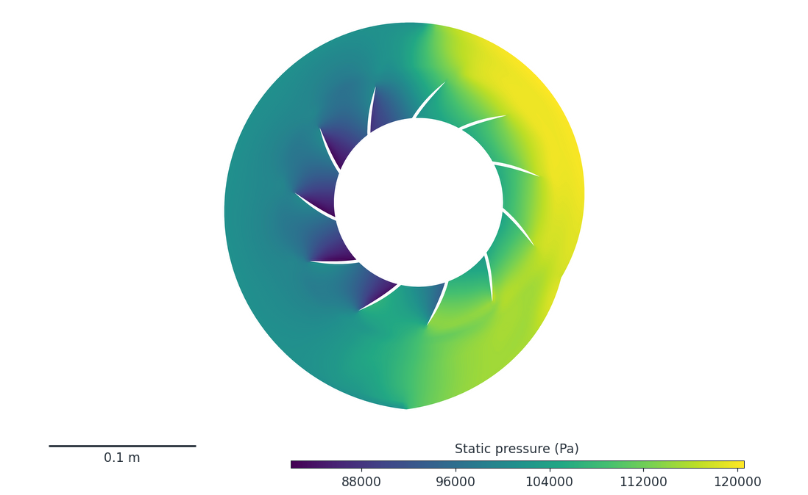

# Centrifugal compressor with casing

[CFD case index](../../README.md#radial-and-mixed-flow-turbomachinery) · [Verification results](../../verification.md#radial-and-mixed-flow-turbomachinery) · [Case source](__init__.py) · [View settings](view.json)

A full radial compressor wheel discharges through a spiral casing. Backsweep and outlet width
affect efficiency and the stage pressure ratio.

**Solver** `rhoSimpleFoam` · **Mesh** structured `polyMesh` · **Level** `smoke`

## Mesh and results

| Initial mesh with cell edges | Solved field |
| --- | --- |
|  |  |

Initial mesh and solved field on the `z = 0.031 m` plane. The results show point data for `p` at
iteration 200. The transverse static-pressure cut shows the wheel and casing at the selected
height.

`checkMesh` reported 137,808 cells and maximum non-orthogonality of 73.99°. It reported zero
failed quality checks. The measured flow imbalance was 0.22%.

## Boundary conditions

| Patches | Velocity condition | `p` condition |
| --- | --- | --- |
| `blade_rotor`, `casing`, `hub`, `hub_rotor`, `shroud` | `noSlip` | `zeroGradient` |
| `inlet` | `flowRateInletVelocity` | `zeroGradient` |
| `outlet` | `pressureInletOutletVelocity` | `fixedValue` |

## Design and reference measurements

| Variable | Unit | Lower | Reference | Upper |
| --- | --- | ---: | ---: | ---: |
| `backsweep_deg` | ° | 20 | 35 | 50 |
| `outlet_width_m` | m | 0.006 | 0.008 | 0.011 |

| Role | Metric | Reference | Campaign bound |
| --- | --- | ---: | ---: |
| **Maximize** | `efficiency` | 0.5273 | — |
| Constraint | `pressure_ratio` | 1.1173 | ≥ 1.10613 (1% margin) |

This smoke run checks the workflow on a coarse mesh. The saved iteration is a coarse-run
reference. Model limits include two-dimensional blades, rectangular spiral casing with a radial
slot over half a turn.

## Reproduce the views

Set up [OpenFOAM and ParaView](../../README.md#set-up), then run from the repository root.

```bash
python3 examples/cfd/gallery.py radial_compressor
```

The workflow writes to `runs/cfd_gallery/radial_compressor/`. Open `figures/mesh/scene.pvsm`
or `figures/reference/scene.pvsm` in ParaView. Each `figure.json` records the saved time,
field association, color range, camera, and source run. See the
[shared workflow](../../README.md#run-one-case) for individual mesh, solve, and optimization commands.
