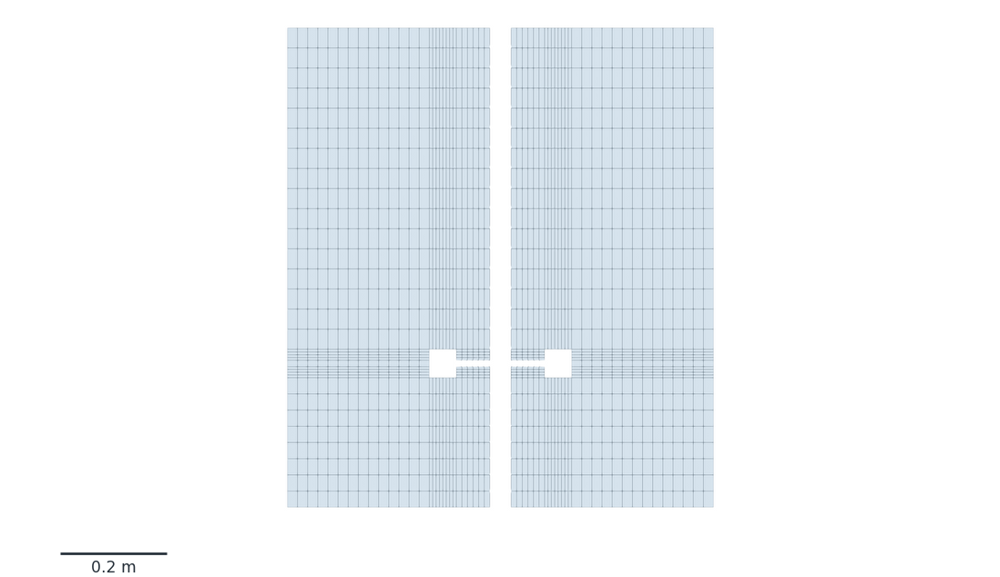
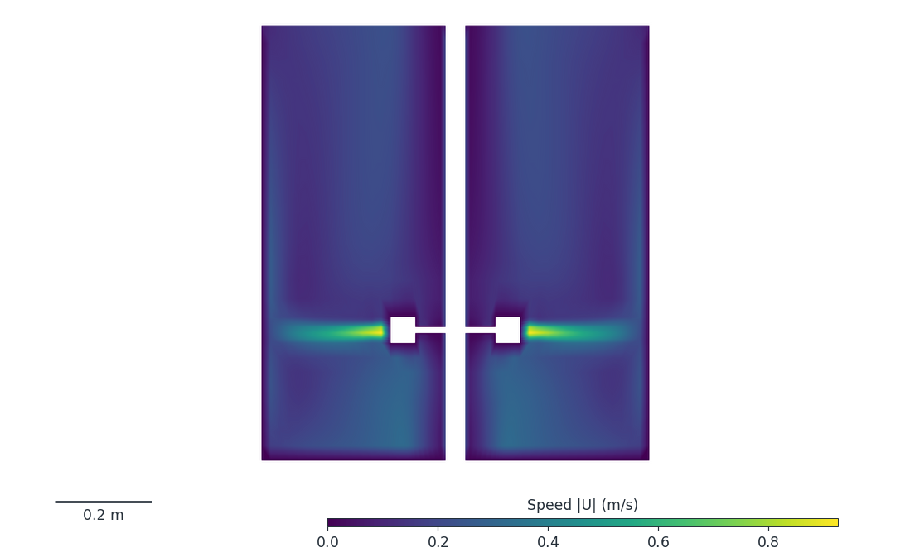

# Rushton turbine in a stirred vessel

[CFD case index](../../README.md#internal-and-process-flows) · [Verification results](../../verification.md#internal-and-process-flows) · [Case source](__init__.py) · [View settings](view.json)

A six-blade disc turbine drives circulation in an unbaffled vessel. Diameter, clearance and
speed change shaft power while preserving the measured mixing speed.

**Solver** `simpleFoam` · **Mesh** structured `polyMesh` · **Level** `smoke`

## Mesh and results

| Initial mesh with cell edges | Solved field |
| --- | --- |
|  |  |

Initial mesh and solved field on the `y = 0 m` plane. The results show point data for `U` at
iteration 200. The vertical cut shows the circulation speed in the single-phase vessel. The
shaft-power objective is derived from torque.

`checkMesh` reported 65,466 cells and maximum non-orthogonality of 0.00°. It reported zero
failed quality checks.

## Boundary conditions

| Patches | Velocity condition | `p` condition |
| --- | --- | --- |
| `bottom`, `impeller`, `tank` | `noSlip` | `zeroGradient` |
| `lid` | `slip` | `zeroGradient` |
| `shaft` | `rotatingWallVelocity` | `zeroGradient` |

## Design and reference measurements

| Variable | Unit | Lower | Reference | Upper |
| --- | --- | ---: | ---: | ---: |
| `impeller_diameter_m` | m | 0.22 | 0.267 | 0.32 |
| `impeller_height_m` | m | 0.2 | 0.27 | 0.4 |
| `speed_rad_s` | rad/s | 7 | 10.5 | 16 |

| Role | Metric | Reference | Campaign bound |
| --- | --- | ---: | ---: |
| **Minimize** | `shaft_power_w` | 18.2863 W | — |
| Constraint | `mean_speed_m_s` | 0.198483 m/s | ≥ 0.178634 m/s (10% margin) |

This smoke run checks the workflow on a coarse mesh. The saved iteration is a coarse-run
reference. Model limits include single phase, flat bottom.

## Reproduce the views

Set up [OpenFOAM and ParaView](../../README.md#set-up), then run from the repository root.

```bash
python3 examples/cfd/gallery.py rushton_impeller
```

The workflow writes to `runs/cfd_gallery/rushton_impeller/`. Open `figures/mesh/scene.pvsm`
or `figures/reference/scene.pvsm` in ParaView. Each `figure.json` records the saved time,
field association, color range, camera, and source run. See the
[shared workflow](../../README.md#run-one-case) for individual mesh, solve, and optimization commands.
