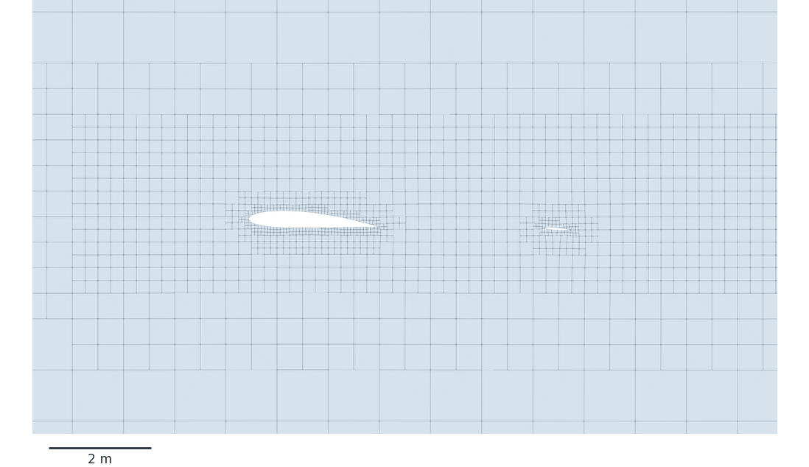
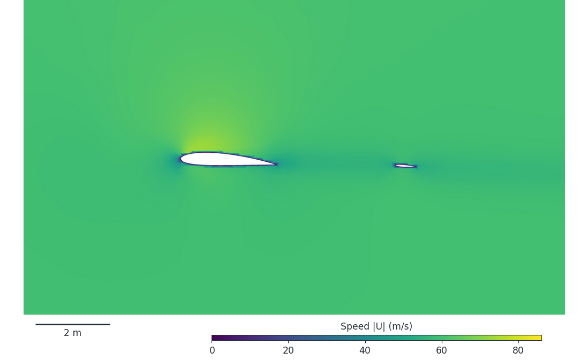

# Fighter airframe lift and drag

[CFD case index](../../README.md#external-aerodynamics) · [Verification results](../../verification.md#external-aerodynamics) · [Case source](__init__.py) · [View settings](view.json)

A generated half-span airframe contains fuselage, elliptical wing, tailplane and fin. Angle of
attack and wing twist change lift-to-drag ratio under a lift constraint.

**Solver** `simpleFoam` · **Mesh** `snappyHexMesh` · **Level** `smoke`

## Mesh and results

| Initial mesh with cell edges | Solved field |
| --- | --- |
|  |  |

Initial mesh and solved field on the `y = 1.6 m` plane. The results show point data for `U` at
iteration 200. An off-center section crosses the wing and its near wake. The smoke mesh has a
recorded quality warning.

`checkMesh` reported 64,558 cells and maximum non-orthogonality of 67.66°. It also reported one
failed quality check. See the retained `log.checkMesh`. The measured flow imbalance was 0.00%.

## Boundary conditions

| Patches | Velocity condition | `p` condition |
| --- | --- | --- |
| `inlet` | `fixedValue` | `zeroGradient` |
| `outlet` | `pressureInletOutletVelocity` | `fixedValue` |
| `left` | `symmetry` | `symmetry` |
| `right`, `ground`, `top` | `slip` | `zeroGradient` |
| `fuselage`, `wing`, `tailplane`, `fin` | `noSlip` | `zeroGradient` |

## Design and reference measurements

| Variable | Unit | Lower | Reference | Upper |
| --- | --- | ---: | ---: | ---: |
| `angle_of_attack_deg` | ° | 1 | 4 | 10 |
| `wing_twist_deg` | ° | -4 | -2 | 0 |

| Role | Metric | Reference | Campaign bound |
| --- | --- | ---: | ---: |
| **Maximize** | `lift_to_drag` | 5.70904 | — |
| Constraint | `lift_coefficient` | 0.420168 | ≥ 0.336135 (20% margin) |

This smoke run checks the workflow on a coarse mesh. The saved iteration is a coarse-run
reference. Model limits include simplified airframe, no propeller.

## Reproduce the views

Set up [OpenFOAM and ParaView](../../README.md#set-up), then run from the repository root.

```bash
python3 examples/cfd/gallery.py spitfire
```

The workflow writes to `runs/cfd_gallery/spitfire/`. Open `figures/mesh/scene.pvsm`
or `figures/reference/scene.pvsm` in ParaView. Each `figure.json` records the saved time,
field association, color range, camera, and source run. See the
[shared workflow](../../README.md#run-one-case) for individual mesh, solve, and optimization commands.
