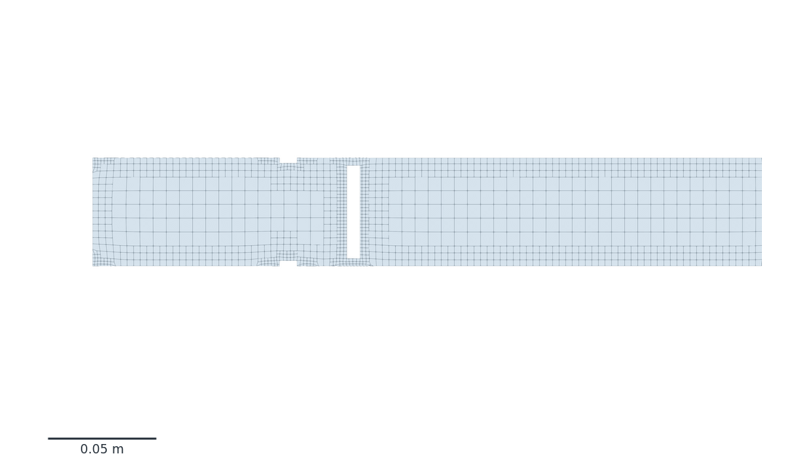
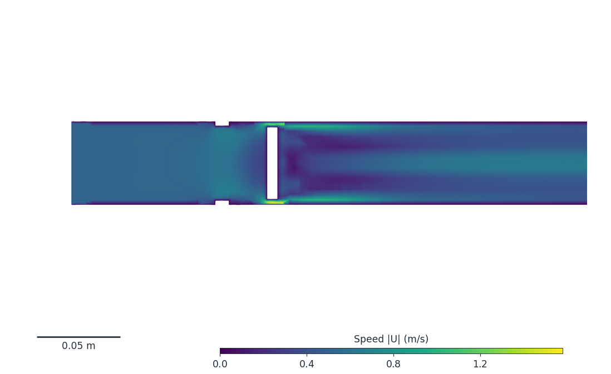

# Butterfly valve in a water line

[CFD case index](../../README.md#internal-and-process-flows) · [Verification results](../../verification.md#internal-and-process-flows) · [Case source](__init__.py) · [View settings](view.json)

A generated pipe, angled disc and seat form a three-dimensional water valve. Opening, disc
thickness and seat height change pressure loss and the force on the disc.

**Solver** `simpleFoam` · **Mesh** `snappyHexMesh` · **Level** `smoke`

## Mesh and results

| Initial mesh with cell edges | Solved field |
| --- | --- |
|  |  |

Initial mesh and solved field on the `z = 0 m` plane. The results show point data for `U` at
iteration 200. The center plane through the pipe shows acceleration and recirculation around the
restriction.

`checkMesh` reported 26,275 cells and maximum non-orthogonality of 60.34°. It reported zero
failed quality checks. The measured flow imbalance was 0.00%.

## Boundary conditions

| Patches | Velocity condition | `p` condition |
| --- | --- | --- |
| `inlet` | `flowRateInletVelocity` | `zeroGradient` |
| `outlet` | `pressureInletOutletVelocity` | `fixedValue` |
| `walls`, `disc` | `noSlip` | `zeroGradient` |

## Design and reference measurements

| Variable | Unit | Lower | Reference | Upper |
| --- | --- | ---: | ---: | ---: |
| `opening_deg` | ° | 35 | 55 | 80 |
| `disc_thickness_m` | m | 0.003 | 0.005 | 0.007 |
| `seat_height_m` | m | 0.0012 | 0.0025 | 0.004 |

| Role | Metric | Reference | Campaign bound |
| --- | --- | ---: | ---: |
| **Minimize** | `pressure_loss_pa` | 1148.34 Pa | — |
| Constraint | `flow_force_n` | 2.40708 N | ≤ 2.8885 N (20% margin) |

This smoke run checks the workflow on a coarse mesh. The saved iteration is a coarse-run
reference.

## Reproduce the views

Set up [OpenFOAM and ParaView](../../README.md#set-up), then run from the repository root.

```bash
python3 examples/cfd/gallery.py water_valve
```

The workflow writes to `runs/cfd_gallery/water_valve/`. Open `figures/mesh/scene.pvsm`
or `figures/reference/scene.pvsm` in ParaView. Each `figure.json` records the saved time,
field association, color range, camera, and source run. See the
[shared workflow](../../README.md#run-one-case) for individual mesh, solve, and optimization commands.
