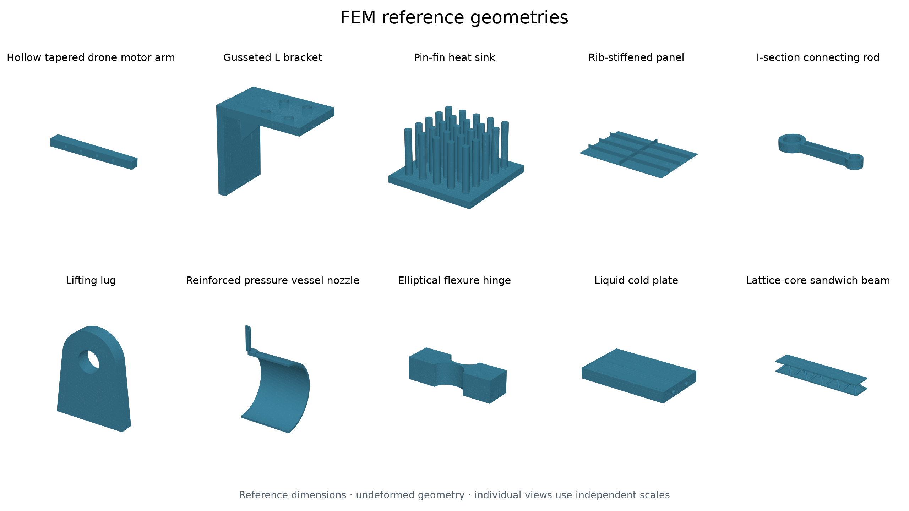

# FEM reference geometry gallery

These images use the reference dimensions from the current 3D problem definitions.
They show undeformed surfaces. Each view has its own scale.

| Case | Reference geometry | Problem definition |
| --- | --- | --- |
| Drone motor arm | [Image](../assets/drone_arm.png) | [Source](drone_arm.py) |
| Gusseted L bracket | [Image](../assets/l_bracket.png) | [Source](l_bracket.py) |
| Pin-fin heat sink | [Image](../assets/heat_sink.png) | [Source](heat_sink.py) |
| Stiffened panel | [Image](../assets/stiffened_panel.png) | [Source](stiffened_panel.py) |
| Connecting rod | [Image](../assets/connecting_rod.png) | [Source](connecting_rod.py) |
| Lifting lug | [Image](../assets/lifting_lug.png) | [Source](lifting_lug.py) |
| Pressure vessel nozzle | [Image](../assets/pressure_nozzle.png) | [Source](pressure_nozzle.py) |
| Flexure hinge | [Image](../assets/flexure_hinge.png) | [Source](flexure_hinge.py) |
| Liquid cold plate | [Image](../assets/cold_plate.png) | [Source](cold_plate.py) |
| Lattice beam | [Image](../assets/lattice_beam.png) | [Source](lattice_beam.py) |

The pressure nozzle image shows the symmetry-reduced domain used by its solver.
Regenerate the images after changes to the reference geometry using the
[rendering instructions](../assets/README.md).
