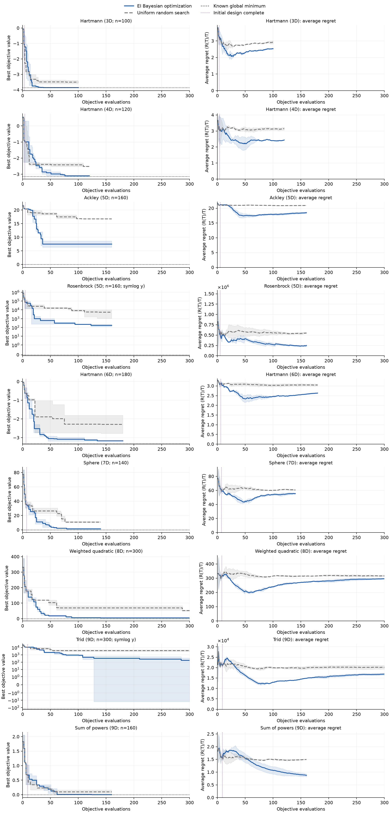

# Bayesian optimization: convergence in 3–9 dimensions

Nine problems (3–9 dimensions), two seeds per problem. Each row pairs best evaluated
objective convergence with average regret against evaluation count; lower is better.

EI finishes below random search in 18/18 runs. Several curves flatten above the global minimum.



Left: best objective. Right: average regret, **R(T)/T = (1/T) Σᵢ₌₁ᵀ [f(xᵢ) − f*]**, including
initialization and all subsequent evaluations. It averages individual evaluation gaps for T ≥ 1.
Blue: EI; gray: matched random search. Lines are medians; shading is the two-run range.
Black dotted lines mark known minima; purple vertical lines mark completion of initialization.
Rosenbrock and Trid objective axes use symmetric logs;
average regret axes are linear. Curves stop at their actual budgets.

| Problem | Evals/run | Global minimum | BO final | Random final | Last BO improvement, seeds 0 / 1 |
|---|---|---|---|---|---|
| Hartmann 3D | 100 | -3.86278 | -3.86148 | -3.50563 | 97 / 37 |
| Hartmann 4D | 120 | -3.13547 | -3.10661 | -2.51545 | 76 / 43 |
| Ackley 5D | 160 | 0 | 7.43999 | 16.7332 | 36 / 36 |
| Rosenbrock 5D | 160 | 0 | 170.625 | 5389.5 | 94 / 123 |
| Hartmann 6D | 180 | -3.32237 | -3.17501 | -2.29693 | 134 / 46 |
| Sphere 7D | 140 | 0 | 1.21418 | 10.7927 | 79 / 61 |
| Weighted quadratic 8D | 300 | 0 | 5.10645 | 51.6504 | 88 / 140 |
| Trid 9D | 300 | -156 | 175.181 | 3590.26 | 128 / 285 |
| Sum of powers 9D | 160 | 0 | 0.00127252 | 0.0974806 | 57 / 157 |

Final values are medians. Last-improvement counts include initialization; flat tails
indicate no further incumbent improvement.

Full benchmark domains; exact GPR (ARD RBF); EI; one point per `batch_bo` batch. Seeds 0 and 1 share
uniform initial designs of exactly d points with random search (d is the input dimension).
GP fitting: 75 optimizer iterations;
acquisition search: 150 evaluations per CMA-ES restart, three restarts.

[Plotting utility](bo_functions/plotting.py) · [Raw results and histories](results/bo_campaigns.json) · [Vector figure](results/bo_convergence.svg)

Reproduce from the repository root:

```sh
export OMP_NUM_THREADS=1 MKL_NUM_THREADS=1 OPENBLAS_NUM_THREADS=1 PYTHONPATH=tests
uv run --no-sync python -m bo_functions.campaign --suite intermediate --seeds 0 1 \
  --output tests/results/bo_campaigns.json
uv run --no-sync --with matplotlib python -m bo_functions.campaign_report
```

Use `--max-evals` for budgets up to 1,000 evaluations per run. Recorded 2026-11-25 on CPU;
numerical libraries can affect optimizer trajectories.
